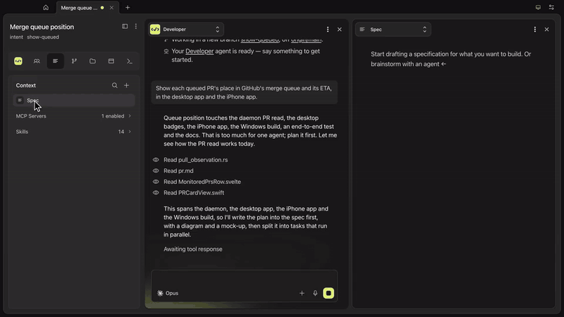
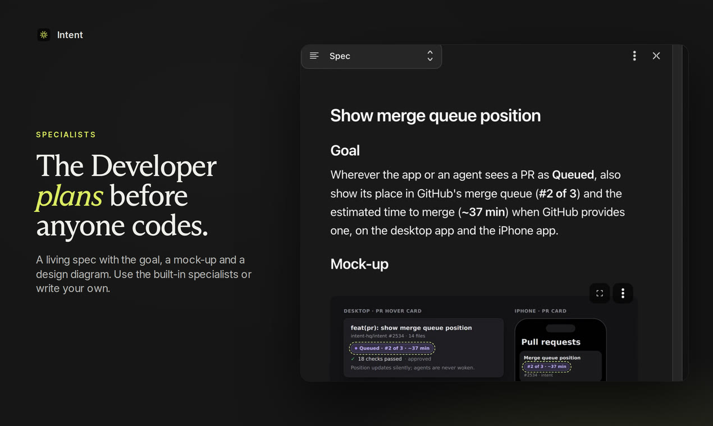
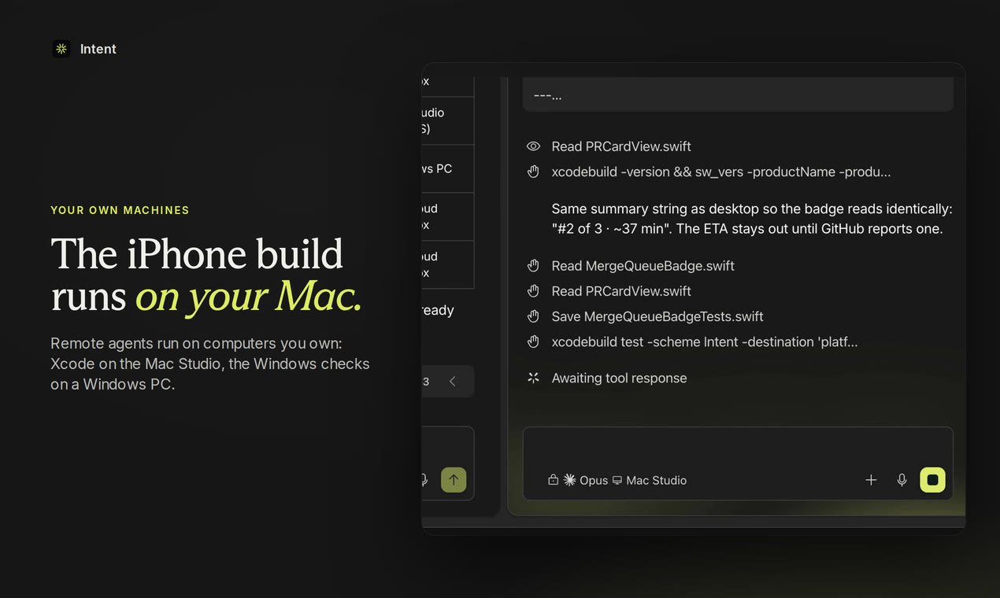
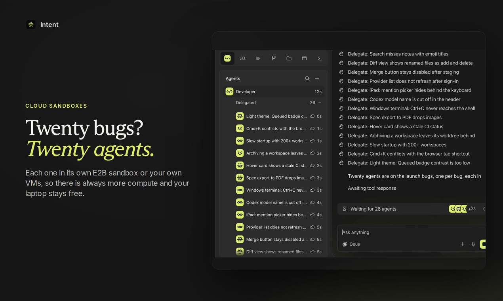
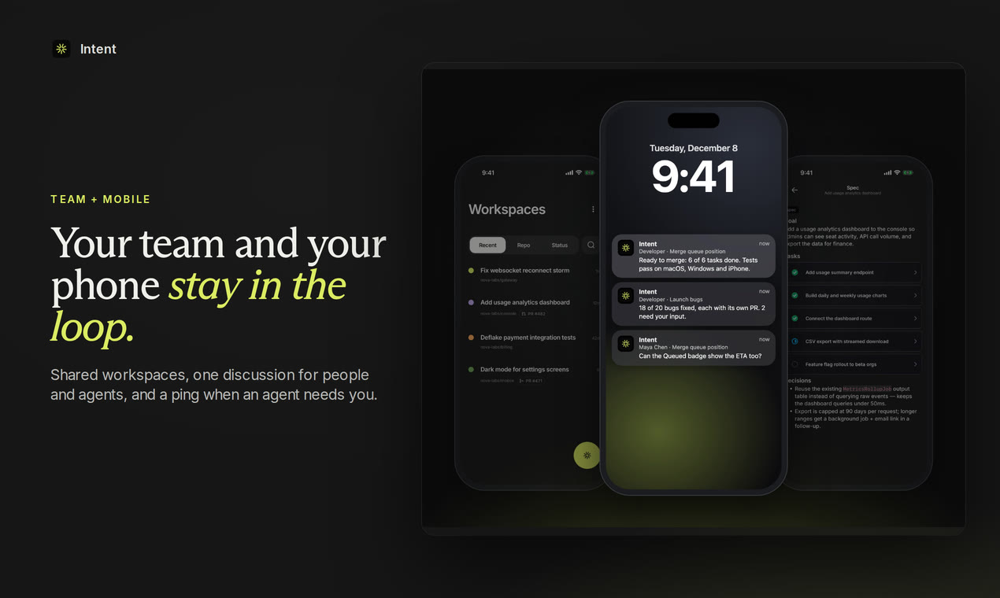

<p align="center">
  
</p>

<h1 align="center">Intent</h1>

<p align="center">
  <strong>Coding agents that plan, then build in parallel.</strong><br>
  An open-source workspace where specialist agents write the spec and hand the work to Claude Code, Codex, Cursor and others, on your own machines or in the cloud.
</p>

<p align="center">
  <a href="https://intentapp.dev"><strong>Download</strong></a> ·
  <a href="https://intentapp.dev/docs">Docs</a> ·
  <a href="https://www.youtube.com/watch?v=f74G9sK5dgA">2-minute demo</a> ·
  <a href="https://x.com/intentcode">@intentcode</a>
</p>

<p align="center">
  <a href="LICENSE"></a>
  <a href="https://github.com/intent-hq/cloudlands-releases/releases/stable"></a>
  <a href="https://github.com/intent-hq/intent/stargazers"></a>
  <a href="https://x.com/intentcode"></a>
</p>

<p align="center">
  
</p>

## What is Intent?

Intent is a workspace for running many coding agents on one codebase at once. You describe what you want; a specialist agent reads the code, writes a living spec with diagrams and mock-ups when the work is big, and splits it into tasks that other agents build in parallel. You review the diff and merge.

There are already many ways to run coding agents, and most of them tie you to one model vendor, one cloud, or both. Intent works the other way round:

- **Specialists that plan and delegate.** Start a workspace with any specialist. The Developer, for example, does small tasks itself and plans bigger ones in a spec before delegating. Intent ships with more specialists, and you can write your own.
- **Bring your own agents.** Use the coding agents and subscriptions you already have, side by side in one workspace. Intent doesn't proxy or resell model access.
- **Bring your own compute.** Run agents on your laptop, on other machines you own (a Mac for the Xcode build, a Windows PC for the Windows checks), or in cloud sandboxes on E2B or your own VMs.
- **Built for teams.** Share a workspace, talk it through in one discussion with the agents, and get a ping on your phone when an agent needs you.
- **Open source and local-first.** Apache 2.0, no telemetry, and your workspaces live on your machine.

<table>
  <tr>
    <td width="50%"></td>
    <td width="50%"></td>
  </tr>
  <tr>
    <td width="50%"></td>
    <td width="50%"></td>
  </tr>
</table>

## Get started

1. **Install Intent.** [Download it from intentapp.dev](https://intentapp.dev) for macOS, Windows or Linux; it picks the right build for your computer and bundles everything it needs. Other versions are on the [releases page](https://github.com/intent-hq/cloudlands-releases/releases). For iPhone and iPad, get [Intent Mobile on the App Store](https://apps.apple.com/us/app/intent-mobile/id6806514581). To use Intent from a browser, run the [web app](https://intentapp.dev/docs/remote#web) on a server.
2. **Connect an agent you already use.** Sign in to Claude Code, Codex, Cursor or OpenCode, or point Intent at a local model.
3. **Start a workspace.** Pick a GitHub repository and a specialist, then describe what you want built.

### Supported agents

| Agent | How Intent runs it |
|---|---|
| Claude Code | Your Claude subscription or API key |
| Codex | Your ChatGPT subscription or API key |
| Cursor | Your Cursor account |
| OpenCode | Your OpenCode setup and providers |
| Local models | Models running on your own hardware |

### Built-in specialists

| Specialist | What it does |
|---|---|
| Developer | Implements small tasks directly; plans bigger ones in a spec and delegates them |
| Product Manager | Interviews you, explores the code and writes a reviewed spec for a Developer |
| PR Reviewer | Reviews pull requests with high-confidence, actionable feedback |
| UI Designer | Builds accessible, production-ready interfaces |
| Vulnerability Scanner | Finds real, exploitable security vulnerabilities |
| Bug Burn-down and Maintenance Coordinators | Keep a steady stream of reviewed, green PRs for bugs, dependency updates and CI fixes |

Write your own specialists in Settings and choose which one starts a workspace or takes each delegated task.

## How it works

```
┌──────────────┐  ┌──────────────┐  ┌──────────────────┐
│ Desktop app  │  │   Web app    │  │  iPhone & iPad   │
└──────┬───────┘  └──────┬───────┘  └────────┬─────────┘
       └─────────────────┼───────────────────┘
                         │ JSON-RPC (local socket, or WSS/TLS)
                         ▼
┌──────────────────────────────────────────────────────────┐
│                 intentd - Rust daemon                    │
│   workspaces · specs · tasks · agents · git · terminals  │
└───────────┬───────────────────────────────▲──────────────┘
            │ Agent Client Protocol         │ MCP: agents use the same workspace API
            ▼                               │
   Claude Code · Codex · Cursor · OpenCode · local models
   on this machine, on your other machines, or in E2B sandboxes
```

Clients are thin: all state and business logic, including the agent runtime, live in `intentd`, which persists to SQLite and serves JSON-RPC 2.0 over a local socket and WSS/TLS. Each agent gets its own MCP bridge back to the daemon, so agents can edit the spec, delegate, message each other and run scripts, and every action is attributable. Each workspace works on a copy-on-write clone of your repository on its own branch. See [docs/ARCHITECTURE.md](docs/ARCHITECTURE.md) for the backend design and [docs/protocol/](docs/protocol/README.md) for the wire contract.

This monorepo ties the components together as git submodules and carries the cross-cutting docs, tooling and CI; the code lives in the component repos:

| Path | Repository | Component |
|------|------------|-----------|
| `packages/intentd` | [intent-hq/intentd](https://github.com/intent-hq/intentd) | Rust backend daemon |
| `packages/cloudlands-fe` | [intent-hq/cloudlands-fe](https://github.com/intent-hq/cloudlands-fe) | Electron + SvelteKit desktop app |
| `packages/ios` | [intent-hq/ios](https://github.com/intent-hq/ios) | SwiftUI iPhone and iPad app (private for now) |

To run the daemon on its own, for example on a remote host, see [Self-hosting the daemon](docs/self-hosting.md).

## Network & privacy

Intent is local-first: all state lives on your machine, and the stack ships
**no telemetry, analytics, or crash reporting**. Network access is limited to
update checks against public GitHub Releases and actions you take yourself:

- **Desktop app auto-updates** — the packaged app checks for and downloads
  updates from GitHub Releases on
  [intent-hq/cloudlands-releases](https://github.com/intent-hq/cloudlands-releases),
  and fetches release notes for the installed version from the same repo's
  GitHub Releases API.
- **intentd sitter self-update** — the sitter (see [Self-hosting the daemon](docs/self-hosting.md))
  downloads the daemon and checks the channel manifests published on the
  public
  [intent-hq/intentd-releases](https://github.com/intent-hq/intentd-releases)
  mirror, falling back to the
  [intentd releases page](https://github.com/intent-hq/intentd/releases). The
  mirror is the permanent public distribution channel, kept even after the
  intentd repo goes public.
- **Provider sign-ins (user-initiated)** — signing in to a coding-agent
  provider (Claude Code, Codex, Cursor, OpenCode and others) runs that
  provider's own CLI/OAuth sign-in flow through the daemon; each provider
  talks to its own vendor service when you sign in.
- **User-configured integrations** — connecting GitHub (OAuth device flow or
  personal access token), Linear (API key), or Sentry (API token) has the
  daemon call the respective service's API with credentials you provide.
  Nothing is sent to any of these services unless you connect them.
- **User-configured MCP servers** — the daemon connects to the MCP servers
  you configure (including when testing a server's connection as you set it
  up) and to no others.

Coding agents you run are external programs and may access the network
according to their own provider's behavior.

## Build from source

```sh
git clone --recurse-submodules https://github.com/intent-hq/intent.git
cd intent

make doctor  # report missing development prerequisites; use BOOTSTRAP_YES=1 make bootstrap-dev-host to install them
make check   # cargo fmt --check + cargo clippy -- -D warnings + repo-slug fold lint
make test    # cargo nextest run --workspace (needs cargo-nextest: cargo install cargo-nextest --locked)
make build   # cargo build --workspace
```

Test runs isolate their build outputs and bound their disk use; see
[local Rust gates](CONTRIBUTING.md#local-rust-gates) and
[gate build storage](CONTRIBUTING.md#gate-build-storage) for the details, flags and coverage targets.

Developing from a remote daemon host? Start with the one-screen
[agent loop](AGENTS.md#developing-on-a-remote-host); use the
[frontend recipes](packages/cloudlands-fe/AGENTS.md#dogfooding-a-dev-fe-against-a-daemon)
and [sandbox internals](docs/fe/DEVELOPER_GUIDE.md#remote-sandbox-internals) only when you
need component or implementation detail.

`packages/ios` is a private submodule and is skipped automatically
(`update = none` in `.gitmodules`), so the clone succeeds without access to
[intent-hq/ios](https://github.com/intent-hq/ios) — the directory is simply
left empty.

Run the stack locally in one of three ways:

```sh
# One-command sidecar mode (recommended): the desktop app spawns and
# supervises its own intentd binary, like the packaged app.
make dev

# Production-data frontend mode: connect the dev FE to the packaged app's
# already-running daemon and show the same workspaces and agents.
make dev-prod

# Two-terminal mode, useful for daemon debugging:
make dev-daemon   # terminal 1 — dev daemon with an isolated data dir
make dev-fe       # terminal 2 — desktop app, pinned to the dev daemon's UDS socket
```

`make dev-prod` uses `INTENTD_SOCKET` when provided. Otherwise, the packaged
socket defaults to `$HOME/Library/Application Support/intentd/intentd.sock`
on macOS and `${XDG_DATA_HOME:-$HOME/.local/share}/intentd/intentd.sock`
on Linux. This mode connects directly to the packaged daemon's production state
and does not start another daemon.

`make help` lists every documented target.

## Community

- [CONTRIBUTING.md](CONTRIBUTING.md) — bug reports and feature requests are
  very welcome via the
  [issue forms](https://github.com/intent-hq/intent/issues/new/choose);
  external pull requests are deferred for now while the public repository is a
  read-only snapshot mirror.
- [SECURITY.md](SECURITY.md) — report security vulnerabilities privately, not
  through public issues.
- [Issue tracker](https://github.com/intent-hq/intent/issues) — the single
  tracker for all Intent components.

## Star history

<a href="https://star-history.com/#intent-hq/intent&Date"></a>

## License

Intent is licensed under the [Apache License 2.0](LICENSE).
