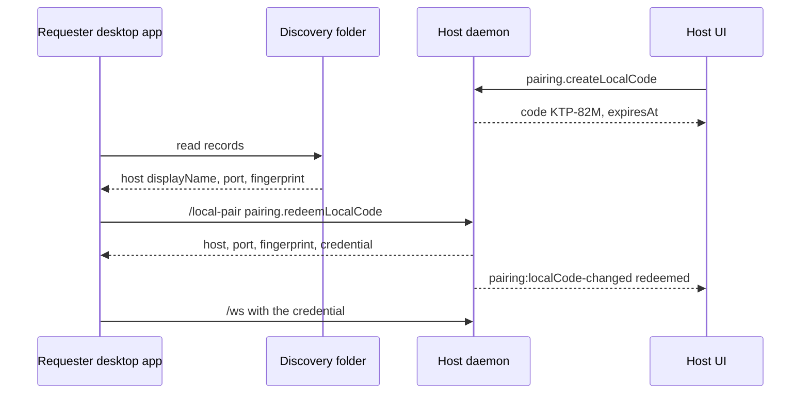

> Part of the [Intent JSON-RPC protocol docs](../README.md) — §5.58 Local code pairing.

## 5.58 Local code pairing *(prepared, not implemented)*

This is a **prepared additive contract**: the docs lead the pinned intentd and
cloudlands-fe, which do not implement it yet.
It lets one running Intent (the **requester**, A) connect to another Intent
running on the **same computer** (the **host**, B) by picking B from a list and
typing a short code that B shows.
Nobody copies a port, a fingerprint or a 64-character token.

On the host, the code panel, the credential list and their methods are served by
the daemon. On the requester, the desktop app's main process reads the discovery
folder and redeems the code; the requester's daemon needs no change.
The requester saves the host as an ordinary saved machine and connects to it
with the credential the redemption returns.



Non-goals: pairing across computers or over a network (use `pairing.getInfo`
and `intentd pair`), and any change to phone pairing, browser access or
workspace invites.

### Status and discovery

The daemon advertises `server.capabilities.localCodePairing: 1` in the
`client.hello` result ([§5.17](./client-hello.md#517-clienthello-handshake--stable-client-identity))
and in `system.capabilities` only when it implements this whole section: the
five methods, the `/local-pair` endpoint, the local pairing credential, the two
events and the discovery record.
Its discovery record carries the same flag (see [Discovery record](#discovery-record)).
Only the exact integer `1` means support; a missing, malformed or unknown value
means unsupported.

- The host UI shows the code panel and the **Intents on this computer** list only
  when its own daemon advertises the flag.
- The requester lists only discovery records whose `capabilities.localCodePairing`
  is exactly `1`.
- The capability describes implementation, not permission. Authority rules are
  below.

**Labs rollout.** While the feature is experimental, both desktop surfaces stay
hidden until the user runs **Enable experimental local pairing** from the
command palette. That switch is a client setting only. The daemon serves the
contract whenever it advertises the flag; with no active code the redemption
endpoint grants nothing, so an idle daemon exposes no extra authority.

### Limits

| Limit | Value |
| --- | --- |
| Code length | 6 characters |
| Code alphabet | `ABCDEFGHJKMNPQRSTUVWXYZ23456789` (31 symbols; no `0`/`O`, `1`/`I`/`L`) |
| Display form | Two groups of three joined by a hyphen, e.g. `KTP-82M` |
| Normalization | Remove spaces and hyphens, then uppercase |
| Active codes per daemon | 1 |
| Lifetime | 10 minutes from creation |
| Wrong tries before the code is cancelled | 5 |
| Code storage | Keyed hash only, in daemon memory |
| Credential token | 32 random bytes, hex-encoded (64 characters), stored as its SHA-256 |

The alphabet, length, display form, normalization and lifetime match the
browser-access sign-in codes, so both short codes read and type the same way.

### Codes

A code is created only on request, lives only in the host daemon's memory, and
never survives a daemon restart.

- **Draw.** Each character is drawn uniformly from the alphabet with a
  cryptographically secure random source.
- **Storage.** The daemon keeps `HMAC-SHA256(key, "intent-local-pairing-code-v1|" + normalizedCode)`,
  where `key` is 32 random bytes generated in memory at daemon start. The
  plaintext code is returned once, in the `pairing.createLocalCode` result, and is
  never logged, persisted, put in an event or returned again.
- **One at a time.** Creating a code while another is active cancels the earlier
  one (reason `replaced`) before the new one becomes active.
- **Tunnel.** No code can be created while the built-in tunnel is running, and
  starting the tunnel cancels the active code (reason `tunnel-active`); see
  [While the built-in tunnel is running](#while-the-built-in-tunnel-is-running).
- **Comparison.** Redemption normalizes the input, computes its HMAC and compares
  it in constant time.
- **Wrong tries.** Each well-formed wrong code counts one try. The fifth wrong try
  cancels the code (state `locked`); the host must create a new one. A malformed
  input (wrong length or a character outside the alphabet after normalization)
  is `-32602 { code: "invalid-params" }` and does not count, because it can never
  match.
- **Single use.** Attempts against a code are serialized. The first matching
  attempt moves the code to `redeemed` and mints the credential in one step; every
  later or concurrent attempt sees the terminal state.
- **Terminal states.** A code ends as `redeemed`, `expired`, `cancelled` or
  `locked`. The daemon remembers the terminal state (never the hash) until the
  code's original `expiresAt`, so a late attempt gets the matching refusal
  (see [Errors](#errors)); after that, and after a restart, there is no code and
  a redemption is `local-code-expired`.

### Methods

`pairing.createLocalCode`, `pairing.cancelLocalCode`,
`pairing.listLocalCredentials` and `pairing.revokeLocalCredential` are
**local-only owner administration**, like `pairing.getInfo`: they are gated on the
real connection origin, so any TCP/WSS caller — including a connection admitted
with a local pairing credential — gets `-32001`.
`pairing.redeemLocalCode` is served **only** on the anonymous `/local-pair`
endpoint below; on `/ws`, `/tunnel` or the local transport it is `-32001`
(`message`: `pairing.redeemLocalCode is served only on /local-pair`).
All five are fast-path methods (§5 fast-path catalog) because they read the
listener's pairing snapshot or the connection's endpoint. None takes
`workspaceId`. Collaborator and member connections never reach them: the four
administration methods are local-only, and the fifth is not served on `/ws`.

| Method | Params | Result |
| --- | --- | --- |
| pairing.createLocalCode *(fast path, local-only)* | — | `{ code, localCode: LocalPairingCode }` — `code` is the plaintext code in display form (`"KTP-82M"`), returned only here; `localCode.expiresAt` is its expiry. Cancels any active code first. No TCP listener is `-32603 { code: "listener-down" }`; a running built-in tunnel is `-32603 { code: "tunnel-active" }`; in both cases no code is created |
| pairing.cancelLocalCode *(fast path, local-only)* | codeId? | `{ cancelled: boolean }` — cancels the active code, or only that code when `codeId` is given; `false` when there is no matching active code |
| pairing.redeemLocalCode *(fast path, `/local-pair` only)* | code (req), appName (req) | `LocalPairingGrant` below — spends the code and mints one local pairing credential |
| pairing.listLocalCredentials *(fast path, local-only)* | — | `{ credentials: LocalPairingCredential[] }` — unrevoked credentials ordered by `createdAt`, tie-break `credentialId`; never includes a token or hash |
| pairing.revokeLocalCredential *(fast path, local-only)* | credentialId (req) | `{ revoked: boolean }` — `false` when already revoked; an unknown ID is `-32602 { code: "not-found" }` |

`appName` is the name the host shows for the requester, for example
`"Intent Alpha"`. It is trimmed and must then be 1–64 characters with no control
characters, else `-32602 { code: "invalid-params" }`.

```ts
type LocalPairingCodeState = "active" | "redeemed" | "expired" | "cancelled" | "locked";

interface LocalPairingCode {
  codeId: string;            // opaque, unique per code; never derived from the code
  state: LocalPairingCodeState;
  createdAt: string;         // RFC 3339
  expiresAt: string;         // RFC 3339, createdAt + 10 minutes
  attemptsRemaining: number; // 5 at creation, 0 when locked
  cancelReason?: "user" | "replaced" | "tunnel-active"; // present only when state is "cancelled"
  credentialId?: string;     // present only when state is "redeemed"
  appName?: string;          // present only when state is "redeemed"
}

interface LocalPairingGrant {
  version: 1;
  host: string;              // loopback address to dial: "127.0.0.1" or "::1"
  port: number;              // the host's WSS port
  fingerprint: string;       // SHA-256 of the host's TLS certificate, same format as pairing.getInfo
  credentialId: string;
  token: string;             // the new credential, 64 hex characters, returned only here
  displayName: string;       // same value as the host's discovery record
  prettyHostname: string;    // same value as system.status
}

interface LocalPairingCredential {
  credentialId: string;
  appName: string;
  createdAt: string;         // RFC 3339
  lastUsedAt: string | null; // last successful admission, RFC 3339
  connected: boolean;        // a live /ws connection currently uses it
}
```

The requester verifies the grant before saving anything: `fingerprint` must equal
both the discovery record's `fingerprint` and the certificate the `/local-pair`
connection presented, and `port` must equal the port it dialed. On a mismatch it
discards the token and shows an error. It then saves the host as a machine
(`host`, `port`, `fingerprint`, `token`, labelled with `displayName`) and connects
on `/ws` like any saved machine.

### The `/local-pair` endpoint

`/local-pair` is an **unauthenticated** WebSocket path on the host's WSS listener,
beside `/ws`, `/tunnel` and `/invite` (§1.1, §2.7). It exists only for the
requester's first contact, before it holds any credential.

Upgrade admission, in order:

1. `server.wsApi.enabled` must be on; otherwise there is no listener.
2. The built-in tunnel must not be running; while it runs every `/local-pair`
   upgrade is `403`, the same refusal as a non-loopback peer.
3. The TCP peer address must be loopback (`127.0.0.0/8`, `::1`, or an
   IPv4-mapped `::ffff:127.0.0.0/104`). Any other peer is `403` at upgrade,
   whatever the bind address.
4. The `Origin` header must be absent or a loopback origin (`http(s)://localhost`,
   `127.0.0.1` or `[::1]`, any port). `Origin: null`, `file://`, the host's own
   hostname and every other origin are `403`. This is stricter than the §2.2
   allow-list because only a native process should redeem.
5. No credential is resolved. An `Authorization` header or `?token=` is ignored
   and grants nothing.

On an admitted connection:

- The only served method is `pairing.redeemLocalCode`. Every other method is
  `-32001` (`message`: `the /local-pair endpoint serves pairing.redeemLocalCode only`).
  No events, subscriptions, reverse RPCs or `client.hello` are served.
- The daemon re-checks the peer address before each request; a non-loopback peer
  at that point is `-32001 { code: "not-loopback" }` (defence in depth).
- Load is bounded: at most 8 concurrent `/local-pair` connections (more are `503`
  at upgrade), 4 KiB frames, one in-flight request per connection, and an idle
  connection is closed after 30 seconds.
- The connection does not count as a client: it never appears in `client.list` or
  `system.status` counts.

TLS is the listener's normal certificate. The requester pins the fingerprint from
the host's discovery record for this connection, then checks the grant as
described above.

### Local pairing credential

A local pairing credential is a **separate credential kind**: not the owner token,
not a `principal_credential` row and not an executor credential. One is minted
per successful redemption; pairing the same requester again mints another.

- **Storage.** The host stores only the token's SHA-256 with `credentialId`,
  `appName`, `createdAt`, `lastUsedAt` and `revokedAt`. Credentials persist across
  daemon restarts until revoked.
- **Admission.** The `/ws` upgrade gate looks the bearer token up among unrevoked
  local pairing credentials after the owner token and principal credentials. It is
  accepted only when the TCP peer address is loopback and the built-in tunnel is
  not running; otherwise it is `401`, like an unknown token. It is `401` on
  `/tunnel`, `/invite`, `/local-pair` and `/node/*`.
- **Authority.** The connection is bound to the **primary principal** with owner
  authority, so the requester sees the host as its owner would remotely.
  Because it is a TCP connection, every local-only method is `-32001`, so it cannot
  read the owner token (`pairing.getInfo`, `server.pairingInfo`), rotate it, create
  codes or manage local pairing credentials. Methods that require the owner token
  itself (for example `executor.mint`) refuse it with `-32003`.
  `pairing.getSelfInfo` refuses it with `-32003 { code: "local-pairing-credential" }`
  so it is never re-exported as an `intent://pair` link for another device.
- **Independence.** `server.rotateToken` leaves local pairing credentials valid,
  and revoking one leaves the owner token, phones, invited people and other
  local pairing credentials unaffected.
- **Revocation.** `pairing.revokeLocalCredential` sets `revokedAt`, closes every
  live connection admitted with that credential with WebSocket close code
  **1008** (`credential revoked`) after draining in-flight responses, and refuses
  the token with `401` on replay. Admission re-checks revocation so a connection
  in the middle of its upgrade cannot survive a revoke.

### While the built-in tunnel is running

Intent's built-in remote-access tunnel (the tailcat sidecar, `server.tunnel.*`,
[§5.12](./settings.md)) forwards remote traffic to the WSS listener, so it arrives
from a loopback peer. Local code pairing is therefore **blocked while that tunnel
is running**: from the moment the daemon starts the sidecar (at boot, through
`settings.update` or `intentd pair`) until the sidecar has stopped, including any
restart backoff after an unexpected exit.

| Surface | While the tunnel is running | When the tunnel starts |
| --- | --- | --- |
| `pairing.createLocalCode` | `-32603 { code: "tunnel-active" }`; no code is created | — |
| Active code | — | Cancelled with `cancelReason: "tunnel-active"` and a `pairing:localCode-changed` event; a later redemption is `local-code-expired` |
| `/local-pair` upgrade | `403`, the same as a non-loopback peer | Open `/local-pair` connections are closed |
| Local pairing credential on `/ws` | `401`, refused like an unknown token | Live connections it admitted are closed with close code **1008** (`tunnel active`) after draining in-flight responses |

Credentials are **not revoked**: they stay listed, and they are admitted again
once the tunnel has stopped. The requester treats the `401` like any unreachable
saved machine and retries; it does not discard the credential. Listing, revoking
and cancelling stay available while the tunnel runs.

**Limitation.** Loopback-only admission cannot tell a local process from traffic
that other tools forward to the listener: SSH port forwards, `tailscale serve`,
other local proxies or reverse tunnels also arrive from a loopback peer. The
daemon can detect only its own tunnel. The real protection is the code itself for
redemption (6 characters, locked after 5 wrong tries, 10-minute expiry, one
active code, created only by the person at the host) and the 64-hex-character
credential for admission. The loopback rule and the tunnel block are defence in
depth.

### Events

Both events are delivered **only to local-transport (UDS / named pipe)
connections** on the host, the same audience as the methods that manage them.
They never reach TCP/WSS connections, including the requester's. Neither carries
a plaintext code, a code hash or a token. Both are daemon-global and carry no
`workspaceId`.

| Event | When | `data` |
| --- | --- | --- |
| `pairing:localCode-changed` | A code is created, a wrong try is counted, or it is redeemed, expires, is cancelled (including by a tunnel start) or is locked | `{ localCode: LocalPairingCode }` — the full current state |
| `pairing:localCredentials-changed` | A credential is minted or revoked, or its `connected` value changes | `{ credential: LocalPairingCredential }`, or `{ credentialId, revoked: true }` after revocation |

The host's code panel shows **Connected** when it sees `state: "redeemed"` for its
`codeId`, and shows the remaining tries from `attemptsRemaining`.
Expiry is emitted when the daemon notices it (within one second of `expiresAt`);
clients may also count down locally from `expiresAt`.

### Discovery record

Each daemon that advertises `localCodePairing: 1` publishes one small JSON file
so another Intent run by the same OS user can list it. The record contains no
secret.

**Location.** One folder per OS user, shared by every install and independent of
the daemon's data folder:

| Platform | Folder |
| --- | --- |
| macOS | `~/Library/Application Support/Intent/local-daemons/` |
| Linux | `$XDG_RUNTIME_DIR/intent/local-daemons/` when `XDG_RUNTIME_DIR` is set, else `~/.local/state/intent/local-daemons/` |
| Windows | `%LOCALAPPDATA%\Intent\local-daemons\` |

`INTENT_LOCAL_DAEMONS_DIR` overrides the folder for both writers and readers
(tests and sandboxes). The writer creates the folder with mode `0700` (owner-only
ACL on Windows) and each file with mode `0600`.

**File.** `<instanceId>.json`, where `instanceId` is a random UUID the daemon
generates once and keeps in its data folder, so one data folder always maps to
one file. The daemon writes it atomically (temporary file in the same folder, then
rename) at startup, rewrites it when a field changes (for example the listener
starts or stops, or the port or display name changes), and deletes it on clean
exit.

```ts
interface LocalDaemonRecord {
  version: 1;
  instanceId: string;
  pid: number;                 // daemon process id
  startedAt: string;           // RFC 3339 daemon start
  updatedAt: string;           // RFC 3339 last rewrite
  displayName: string;         // label shown in the requester's list
  dataDir: string;             // absolute path of the daemon's data folder
  daemonVersion: string;       // same as system.status version
  protocolVersion: string;     // same as system.status protocolVersion
  port: number | null;         // WSS port, null while the TCP listener is down
  fingerprint: string;         // SHA-256 of the TLS certificate
  capabilities: { localCodePairing: 1 };
}
```

`displayName` is the `sharing.machineName` setting when set, else the install's
product name (for example `"Intent"`, `"Intent Alpha"` or `"Intent (dev build)"`).
Readers show `dataDir` as secondary text to tell same-named installs apart.

**Reader rules.** The requester's desktop app reads the folder each time the
list opens and while it stays open (at most once a second). It skips, without
error:

- a file that is not a regular file (a symlink included), is larger than 16 KiB,
  is not owned by the current OS user, or does not parse;
- a record whose `version` is not `1`, or whose `capabilities.localCodePairing` is
  not exactly `1`;
- a record whose `pid` is not a running process (stale after a crash);
- the requester's own daemon, matched by `fingerprint` (or `instanceId`) against
  its own daemon's `system.status`.

A record with `port: null` is listed as not accepting connections; the host
user must turn on connections (loopback only is enough) before redeeming.
A reused process id can leave a stale record looking alive. That fails safe:
the fingerprint pin on `/local-pair` refuses any other listener.

**Cleanup.** At startup a daemon replaces its own file and may delete other
records whose `pid` is not running. It never deletes a live daemon's record.

### Errors

| Numeric code | `error.data` | Method | Meaning/recovery |
| --- | --- | --- | --- |
| -32602 | `{ code: "local-code-invalid", attemptsRemaining }` | `pairing.redeemLocalCode` | Wrong code; `attemptsRemaining` is at least 1. Retype it |
| -32602 | `{ code: "local-code-locked" }` | `pairing.redeemLocalCode` | The fifth wrong try, or any try after it; the code is cancelled. Ask the host for a new code |
| -32602 | `{ code: "local-code-expired" }` | `pairing.redeemLocalCode` | No active code: it expired, was used, was cancelled, was never created, or the host restarted. Ask the host for a new code |
| -32602 | `{ code: "invalid-params" }` | `pairing.redeemLocalCode` | Malformed `code` or `appName`; does not count as a try |
| -32001 | `{ code: "not-loopback" }` | `pairing.redeemLocalCode` | The peer is not on this computer. Normally refused earlier with `403` at upgrade |
| -32001 | — | any | A local-only method over TCP/WSS, `pairing.redeemLocalCode` outside `/local-pair`, or another method on `/local-pair` |
| -32003 | `{ code: "local-pairing-credential" }` | `pairing.getSelfInfo` | Called on a connection admitted with a local pairing credential |
| -32603 | `{ code: "listener-down" }` | `pairing.createLocalCode` | The host has no TCP listener; turn on connections first |
| -32603 | `{ code: "tunnel-active" }` | `pairing.createLocalCode` | The host's built-in remote-access tunnel is running; turn it off first |
| -32602 | `{ code: "not-found" }` | `pairing.revokeLocalCredential` | Unknown `credentialId` |

The order of checks in `pairing.redeemLocalCode` is: endpoint and peer, then
params, then the code's state (`local-code-expired` / `local-code-locked`), then
the comparison. A wrong code never reveals anything beyond the remaining tries.

### Conformance

These are requirements for the component tests, not results of documentation
checks.

| Behavior | Expected |
| --- | --- |
| Right code, first try | Grant returned; code `redeemed`; credential listed on the host; `/ws` admits the token from loopback |
| Wrong code | `local-code-invalid` with `attemptsRemaining` 4, 3, 2, 1, then `local-code-locked` on the fifth |
| Right code after lock | `local-code-locked` until the original expiry, then `local-code-expired` |
| Code older than 10 minutes | `local-code-expired`; event state `expired` |
| Used code again | `local-code-expired` |
| Two concurrent right attempts | Exactly one grant; the other gets `local-code-expired` |
| New code while one is active | Old code `cancelled` with `cancelReason: "replaced"` |
| `/local-pair` from a non-loopback peer | `403` at upgrade |
| `/local-pair` with a non-loopback `Origin` | `403` at upgrade |
| Credential from a non-loopback peer, or on `/tunnel` | `401` |
| Revoke while connected | Connection closed with 1008; replay `401` |
| `server.rotateToken` | Local pairing credentials keep working |
| Daemon restart with an active code | Code gone; credentials kept |
| `pairing.createLocalCode` with the tunnel running | `tunnel-active`; no code |
| Tunnel starts with an active code | Code `cancelled` with `cancelReason: "tunnel-active"` |
| `/local-pair` with the tunnel running | `403` at upgrade |
| Tunnel starts with a credential connected | Connection closed with 1008; `401` while the tunnel runs; admitted again after it stops; credential still listed |
| Clean exit | Discovery record deleted |
| Crash | Record left; readers skip it because `pid` is not running |
