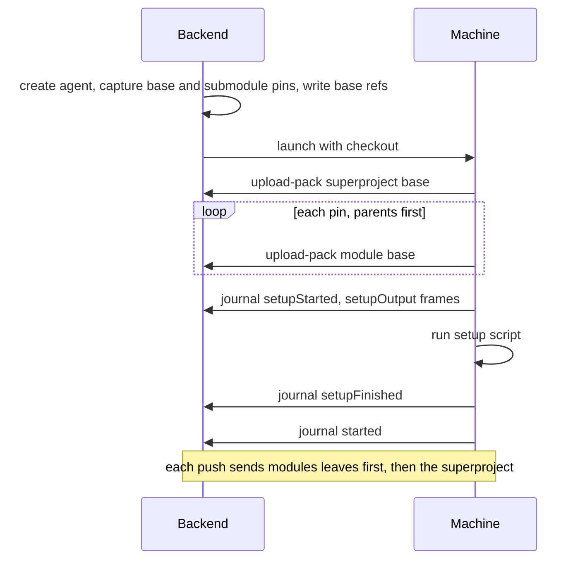

# Phase 1 private node link (prepared contract)

This is a future implementation contract, not the client WSS protocol and not a
claim about the pinned daemon. See [§5.50](./methods/nodes.md) for public methods,
placement, fields and authority. Both static nodes and the in-process local node
implement this semantic boundary; only static nodes serialize it over TLS.

The [daemon-to-daemon executor link](#daemon-to-daemon-executor-link-nodeprotocol-7)
at the end of this document is the exception: an implemented, separate and
smaller protocol (nodeProtocol 7 to 14) on which one regular daemon runs agents
for another. It does
not implement or replace the prepared versions 2-4 below, which stay the target
for the complete node contract.

## Ownership and bootstrap

Head owns SQLite, transcripts, notes/tasks, placement, lease reconciliation,
prompt assembly, hub refs, public events and publication. Node owns the provider
CLI/ACP connection, fs/terminal handlers, QuickJS workspace API evaluation, stdio
MCP, checkout, child process trees, memory budget and idle reaping. Head stores no
remote `Child`, ACP `Connection`, local PID or remote PID memory sample. Node
reports resource totals; head's local ProcessRegistry counts only local processes.

An operator starts the same installed binary as `intentd node`, with its own
private data root, TLS certificate and one-time enrollment token. Head dials
`/node`; nodes never dial head. Registration pins the supplied certificate before
sending the token (no trust-on-first-use downgrade). The token is at least 256
random bits, accepted once, never logged or returned by inventory. Node persists
its random identity and one durable head-installation owner. Head allocates
`leaseId`, `incarnation` and a fresh 256-bit lease token; enrollment stores that
binding on both sides before acknowledging success. Persist the register request
ID/receipt so a lost response can reconcile the same registration without consuming
the token twice. Ambiguous partial enrollment stays acquiring until the same
head proves ownership; another head must obtain explicit operator reset.

Lease tokens live in the existing head secret store and node private state,
excluded from snapshots, logs, events and manifests. Reconnect presents the lease
token over pinned TLS. A token is valid only for its node identity, incarnation
and head identity. Revocation fences further calls/ref writes even on an already
open socket. Node accepts one current link: head persists a monotonically
increasing `linkGeneration` before connecting, node durably accepts a greater
generation and closes the old socket. Equal/older generations cannot take over.
Restoring/cloning a node data directory requires a fresh identity/enrollment and
termination of inherited processes; never reuse a snapshot's lease identity.

After authentication both endpoints exchange:

```json
{
  "kind": "hello",
  "nodeProtocol": 4,
  "intentdVersion": "<exact installed version>",
  "buildRevision": "<exact build revision>",
  "headId": "head-1",
  "nodeId": "node-1",
  "nodeIdentity": "<node identity>",
  "leaseId": "lease-1",
  "incarnation": "<uuid>",
  "linkGeneration": "7",
  "checkpointFormat": 1,
  "journalFormat": 1
}
```

All values must match the persisted lease and exact installed release/build on
both ends, including protocol/format versions, before replay or spawn. A mismatch
marks node incompatible and fails closed; phase 1 never downloads/upgrades a binary
or halts agents for an automatic upgrade. Operators install matching versions.
Version 4 adds [trusted assignment enrollment](#trusted-assignment-enrollment).
Version 3 adds the [private checkpoint capture agreement](#private-checkpoint-capture);
version 2 retains lifecycle/read behavior without capture writes. Dispatch gates
must use explicit supported sets:

| Private operation family | Supported nodeProtocol values |
| --- | --- |
| Preparation, status, Prompt/Stop, selected checkpoint reads | 2, 3, 4 |
| Checkpoint registration and commit | 3, 4 |
| Trusted assignment enrollment | 4 only |

Both peers agree on the exact installed version/build. Never use an open-ended
`>=` gate or silently downgrade. Version 1 remains denied for these families.
Versions 6 to 14, the [executor link](#daemon-to-daemon-executor-link-nodeprotocol-7),
are not members of any set in this table: that link carries none of these families
and never negotiates with a version 2-4 peer.
Versions 3 and 4 preserve prior family semantics; method grants, installed feature
policies and current authority are still required. A version-4 Hello does not
qualify an unimplemented capture/provider profile, listener or readiness. Public
protocol, checkpointFormat 1 and journalFormat 1 are unchanged.

The local node receives a bound identity/capability from the composition root over
an in-memory link; it uses no TLS listener, token or extra daemon. It keeps the
same ordering, scope, persistence and cancellation semantics.

## Multiplexing and RPC

WSS messages contain one frame: a four-byte big-endian JSON-header length, a UTF-8
JSON header and optional binary payload. Maximum header is 16 KiB, binary payload
64 KiB; larger logical transfers fragment into bounded frames. Required header
fields are `channel`, `streamId` (UUID), `kind`, `leaseId`, `incarnation`,
`linkGeneration`; the authenticated socket, never those untrusted fields alone,
establishes scope. Unknown channel/kind or invalid length closes the link.
Metadata-only frames have no payload. Whole logical RPC bodies cap at 8 MiB;
larger results become blob handles, not a single unbounded JSON frame.

| Channel | Initiator / direction | Contract |
| --- | --- | --- |
| control | Both | Hello/reconcile, heartbeat, window credit, prompt, cancel, stop and admission; highest priority |
| journal | Node to head; ack back | Persisted ordered agent frames/events; high priority |
| rpc | **Both**, correlated | Node coordination calls to head; head live reads, commands and target-node hook evaluation; high priority |
| git | Both | Smart Git protocol pack negotiation/bytes, scoped by repo and ref grants; low priority |
| blob | Both | Attachment, session and oversized-result bytes, verified by SHA-256; low priority |

Each endpoint has a single writer with control serviced first, then round-robin
journal/RPC, then round-robin bulk streams. Bulk frames are at most 64 KiB; cap
total queued bulk bytes at 4 MiB and per-stream unconsumed credit at 1 MiB. Control
has a separate bounded 256 KiB queue, journal/RPC 4 MiB. Never hold the writer
lock while reading a pack/blob, and never require bulk credit to send stop or
heartbeat. Socket backpressure can still delay all bytes; priority does not
promise delivery on a dead link. No `forward` tunnel or cloud channel is added in
phase 1; existing head-host browser forwarding is unchanged.

RPC request metadata: `kind: "request"`, `requestId` (UUID), `agentId`,
`workspaceId`, `method`, `timeoutMs` (1..120000), `idempotencyKey?`; payload is JSON
params. Response has `kind: "response"`, the same request ID, and a payload
containing exactly `result` or `error` (JSON-RPC error shape). `kind: "cancel"`
names that ID; cancellation is scoped to its originating endpoint, agent, lease
and generation. Requests from opposite directions have distinct ID spaces.
Timeout/cancel stops work where possible but is not rollback. Lost response to a
mutation without a durable idempotency key returns `rpc-outcome-unknown`; neither
node nor head automatically resends it as a new operation. Read retries get new
IDs; keyed mutations retain theirs. RPC results do not use journal ack as proof
that a mutation committed. Reconnect drops stale responses/stream handles.

Ordinary agent operations validate lease ownership and current agent/workspace/repo
assignment on **every** request, including after await/admission boundaries.
[Trusted enrollment](#trusted-assignment-enrollment) has a separate head/lease
admission before an agent grant exists; it does not weaken ordinary authorization. A node carries an
execution envelope around the existing agent caller authority; it cannot set
`Caller::Daemon`, choose a principal, claim UDS origin or become administrator.
Only bound agents may forward control-plane operations, restricted to the
intersection of their existing authority and lease grants. A wire user's live
read uses a head-issued operation capability restricted to that request; it does
not expose their credential to the node. Hooks retain their scheduling ownership
on head, but forwarded effects run under the owning agent's restricted capability,
not today's unrestricted daemon caller. Missing/stale scope is forbidden.

## Trusted assignment enrollment

**nodeProtocol 4**, prepared contract. `node.assignment.enroll` installs a fresh
assignment before Prepare; Prepare cannot create its own authority. This is a
private head-to-node operation, absent from public/MCP method and workspace-routing
tables. Enrollment never starts a provider or delivers a prompt. The [prepared
examples and static validator](./fixtures/nodes/enrollment.json) describe wire
integrity and required scenarios, not an implemented listener or runtime proof.

### Enrollment carrier and closed data

Use head → node `rpc/request` and node → head `rpc/response`, with
RequestScope.method `node.assignment.enroll`. The authenticated endpoint has
peer=Head; `agentId` and `workspaceId` select the TARGET, not the acting principal.
`streamId = requestId`; `idempotencyKey = preparationId`; `operationCapability`
MUST be absent. A new requestId is transport correlation, never new enrollment.
Existing 16 KiB header, 64 KiB frame, 8 MiB assembled RPC and finite inflight limits
apply; timeoutMs is 1..120000. Unknown/duplicate decoded keys (including escaped
aliases), missing fields, explicit null, invalid UTF-8/shapes and excessive bounds
fail before effects. The nested Prepare retains its own closed schemas.

Install has exactly these members (optional members are marked `?`):

```text
{
  action: "install",
  intentSha256: <lowercase SHA-256>,
  originGeneration: <positive canonical u64 decimal string>,
  expiresAt: <UTC RFC3339 instant>,
  assignment: {
    repoKeys: [<opaque key>],
    inheritedCheckpointId?: <UUID>,
    mergeTargetAgentId?: <canonical AgentId>
  },
  memoryBytes: <positive safe integer, at most 2^50>,
  prepare: <existing closed PrepareRequest>
}
```

Target agent/workspace come from RequestScope; full LeaseOwner comes from the
actual authenticated binding; preparationId/runId/assignmentEpoch come from
Prepare. Do not serialize NodeAssignment wholesale: no nodePath, active,
tombstoned or owner flags. repoKeys are unique, sorted by their UTF-8 byte order,
1..64 entries, each 1..128 UTF-8 bytes without control characters. They equal the
complete selected manifest repository closure, including required inherited and
submodule roots. Inherited checkpoint/merge selectors must exactly match the
persisted head assignment; parent source identity need not equal the target run.
Here canonical mergeTargetAgentId means the existing AgentId::is_canonical
predicate: `agent-` followed by a 36-character hyphenated UUID accepted by the
UUID parser. This restriction applies to that optional cross-agent selector only.
RequestScope agentId/workspaceId retain their existing typed-string validation;
AgentId::new()'s bare UUID does not imply a new scope prefix requirement. Do not
normalize or invent another agent identity to satisfy source equality.

Memory comes from the trusted admitted head profile, not a model override, and
must fit actual local per-agent and aggregate capacity.

Prepare carries the existing inline configuration and sourceMetadata, exact raw
manifest hash and complete retained attachment descriptors. All existing bounds
and typed byte encoding remain. The trusted head derives it from its retained
selection, including its persisted actual effective permission policy. Node checks
its installed contained provider/profile and permission ceiling, rejecting
mismatch rather than silently clamping or elevating policy. No grants list,
Workspace/root, binary, socket, command, environment, credential, arbitrary tool
extension or path is accepted. Unsupported resume fails explicitly; enrollment
does not make portable session import supported.

Compute intentSha256 as SHA-256 of RFC 8785 canonical JSON:
`{ bindingOwner, agentId, workspaceId, install }`, where install is the complete
body with only intentSha256 removed. The full authenticated LeaseOwner and both
target selectors participate. Keep the exact decoded manifestJson string bytes;
never parse/re-serialize the inner manifest when calculating its existing digest.
Configuration and manifest digests retain their earlier definitions. Full intent
includes descriptors, memory, source, configuration and original deadline. Hashes
and serialized data confer no authority.

Close has exactly:

```text
{ action: "close", preparationId, runId, assignmentEpoch,
  originGeneration, intentSha256 }
```

The UUID/counter/hash fields name the exact retained install. Close is irreversible;
there is no replace/reopen action. It handles cancellation before OwnedPreparation
exists. Once Prepare begins, head also retains its existing durable Stop intent
and uses the same typed Stop/cleanup owner. Enrollment close fences plan/Prepare
acquisition; it is neither a second execution owner nor proof that Stop finished.

The response is exactly `{ result: <receipt> }` or `{ error: <JSON-RPC error> }`.
A receipt is at most 4 KiB and contains exactly:

```text
{ preparationId, runId, assignmentEpoch, originGeneration, intentSha256,
  revision, state, ownership }
```

States: `pending | installed | closing | closed | failed_retained`.
Ownership: `held | released`. Revision is a durable canonical u64 decimal string;
each observable state/ownership transition increments it atomically. Identity is
immutable. Ignore numerically older observations; a conflicting equal revision
is invalid. installed requires held plus a fully published grant/plan gate, not
provider readiness. released is legal only with closed after actual disposal;
pending/failure/uncertainty retain held ownership. Known pending/closing/failure
normally returns its retained receipt. No response grants install/read/prompt,
execution, ready or checkpoint-ACK authority.

Use the existing JSON-RPC error envelope, sanitized message and data.code:

| data.code | JSON-RPC code | Meaning |
| --- | --- | --- |
| invalid-params | -32602 | Invalid closed shape, bounds or digest |
| forbidden | -32003 | Wrong direction, head/lease policy or operation authority |
| stale-assignment | -32003 | Wrong/stopped/replaced target, owner or generation |
| enrollment-conflict | -32005 | Retained key or occupied assignment has different intent |
| enrollment-unavailable | -32603 | Finite storage/capacity cannot admit work |
| unsupported-configuration | -32602 | Uninstalled provider/tool/resume/profile policy |
| enrollment-outcome-unknown | -32603 | Lost/uncertain result requires exact reconciliation |

No paths, credentials or raw stderr are returned. An error/timeout does not
permit a new identity, release charges or prove absence of effects. Known owned
pending/failure remains observable as the retained receipt above.

### Head authority before an agent grant

Operator installation explicitly enables enrollment for one exact enrolled
head/lease/incarnation, matching version-4 build/profile and finite capacity.
Pinned TLS, the enrolled 256-bit lease token, immutable endpoint direction and
current accepted generation authenticate the head. Public WSS, node-originated
RPC, model workspace calls, generic operation capabilities and copied frames deny.

A new typed, nonserializable enrollment admission comes only from the retained
NodeLeaseAuthority, installed operator policy and authenticated physical endpoint.
It is default-denied and distinct from generic per-agent authorization; no fake
Caller::Agent or caller-supplied grant mints it. Check before accepting fragments,
after closed raw decode, before each durable/file effect and under the actual
response StartedWrite permission. Generation/lease replacement still waits for
issued native/write permissions. Receipt, parser or endpoint observation is not
such a permission.

Head consumes its actual Store assignment, retained launch/capacity claim and
HeadPreparationReservation with selected source/configuration/credentials.
Retain the ORIGINAL complete Prepare/sourceMetadata/resume plus install identity,
preparation/launch correlation, memory and deadlines before the first write.
A stored Prepare hash alone is insufficient; never reconstruct from current
defaults. An already-backed source reservation can be produced without a node
grant. A fresh ordinary workspace lacking a selected checkpoint and retained
inventory needs a separate trusted source initializer; fixture rows, raw paths
or fabricated journal lineage cannot supply it.

The SAME retained HeadWorkspaceAuthority needs an additive exact-entry inventory:

1. Reserve a bounded durable entry from the actual Store assignment, original
   binding/generation, preparation/full intent, retained preparation and launch
   owners, and installed method/repository profile before enrollment issuance.
   An enrolling entry permits only scoped enrollment/close/observation; ordinary
   execution stays denied.
2. A correlated installed receipt satisfies sequencing only. Recheck live Store
   assignment/run/epoch/lease, source/config deadlines, capacity and close fence
   before admitting Prepare. Before its first write can trigger callbacks,
   publish the preparation-issued phase required by existing source registration,
   metadata and credential authorizers. Each callback still needs its actual
   current Store/source/repository/credential and write permissions.
3. Authorization, frame writes, selected Git writes and responses share that same
   inventory/close fence. Preserve unrelated agents and reject conflicts; never
   replace the complete authority/map or derive it from the node receipt.
4. Stop/revocation/generation replacement close issuance before waits and retain
   callback/cleanup correlation and charges. Node closed is not proof that head
   effects settled. No map/database lock spans network or task joins.

### Node publication and owned storage

Register retained task/result/resource slots BEFORE spawn/await. Pre-grant
reservation is a new typed companion under the SAME PreparationRegistry
Inner/Storage/NodeBootstrap; ordinary reserve requires AssignedPreparation and
cannot mint its own missing grant. Do not introduce a fresh registry or synthetic
assignment. Transfer to ordinary ownership only after a durable, currently live
installed gate.

Durably reserve memory, preparation slot, full intent and backing before object
writes, root/plan provisioning or grant publication. Transfer one actual shared
capacity claim into NodeRuntime; a second scalar charge or sampled capacity is
not admission. Bounds include pending/temp/orphan and uncertain storage:

| Owned resource | Bound |
| --- | --- |
| Compact enrollment companion | 16 KiB per record; no expansion of the 36,864-byte preparation record |
| Companion records and replay tombstones | 4096; 64 MiB aggregate |
| Active/uncertain enrollments | min(installed maxAgents, actual registry capacity, 256) |
| Existing metadata aggregate | 64 MiB, all pending/uncertain bytes charged |
| Complete enrollment backing object | 1,232,896 bytes: existing 1,183,744 metadata + 32 KiB config + 16 KiB selectors |
| Install assembly | One active per connection; existing 8 MiB RPC cap |
| Install transient storage | 16 MiB pre-reserved budget, not per waiting retry |

Head extends its existing per-preparation bookkeeping reservation, not a second
unbounded ledger. Reuse metadata through owned transfer/shared accounting; count
all bytes and do not discard uncertainty to make capacity appear free.

Persist installing intent/reservation, then write/fsync/rename/fsync-parent bounded
objects and construct the node-local plan. Publish one durable installed gate
binding grant, plan, full intent, generation and ownership. If stores are separate,
inactive grant and plan authorize nothing until that gate and the matching live
owner are atomically visible. Ordinary Prepare/execution checks this gate.
Intermediate crash leaves quarantine/held charges. Reopen validates indexed and
orphan data and restores NO authority automatically, even for an installed row.

Use conditional single-entry publication under a stable receiver and once-installed
cleanup lookup with bounded growing inventory. Whole-list replace_grants and a
read-copy-replace race are invalid; concurrent agents retain their owners.
NodeStorage alone derives the Workspace projection, local root/repo mapping and
runtime layout. No head paths, setup scripts or injected defaults enter that
projection; workspace.details remains the separately authorized head metadata.
Use the SAME accepted RpcSession source-registration client and physical lane.
Operator-local credential (host,path)→repoKey mapping must intersect actual head
credential/source authorization: opaque manifest keys do not supply this mapping.
Unknown tuples fail. Local provider/helper installations and all existing
initialization, attachment, external-writer and provider barriers remain required.

### Enrollment lifetime, replay and reconciliation

Key enrollment by preparationId within lease incarnation and target
agent/workspace/run/epoch. Exact full-intent retries join the retained owner;
changed data conflicts. Head supplies expiresAt from its original admission,
never model input. Effective expiry is the earliest ORIGINAL enrollment window,
actual SOURCE policy deadline, actual TARGET policy deadline, lease expiry and
node first receipt + 120 seconds. The existing source producer's policy is
started + **300 seconds**, despite an outer 600-second reservation/dispatch
window; the latter cannot extend it. Persist the first deadline; retries never
renew it. This bounds enrollment/Prepare entry, not transferred provider lifetime.

Normal Replied retirement is distinct from Cancelled, exactly once including
transport errors. Replied does not cancel installed execution. Attached explicit
cancellation, Stop, revocation, pre-handoff expiry or disconnect fences new effects
immediately; retain SAME task/result/native/IO/cleanup and charges through actual
settlement. No waiter-owned detach, finished-flag pruning or asynchronous Drop
counts as disposal. Local producer cancellation is not a remotely correlated
negative fence; persist and retain the exact enrollment close owner.

Close persists its sticky fence before joins. A reordered close may reserve a
bounded negative fence before install; delayed install cannot undo it. A
closing/held response need not wait for execution settlement. After Prepare,
close joins its existing Stop/cleanup ownership. Never force-drop permissions or
infer reclamation from expiry, cancellation or a closed socket.

originGeneration is immutable. Install requires that original current generation.
A genuinely admitted newer connection may only observe/close a KNOWN old record
using trusted retained original correlation and fresh current lease authority;
it cannot reinstall, activate or turn the result into installer/read admission.
The close carrier returns its correlated current receipt; there is no new status
method. Retained correlation selects expected original receipt identity, not
untrusted payload data. Current outer frames and original receipt generation
remain distinct; older revisions never overwrite newer observations. If old native
permissions prevent newer generation admission, this route remains unavailable.
Missing retention/restart quarantine requires head-local/operator reconciliation.

Keep close/replay tombstones until durable lease-incarnation retirement AND all
associated owners settle. Expiry never makes a key reusable; bounded exhaustion
rejects new effects. New run/epoch needs actual prior ownership settlement and
fresh authority. Close/install/Stop/link failure serialize on the same owner gate.

### Enrollment implementation and verification boundary

Internal owner adapters are required on both sides: a retained head enrollment
attempt/authority entry consuming real launch/preparation claims, and a NodeStorage
factory consuming typed enrollment admission, the same accepted session, local
profile and capacity owner. Current immutable maps and post-grant constructors
are not an implemented composition. A serializable PreparedCheckpoint is data;
source-reader provenance remains separate from target grant installation.

The [standalone static validator](./fixtures/nodes/enrollment.test.mjs) checks
prepared closed envelopes, hashes, numeric bounds, identity and version examples.
Its modeled admission/state decisions are not execution of Rust authorization,
SQLite durability, TLS, native writes, provider startup or cleanup. Runtime
scenarios remain unexecuted. Required later evidence includes pre-grant denial,
valid install then Prepare, concurrent-agent preservation, every crash/publication
boundary, dropped waiters/SAME task joins, guarded replies, deadlines, close-first
reordering, lost correlation and actual node-local factory/provider behavior.

## Private preparation lifecycle

This section defines the **nodeProtocol 2** lifecycle, carried forward unchanged
in **nodeProtocol 3 and 4**; it replaces private version 1 for lifecycle dispatch. It does not change the public client protocol, checkpointFormat 1 or
journalFormat 1, and does not advertise an implemented listener. Version 1 must
not accept these operations or downgrade to raw startup. The local in-process
node implements the same semantics without a token/listener.

### Authority and carriers

Head dispatches two private RPCs: `node.execution.prepare` and
`node.execution.status`. Prepare owns hydration and contained provider/ACP
startup, but delivers no prompt; there is no separate start mutation.
Node-originated RPC, agent workspace scripts, public WSS and generic namespace
forwarding cannot invoke these head-to-node operations. The separate
node-to-head checkpoint-read registration below has its own restricted grant.
Trusted composition explicitly grants
each operation to the exact persisted owner/agent/workspace/run/assignment epoch.
A serialized assignment, `active` flag, config hash or ready receipt grants no
authority. Resolve repo grants and safe roots from that assignment and trusted
node storage, not request paths.

| Channel/kind | RequestScope.method | Meaning |
| --- | --- | --- |
| rpc/request | node.execution.prepare | Reserve or join owned preparation |
| rpc/request | node.execution.status | Read its current scoped receipt |
| control/prompt | agent.prompt | First message or resume continuation for that preparation |
| control/stop | agent.stop | Durably close that exact preparation/run |
| rpc/response | Correlated requestId | Result/error for the above operations |
| control/cancel | Original requestId, agentId and workspaceId | Cancel a still-attached request; no payload |

Prompt/Stop carry the existing full RequestScope metadata, not new fields in that
deny-unknown scope: `requestId`, `agentId`, `workspaceId`, `method`,
`timeoutMs`, `idempotencyKey`, and optional `operationCapability` under existing
rules. `streamId = requestId`; `offset`/`more` describe framing. Run, epoch and
preparation selectors belong in the **body**. Binding headers are still checked
against the authenticated connection.

Version 2 allows a Stop JSON body of at most 1 KiB in one frame
(`offset: 0, more: false`); version 1's metadata-only Stop cannot represent it.
Prompt uses bounded fragmentation up to the existing 8 MiB RPC limit. Never put
the whole prompt into the 256 KiB control queue: bounded credit and scheduling
must service stop/heartbeat before further prompt fragments. Admission frames
mapped to `agent.spawn` cannot bypass preparation and are rejected by this
lifecycle dispatcher. The private control names above are not new public methods.

### Prepare and inline configuration

Prepare's required body is illustrated below. IDs are UUIDs; hashes are lowercase
SHA-256. `assignmentEpoch` is a decimal u64 string, compared numerically. Unknown
or missing fields are invalid. RequestScope.idempotencyKey must equal
preparationId; requestId is only transport correlation.

```json
{
  "preparationId": "00000000-0000-4000-8000-000000000001",
  "runId": "00000000-0000-4000-8000-000000000002",
  "assignmentEpoch": "7",
  "checkpoint": {
    "checkpointId": "00000000-0000-4000-8000-000000000003",
    "manifestSha256": "<64 lowercase hex digits>"
  },
  "sourceMetadata": {
    "manifestJson": "<exact checkpointFormat 1 typed manifest JSON bytes>",
    "attachments": [
      { "id": "attachment-1", "sha256": "<64 lowercase hex digits>", "bytes": 256 }
    ]
  },
  "configuration": {
    "configId": "00000000-0000-4000-8000-000000000004",
    "sha256": "<SHA-256 of canonical snapshot JSON>",
    "snapshot": {
      "schemaVersion": 1,
      "providerId": "fixture-static-provider",
      "permissionPolicy": "denyAll",
      "toolProfile": "contained-v1",
      "terminal": false,
      "externalAcpMcp": []
    }
  }
}
```

The configuration snapshot travels **inline over the authenticated link**; there
is no assumed pre-staged remote config registry or general upload/fetch API.
The example provider is a test registry entry, not a production provider.
Required snapshot fields are shown. Only `model` and `reasoningEffort` are
optional additional fields, each a nonempty string of at most 256 UTF-8 bytes.
providerId is an installed registry identifier of at most 128 ASCII identifier
bytes (letters, digits, underscore or hyphen).

permissionPolicy is `interactive | autoByRisk | allowAll | denyAll`, mapping to
the existing policy only when the head's persisted assignment settings authorize
that exact choice. Interactive requires a qualified head permission-prompt route.
The head must not elevate a node/agent-supplied setting into trusted configuration.

The only toolProfile is `contained-v1`: the installed same-build contained
provider and scoped workspace API policy. terminal must be false and
externalAcpMcp must be empty. Unsupported settings fail explicitly, never silently
reduce the requested tool set. This schema does not qualify terminal, external
ACP-MCP, arbitrary plugins or portable session loading. Future support needs
typed reviewed additions.

The snapshot is at most 32 KiB of RFC 8785 canonical JSON. Reject duplicate keys
before hashing and unknown fields; use no Unicode normalization. Hash the
canonical snapshot bytes, excluding configId. IDs and hashes both participate
in the pinned intent. Reusing configId for different bytes is invalid.
No arbitrary option/environment map, executable, command, cwd, HOME, filesystem
path, URL, credential selector, package spec, token or serialized SpawnOptions
is accepted. Secret bytes are never part of this snapshot/hash/log.

Trust comes from current authenticated head dispatch and its persisted config
selection, not the digest. Node reconstructs internal typed settings using its
installed provider registry and trusted executable/helper/storage layout, then
obtains credentials via the existing scoped acquisition/validation flow.
Instructions belong to the assembled message, not a rules-file path. Persist
only the bounded secret-free snapshot and identity with preparation; status
returns configId/hash, not the snapshot. Changed settings require a new run/epoch
after the applicable fence, not mutation of an owned preparation.

Validate link/assignment, closed schema/hash, existing operation identity/conflict,
then trusted configuration choice before reserving new effects. Prepared checkpoint
metadata can be serialized/deserialized; it is **data**, not an admission
capability. Resolve and validate it through owned staging/source. Authorize parent
or prior-run source lineage separately from same-owner target staging; never
require an inherited parent to impersonate the child's execution identity.
Verify all granted repository/object closure, inherited worktree/index/submodules
and checkpoint-bound attachments before ready. No source path supplied by a
caller is opened.

### Immutable source metadata

Prepare requires `sourceMetadata: { manifestJson, attachments }` alongside the
checkpoint selector. It is request-only: status and other receipts keep their
existing selector/revision shapes and never echo these bytes. The
[lifecycle corpus](./fixtures/nodes/lifecycle.json) contains complete matching
strings, digests and descriptors; the inline schema above uses placeholders.

The authenticated head selects the exact retained source checkpoint under its
persisted current-or-inherited reader relation before dispatch. Manifest
workspace/agent/lease/incarnation/run/epoch/capture revision identify that source;
prepare's run/epoch and current assignment identify the target. Validate these
separately. Neither a hash nor deserialized PreparedCheckpoint grants access, and
a parent must not impersonate the child's target assignment. Each subsequent
source read requires fresh live source/target admission for that exact selection.

`manifestJson` is a string whose decoded UTF-8 bytes are at most 1 MiB and describe
at most 64 repositories. Its SHA-256 must equal checkpoint.manifestSha256 and its
checkpointId must match the selector. Reject unknown/missing/null members, wrong
types and duplicate keys (including escaped equivalents) at every level of both
the outer request and the enclosed JSON. Validate the closed checkpointFormat 1
manifest, including flattened repository fields, full OIDs, canonical decimal
counters, ordered submodule graph, inherited metadata and safe relative layout.

The digest remains SHA-256 of the existing checkpointFormat 1 **typed compact
serializer bytes**, not configuration's RFC 8785 encoding. The current head stores
a typed PreparedCheckpoint, not a separately addressable raw-manifest blob.
After authorized DurableStages::load validates its stored hash, head reconstructs
`serde_json::to_vec(loaded.manifest())`, checks that hash again, and sends those
exact bytes. Receiver strictly decodes the typed format, verifies the raw byte
hash, and requires byte-for-byte equality on the same typed re-encoding. Never
round-trip through a generic JSON map, pretty-print, reorder fields/arrays,
normalize Unicode/escapes or silently change optional-field omission. Equivalent
JSON with different bytes is not the selected manifest. Unsupported serializer,
build or format fails explicitly; it cannot justify a new checkpoint digest.

attachments is required (empty when the manifest has none), sorted by ID and
contains only `{ id, sha256, bytes }`. IDs are unique, nonempty and at most 128
UTF-8 bytes; hashes are lowercase SHA-256; bytes is a nonnegative integral JSON
number. At most 128 entries are allowed, with each size and the checked sum at
most 1 GiB. The ID/hash set must equal the manifest's complete attachment set.
Head selects lengths from that checkpoint's retained AttachmentInventory, never
from a current mutable registry file. Lengths are not part of the manifest hash:
pin them in the complete preparation intent and verify them against retained
inventory and actual bytes. All existing lower storage limits and the total
8 MiB RPC framing limit still apply; bulk metadata must not starve stop/heartbeat.

This data provides repository/object closure and attachment requirements, not
host paths, URLs, credentials, environment maps, retained receipt UUIDs, source
owner tokens, expiry-based authority or file payloads. Format-defined relative
repository/submodule/session layout remains inert validated metadata; never open
a supplied source path. Restore only into trusted anchored target roots. Parent
session metadata does not authorize portable import or require a fresh child to
use the parent's provider. The existing prepare.resume/Prompt.history carrier
remains the sole bounded history-text route; portable session-file import stays
unsupported when requested. No new fetch method or session carrier is introduced.

### Bounded metadata ownership

The complete immutable intent includes source metadata as well as checkpoint,
configuration and resume. Identical intent joins one owner; changed manifest
bytes, digest or attachment descriptor under the same preparation ID fails
request-id-reused, while a different intent in an occupied assignment fails
preparation-conflict. A fresh transport requestId does not create a new execution.

Do not embed the large wire member unchanged into the preparation ledger. Its
entire serialized record remains capped at **36,864 bytes**. A versioned internal
compact intent must retain small selectors/config/resume plus an opaque locally
derived metadata-object ID, source checkpoint/hash, exact lengths, descriptor
checksum and owner-binding checksum. Validate the full encoded record against
the unchanged cap before writing; never truncate or implicitly expand it.
Current full-PrepareRequest persistence and its selector-only identity require an
explicit adapter, not a DTO-only change or automatic restoration of old owners.

Store exact source bytes separately in private node-owned durable storage. Bind
the internally derived object name/header to full owner/agent/workspace/run/epoch/
preparation identity and checkpoint/hash; accept no object path/ref from wire.
Use a versioned exact descriptor encoding and local integrity checksum (not a
replacement checkpoint digest); qualify that encoding with goldens. Bounds are
1 MiB manifest, 128 KiB encoded descriptors and 4 KiB binding/header: at most
1,183,744 bytes per object. Reserve actual bytes against a 64 MiB aggregate cap
(or lower configured capacity) and no more objects than registry capacity,
which is at most 256. Pending, temporary, retained-failure and recovery-orphan
objects stay charged; no duplicate unbounded buffers or eviction of owned data.

1. Under the owning registry/storage lock, validate bounded data and current
   authorization, then durably reserve one compact preparation record and byte/
   count charge before object writes or async fetch. Its expected-but-incomplete
   object reference is not readiness or source admission; retries join the owner.
2. Write the owned temp object under current effect admission in a separate
   private no-follow store (the existing flat ledger rejects extra directories).
   Fsync files and newly created directory links, atomically rename to the derived
   immutable name, and fsync its parent before any fetch/restore depends on it.
3. Only a complete matching object and durable intent allow further preparation,
   still under fresh live admission. Missing/torn/mismatched/unpublished objects
   or uncertain publication close issuance and retain ownership/quota. Reopen
   reconciles ledger and object inventory first; unindexed leftovers remain
   quarantined/charged, never trusted or silently swept. An intact object cannot
   restore execution authority, replay a prompt or reset cancellation.
4. Cleanup closes admission and settles every native/capture/blob/repository reader
   first, removes only this preparation's object/temp files and fsyncs deletion,
   then durably records closed/released ownership and releases quota. Never delete
   its ownership record first or remove head checkpoints/other owners' data.
   Uncertain disposal retains ownership and blocks reuse of this slot/root;
   independently fenced recovery elsewhere remains allowed.

Malformed/overbudget metadata is invalid-params; mismatched digest, selector,
source or descriptor set is checkpoint-invalid; stale target authority remains
stale-assignment. Before-effects capacity failure is preparation-unavailable.
After reservation, cancellation, missing source bytes or failed persistence must
settle through owned failed/closing cleanup, retaining failed ownership when
cleanup cannot be proved. No transient object, partial closure or lost reply can
produce ready/released/ACK. Typed request retirement/cancellation, independent
execution lifetime and durable receipt revisions below remain unchanged.

### Selected checkpoint Git reads

Private version 2 adds node-to-head `rpc/request`
`node.checkpoint.read.prepare` to register/reconcile one selected-checkpoint read
attempt. Its result supplies an issued transfer ID before Git Open. Git Open uses
Service::Upload (`git-upload-pack`) with RequestScope.method
`git.checkpointUploadPack`; this is a private Git-lane discriminator, not a generic
workspace RPC. Neither name belongs in public method/routing catalogs. Version 1
rejects both. Ordinary Upload retains `git.uploadPack` and independent ordinary
grants; Receive/Stage remain unchanged.

The existing Open/RequestScope/helper Hello field sets do not change. Upload
still rejects StageBinding (`checkpoint`), operationCapability and idempotencyKey.
Only Stage accepts StageBinding. A missing source registration cannot fall back
to ordinary Upload, current-preparation lookup, today's aliases or arbitrary
manifest OIDs. Identity alone grants no authority.

#### Registration schema and direction

The closed request body is at most 2 KiB:

```json
{
  "preparationId": "00000000-0000-4000-8000-000000000060",
  "runId": "00000000-0000-4000-8000-000000000002",
  "assignmentEpoch": "7",
  "repoKey": "aaaaaaaaaaaaaaaaaaaaaaaaaaaaaaaaaaaaaaaaaaaaaaaaaaaaaaaaaaaaaaaa",
  "attemptId": "00000000-0000-4000-8000-000000000051"
}
```

UUIDs are nonnil; epoch is a canonical decimal u64 string. repoKey is the exact
granted canonical repository identifier, at most 512 UTF-8 bytes, not a path or
URL; existing HubUrl canonical validation still applies. Reject unknown, missing,
null, wrong-type and duplicate/escaped-duplicate members before effects.
RequestScope supplies agent/workspace; requestId equals streamId and is transport
correlation. idempotencyKey equals attemptId; operationCapability is absent.
Registration's idempotencyKey is never copied to Git Open.

Only the trusted assigned node preparation supervisor may call this operation,
on its authenticated current link under an explicit installed method grant.
Agent scripts, public WSS, generic namespace forwarding, other nodes and the
opposite direction cannot invoke it. Head validates the exact issued preparation
record plus current source-reader and target admission; a valid lease alone is
insufficient. The source selector is derived from that record, never supplied or
replaced by registration arguments.

The closed result is at most 4 KiB; required fields are illustrated below. Only
`outcome` is additionally optional (sent, failed, cancelled, expired or unknown).
The [prepared corpus](./fixtures/nodes/lifecycle.json) supplies actual matching
hashes; the schema illustration's digest is a placeholder.

```json
{
  "preparationId": "00000000-0000-4000-8000-000000000060",
  "runId": "00000000-0000-4000-8000-000000000002",
  "assignmentEpoch": "7",
  "repoKey": "aaaaaaaaaaaaaaaaaaaaaaaaaaaaaaaaaaaaaaaaaaaaaaaaaaaaaaaaaaaaaaaa",
  "attemptId": "00000000-0000-4000-8000-000000000051",
  "transferId": "00000000-0000-4000-8000-000000000052",
  "linkGeneration": "3",
  "checkpoint": {
    "checkpointId": "00000000-0000-4000-8000-000000000070",
    "manifestSha256": "<64 lowercase hex digits>"
  },
  "state": "issued",
  "ownership": "retained",
  "revision": "1",
  "expiresAt": "2026-09-30T00:02:00Z"
}
```

transferId is a head-generated globally unique UUID, used as Git streamId and
Open.request.requestId, not a bearer capability. Normal registration and installer
validation compare the complete receipt to the owned preparation, selected
checkpoint/hash, repo and current binding. For the narrow cleanup-only observation
below, the outer frame instead uses the current observer binding while the receipt
retains the original attempt generation; trusted retained correlation supplies
that expected identity. This exception grants no read or installer authority.
States are issued, streaming, closing, closed and failed_retained. Ownership is
retained except when closed. State/outcome/ownership updates atomically advance a
durable per-attempt decimal u64 revision; receivers discard older observations
and require equal revisions to agree. These revisions are independent of the
preparation receipts below.

#### Head reservation before dispatch

Before sending lifecycle prepare, head durably reserves an issued preparation/
source record under exact head/owner/agent/workspace/preparationId. Target node,
lease/incarnation/run/epoch, source checkpoint/hash/identity and current-or-inherited
reader relation, full metadata intent digest, inventory digest and original
source-window deadline are immutable values. Changed intent under that identity
fails; retries reconcile one owner. The existing node-local registry is not this
head producer. Do not reconstruct it from an unknown Open or target singleton.

Head source records have separate, cumulative limits from transfer attempts:

| Resource | Limit |
| --- | --- |
| Head preparation/source records, including reservations and tombstones | 256 |
| Encoded bytes per source record / aggregate | 32,768 / 8 MiB |
| Repository retention grants per source record | 64, at most three selected anchors each |
| Attachment retention grants per source record | 128 |
| Explicit root/object retention references per source record | 320 |
| Identity strings | At most 512 UTF-8 bytes; stricter UUID/epoch rules still apply |

All encoded identity/reference bookkeeping counts toward the record cap. Store
identity/hash-bound references and inventory digests to the existing authorized
checkpoint objects, not another inline manifest or caller paths/credentials.
Missing/mismatched referenced metadata fails closed. Reference counts do not
bound Git object bytes: backing storage must reserve actual retained closure data
under a finite configured capacity before admitting pins. Shared objects stay
charged while any reference retains them. Missing/exhausted backing capacity
rejects admission; configured limits may be lower.

Atomically reserve the slot, maximum record allowance and required reference/data
capacity **before pin acquisition or prepare dispatch**. The durable reservation
owns partial pin acquisition. Persist the complete validated inventory before
sending prepare. Lost dispatch, publication uncertainty, interrupted acquisition
and a node that never registers any attempt remain charged. Registration cannot
implicitly create a preparation record. No acquired or uncertain ownership is
evicted to admit more work.

#### Attempt producer, installer and Open

Head registration selects only the exact immutable checkpoint HEAD/index and
optional WIP anchor names AND expected OIDs for the granted repository. Source
identity may belong to a parent/prior run; HubUrl/HubAssignment remains the target.
Never forge the parent's assignment for a child. Required inherited execution
bases must be proven in the selected closure; submodules each require their own
granted repository/attempt and parent-before-child restore validation.

Before returning a transfer ID, durably store full target/source/preparation/repo
identity, current lease/incarnation/link generation, method/service, attempt and
transfer IDs, deadlines/retry ordinal, expected immutable roots, source retention
reference, state/revision and cleanup ownership. Source pins are not selection
proof: orphan checkpoint anchors cannot substitute for an authorized successful
checkpoint. Missing mandatory anchors or OID mismatch fail checkpoint-invalid,
not partial advertisement; no union with moving aliases or unrelated hub objects.

The authenticated receipt installs a one-shot **typed local Upload grant** binding
an existing private helper capability and exact HubUrl to the issued ID, method,
current binding and owned preparation. The capability is node-local, never an
Open operationCapability. Hello, URL and CLI cannot choose the issued ID or
method. Its namespace/path remains distinguishable after consumption/expiry:
unknown, consumed or expired source grants cannot fall through to ordinary helper
capability handling. Ordinary helpers retain ordinary IDs/grants. ReceiveIntent
and ReceiveAttempt are ownership-pattern references, not Upload implementations.

NodeGitService consumes the installed source grant instead of generating an ID.
It sends the existing Git data frame with `gitOpen` metadata: service
`git-upload-pack`, exact target HubUrl and RequestScope.method
`git.checkpointUploadPack`, timeoutMs 120000, streamId equal to requestId, and no
checkpoint, operationCapability or idempotencyKey. Head checks this closed
service/method pair, current authenticated binding/generation and matching URL/
scope agent/workspace before atomically claiming issued to streaming. Unknown,
foreign, expired, already-consumed or stale IDs fail before advertisement. Issued
source IDs also fail with ordinary git.uploadPack; never relax validation to
arbitrary method strings.

Retain a distinct typed Upload owner through selected-source HubAccess, native
reads/copy/advertisement, scratch work and outgoing writes. Fresh source/target
admission is required after waits, before native reads, before each chunk enqueue
and at the actual write. Queued frames must retain an attempt-owned write guard;
a pre-enqueue check or today's unguarded Upload send is insufficient. Stop,
revocation and lease/generation closure fence admission first, then drain readers
and queued/native writes before cleanup. Already delivered bytes cannot be
recalled; no new bytes may pass after the fence.

This requires new producer/registry, method grants, typed installer, selected-source
adapter and guarded Upload composition. Existing local stage repository maps and
ordinary Git transport are not qualified remote selected-checkpoint delivery.
Registration, EOF and outcome sent prove neither node fsync nor complete local
closure, hydration, readiness or checkpoint ACK. Validate all repositories,
inherited index/worktree/submodules and attachments under live authority before
ready; existing Prompt history and unsupported portable import remain unchanged.

#### Retries, limits and reconciliation

Dedup identity is owner/agent/workspace/preparationId plus attemptId. Repo, run,
epoch, generation and source selection are immutable values, not alternate keys.
Changed attempt values with that nonce fail request-id-reused. A repeated
registration may use fresh transport correlation but returns the same transfer ID
and current versioned receipt, never another native transfer. A cleanup-only
observation on a newer admitted link does not change the attempt generation or
re-register it: the exact old identity must already be retained at both ends.

Allow one unsettled attempt per preparation/repo. A different nonce while issued,
streaming, closing or failed_retained fails source-read-in-use. Duplicate Open
fails; it cannot join or restart a stream. Lost registration reply is reconciled
with the same nonce. Repeated receipts cannot reinstall a consumed local grant
or launch a second Open during active/uncertain ownership. Node retains consumed/
uncertain installer state until settlement; loss of that state requires
conservative reconciliation/retirement, not resurrection from an issued receipt.
The lane's bounded retired-stream set is not durable replay evidence.

After actual closure, allow a fresh nonce/ID only under fresh authority and the
same source. Limits are three attempts per preparation/repo across generations,
64 repository slots per preparation, 4096 total live/terminal-retained attempt
rows and 16 MiB encoded attempt storage, at most 4 KiB per row. Lower configured
caps are allowed. Reserve before returning an ID. Counters/tombstones needed for
dedup stay charged until safely compacted; reconnect cannot reset them.

The source window is at most 600000ms from initial durable head reservation. Each
attempt expires no later than 120000ms after issuance or the original source/
lease deadline, whichever is earlier; earlier preparation stop/delivery deadlines
still win. Head admission/time is authoritative; node may shorten, never extend.
Clock/restart uncertainty cannot extend deadlines. Reconnect fences old generation
IDs, helper grants and queued writes. A new read attempt on a newer admitted
generation requires actual prior ownership settlement, a new nonce/ID and fresh
source/target admission within the original budgets. A cleanup-only observation
may report retained old ownership without permitting that new attempt. Disk
records do not restore a grant, authority or cancellation token after restart.

Registration cancellation before publication leaves no usable ID; uncertain
publication retains reservation for same-identity reconciliation. Normal RPC
reply retirement does not cancel an issued attempt: its lifetime is independent
of the waiter. Explicit stop/cancellation/source revocation/expiry closes it.
Known-attempt cleanup-only reconciliation may return sanitized status after
preparation tombstoning under a valid current lease/link and exact retained
owner/run/epoch. It cannot allocate, reopen, read source or change selection;
expired/released credentials are rejected. Head-local operator reconciliation is
separate.

For observation across generations, reuse node.checkpoint.read.prepare with the
same preparation/run/epoch/repo/attemptId and idempotency key, plus a fresh transport
requestId. Add no selector, generation override or capability field. Head must
resolve an existing exact bounded record, never infer the current preparation or
allocate on a miss. A retired unknown identity stays denied by its durable fence.

Authenticate the current outer request/response against the genuinely accepted
new link. The lease/incarnation/head/node/owner must equal the original attempt's
owner; only linkGeneration may differ, and must be strictly greater. Check exact
retained agent/workspace/run/epoch cleanup rights and installed method authority;
an active assignment alone is not proof. Different/released leases, re-enrollment,
foreign runs and stale outer frames remain denied. The durable attempt generation,
transferId, checkpoint/hash, expiry and other immutable fields are never rewritten.

The old attempt must already be fenced and its actual persisted state must be
closing, closed or failed_retained. Return that state's original-generation
receipt with its real ownership/revision; no artificial closed transition or new
transfer makes observation possible. Unreconciled old issued/streaming state is
unavailable/unknown and remains owned. Ordinary registration/Open/read decoding
continues to require the current generation.

A fresh typed observation-only permission binds the current observer link to the
exact retained original owner and remains held through queued/actual response
writes. Current-link revocation fences those bytes. Never copy old RequestContext,
revive old cancellation or weaken a read/installer permission to send status.
Original source/native owners retain their actual settlement obligations.

Before sending, the trusted live retained node owner binds a bounded pending
observation descriptor to the original generation and complete known attempt
identity, including transferId and checkpoint/hash. The RPC layer validates current
outer-frame identity and strict original response bytes, then compares the body
to that trusted descriptor. It cannot take expected generation from a generic
caller, wire payload or the returned value itself. Deliver an internal typed
observation-only result that cannot enter install/consume/Open/read/execution.
Monotonic receipt ordering remains unchanged: ignore older revisions, require
equal revisions to agree, and never reinstall from a repeated or late observation.

A lost initial registration reply, missing issued ID, lost local correlation or
unproved restart record cannot be repaired by trusting returned history, scanning
the current preparation or inventing an alias. Retain uncertainty and reconcile
head-locally. Persisted bytes alone cannot recreate observation authority; without
proven retained ownership/correlation and current live cleanup authorization, the
wire route remains unavailable.

This observation route requires a newer link admitted through the existing
generation-fencing and native-drain rules. If retained native read/write permission
prevents that admission, cleanup remains head-local; closing the old socket,
expiring a deadline or requesting cancellation does not justify dropping permission,
accepting a newer generation early or treating old ownership as settled. Retained
pins/ledger records differ from outstanding native permission: they may remain
after the existing generation-admission requirements genuinely complete.

A closed head receipt does not prove node helper/restore cleanup or permit reuse
of its local root/slot. New reads still require actual head and node ownership
settlement with fresh identity/admission; independently fenced recovery elsewhere
retains its existing rule. Prepared reconnect examples are specifications until
an actual failed stream, shared-link closure, admitted reconnect and typed
observation path are qualified; same-generation controls do not establish this.

On recovery, expiry or stop, head reconciles even records with **zero attempts**.
Durably fence registration/Open first, settle all claimed readers, native work,
scratch and queued writes, then idempotently release each recorded retention grant
by preparation/reference identity. Persist confirmed release before refunding
capacity. Uncertain claim/publication/release remains charged and failed_retained.
Expiry, waiter disappearance, disposal or deletion is not cleanup evidence. Zero
attempts removes transfer settlement only when durable state proves none was
claimed. Releasing head source pins does not declare a node checkout/process clean
or permit reuse of its slot/root. Fenced recovery elsewhere remains allowed.

After actual source/attempt settlement, compact to a charged tombstone retaining
preparation identity, immutable target/source/metadata digests, deadline, terminal
decision and nonce/retry fences (or their still-charged attempt rows). Reject
renewed registration/stale Open; compaction cannot make the identity admissible
again. Delete a tombstone only after durable retirement of its target assignment
epoch/lease makes all old requests **and issuance paths** reject before lookup,
across restart. The identity cannot be reused in a later epoch. Without that
retirement proof retain the charge and fail closed on capacity exhaustion; it
never substitutes for actual cleanup.

Registration uses the existing sanitized error envelope:

| errorCode | JSON-RPC code | Condition |
| --- | --- | --- |
| invalid-params / request-id-reused | -32602 | Invalid closed schema/identity or changed nonce intent |
| stale-assignment | -32003 | Foreign, stopped, replaced target or generation |
| checkpoint-invalid | -32602 | Invalid/ungranted source, repository or required roots |
| source-read-in-use | -32005 | Another unsettled attempt owns the exact slot |
| source-read-unavailable | -32603 | Capacity/deadline/retry budget unavailable before effects; retryable only when safe |
| rpc-outcome-unknown | -32603 | Uncertain result; reconcile its retained identity, never assume absence |

Git Open uses the existing sanitized Git-stream failure mechanism and settles
its owned attempt without partial source advertisement. No public error/event
or checkpoint/journal format is added.

### Owned states, identity and receipt

Before filesystem/native work or asynchronous fetch, durably reserve one bounded
record for owner/agent/workspace/run/epoch, preparationId and exact checkpoint,
configuration and optional resume intent. Capacity/storage exhaustion rejects
new work; never evict an owned record to make room.

- Same preparationId with changed intent is `request-id-reused`.
- Identical intent for the same live assignment joins/returns its owned operation.
  A different proposed preparationId returns the existing canonical ID; do not
  allocate an unbounded alias table.
- Different checkpoint/config/resume intent for an occupied assignment is
  `preparation-conflict`. Stale, stopped or replaced assignments cannot reopen it.
- Link generation is revalidated rather than included in the stable intent:
  an authenticated reconnect can reconcile the same run, but old generations fail.
- Retain terminal identity/tombstones until durable retirement fencing makes every
  old run/epoch request rejectable. Compaction cannot permit a duplicate spawn.

Prepare returns a current snapshot promptly after reservation, usually preparing;
the owned supervisor continues independently of its RPC waiter. Status is
read-only and never reserves/retries work. Status params are
`{ preparationId, runId, assignmentEpoch }`, without an idempotencyKey.
Both return this shape:

```json
{
  "preparationId": "00000000-0000-4000-8000-000000000001",
  "runId": "00000000-0000-4000-8000-000000000002",
  "assignmentEpoch": "7",
  "checkpoint": {
    "checkpointId": "00000000-0000-4000-8000-000000000003",
    "manifestSha256": "<64 lowercase hex digits>"
  },
  "configuration": {
    "configId": "00000000-0000-4000-8000-000000000004",
    "sha256": "<64 lowercase hex digits>"
  },
  "revision": "2",
  "state": "ready",
  "ownership": "retained"
}
```

revision is a durable per-preparation monotonically increasing decimal u64 shared
by prepare, status, Prompt and Stop result snapshots. Persist each lifecycle state,
ownership, failure, firstDelivery or stop change atomically with an increment of
that revision, before exposing the changed snapshot. Reads and identical retries
that cause no change do not increment it. Never wrap the counter; fail closed
before mutation if exhausted. Results observe a consistent persisted snapshot.

Consumers compare revisions numerically for the same preparation/run/assignment
identity across all four response kinds. Ignore observations with a lower revision;
older replies must never overwrite newer status or result observations. Equal
revisions agree on overlapping fields; a partial Prompt or Stop result does not
clear fields it omits. States are preparing, ready,
failed_retained, closing and closed. ownership is retained except when closed,
when it is released. Optional failure is `{ code, retryable: false }`, with no
path/secret/stderr. Closed may retain failure metadata and does not imply a
successful task or preparation. Optional firstDelivery and stop are defined below.

Ready requires validated complete hydration/attachments, installed required
credentials, actual contained provider startup and ACP/session/tool setup.
It is a fact about that exact owned run and baseline, **not a token or durable
admission capability**. Capture/ACK ownership remains separate: readiness or
provider idleness cannot release a capture permit, prove quiescence or advance
the durable head checkpoint pointer.

Preparing becomes ready only on that success. Cancellation/revocation/failure
starts closing; uncertain/failed cleanup is failed_retained; confirmed cleanup
and capture settlement alone permit closed. Cleanup may retry through closing,
but failed preparation never becomes ready by retrying prepare. Retain charged
native/private/capture owners until actual settlement; neither dropping a future
nor unit-return shutdown releases them.

Persist reservation before effects and ready after real startup before exposing
its receipt. Crash after spawn but before receipt is owned uncertainty, not
permission to spawn again. On restart, formerly preparing/ready records become
closing before serving status, with orphan reap/reconciliation. No serialized
receipt restores admission.

### Execution lifetime and cancellation

An incoming RequestContext is request-scoped. In the existing transport,
RunningOwner retirement cancels that context even after a normal final response.
Do not clone it into permanent preparation authority, ignore its cancellation,
or replace its token ad hoc.

While the handler is admitted, trusted composition reserves the intent and
constructs a separate **non-serializable owned execution lifetime**: exact
assignment/binding, live ExecutionAdmission, stop/closure token, scoped operation
factories and native/private/capture owners. Each later credential/RPC/effect
uses a fresh scoped context from that trusted factory and revalidates current
run/lease/generation. It cannot manufacture daemon/principal authority.

A typed transport-to-owner notification must distinguish peer cancel/deadline/
abandoned dispatch from successful response retirement. The undifferentiated
RunningOwner cancellation bit is insufficient. Serialize attached→retired versus
attached→cancelled: attached cancellation closes the shared owned attempt;
normal response retirement detaches the waiter without cancelling preparation.
After a preparing response, cancelling the completed requestId has **no lifecycle
effect**; send the exact stop below for guaranteed closure. Status cancellation
never affects preparation. Loss/uncertainty retains cleanup ownership, not a free
slot or an automatic new run. An implementation lacking safe lifetime/reconnect
composition must remain unqualified rather than weaken the authority checks.

### First delivery and resume history

First-message params are:

```json
{
  "preparationId": "00000000-0000-4000-8000-000000000001",
  "runId": "00000000-0000-4000-8000-000000000002",
  "assignmentEpoch": "7",
  "turnId": "00000000-0000-4000-8000-000000000006",
  "message": {
    "blocks": [
      {"type": "text", "text": "Review the hydrated changes."},
      {"type": "attachment", "attachmentId": "attachment-fixture"}
    ]
  }
}
```

Only text `{ type, text }` and attachment `{ type, attachmentId }` blocks are
accepted: at most 256 blocks and 8 MiB total request body, no empty total message.
Resolve attachment IDs through the authorized registry/materialization flow for
that assignment/turn and map to supported ACP content. Unsupported types or
missing attachments fail before delivery; no arbitrary resource URL/path is
accepted. RequestScope.idempotencyKey equals turnId.

Before provider dispatch, persist one bounded firstDelivery record:
`{ turnId, payloadSha256, state }` for the exact preparation/run/epoch. Hash
canonical complete prompt params. States are queued, dispatching, delivered,
failed and outcome_unknown; a failed record may include a sanitized failure code.
Receipt/status returns it. A different turnId cannot replace an unresolved first
delivery. Later ordinary turns require their separately qualified turn path.

Queued delivery waits for actual preparation within its original timeoutMs
deadline; retries/status/queued receipts never extend that deadline. Then verify
attachments and acquire current live execution/credential admission at the
delivery boundary, rechecking closure and stop tombstones. Persist dispatching
before submission, and delivered only on definitive provider acceptance.
Delivered means accepted, not completed. An uncertain acceptance becomes
outcome_unknown and is reconciled through status/journal; never automatically
redispatch. Same turnId/hash returns the existing record; changed bytes under
that ID fail. Expiry before dispatch fails the queued delivery and closes the
owned preparation. Restart reconciles an uncertain deadline conservatively.

Prompt result is `{ preparationId, runId, assignmentEpoch, revision, turnId,
deliveryState }`; it may be queued. Only delivered settles the first-message
gate successfully. Cancelling a completed prompt request cannot recall delivery:
use exact stop to prevent future dispatch. A timeout after dispatch has begun
reports uncertainty and triggers owned halt/reconciliation, not replay.

An explicitly admitted resume adds this prepare member:

```json
{
  "resume": {
    "resumeAttemptId": "00000000-0000-4000-8000-000000000007",
    "previousRunId": "00000000-0000-4000-8000-000000000008",
    "mode": "history",
    "history": {
      "sourceLeaseId": "lease-source",
      "sourceIncarnation": "00000000-0000-4000-8000-000000000011",
      "throughJournalSeq": "42",
      "sha256": "<SHA-256 of raw UTF-8 history text>",
      "bytes": 256
    }
  }
}
```

Head persists this attempt against the interrupted run before prepare; node
persists it as part of preparation identity before spawn. History text is assembled
**on head from its authorized acknowledged transcript**, bounded and frozen before
preparation. Source lease/incarnation/cut must match the authorized interrupted
lineage and not precede the applicable checkpoint journal cut. A different source
lease requires a persisted source-reader lineage relation, not guessed equality
with the new node. Sequence/hash alone grants no access.

The corresponding Prompt body additionally contains the same resumeAttemptId and
`history: { text }`. Fresh starts forbid both. Raw UTF-8 history is at most 1 MiB;
its exact byte length and SHA-256 must match prepare.resume.history. It travels
inline over authenticated Prompt, with no new transcript-fetch RPC or hidden
registry. firstDelivery's hash binds history and continuation together.
History is context, never replayed executable tool effects. Unavailable/ungranted
history, unsupported adapter or portable-session import fails explicitly; no
silent empty continuation. Fresh inherited children start new provider sessions.

Duplicate resume intent joins the existing preparation. A changed attempt conflicts.
A surviving process on reconnect continues with its existing preparation and
receives no second first message. New-run recovery requires a new epoch and the
canonical stop/loss fence, not a request-supplied fenced boolean.

### Exact stop and cleanup-only observation

Stop's body is:

```json
{
  "preparationId": "00000000-0000-4000-8000-000000000001",
  "runId": "00000000-0000-4000-8000-000000000002",
  "assignmentEpoch": "7",
  "stopId": "00000000-0000-4000-8000-000000000009",
  "reason": "user"
}
```

reason is user, deleted, preparation_cancelled or lease_released.
RequestScope.idempotencyKey equals stopId. Head persists its tombstone before
sending. Node durably binds the exact stop intent, closes admission before cleanup,
and prevents queued first delivery. Return `{ preparationId, runId,
assignmentEpoch, revision, stopId, state, ownership }`, never optimistic stopped:true.
Status may include `stop: { stopId, reason }`. Same stop joins; changed intent
under the same ID fails; no new ID reopens work. Late stop for an old run cannot
stop a replacement. A closed/released receipt alone acknowledges local settlement.

Ordinary authorization that requires active && !tombstoned cannot reconcile
retained cleanup unchanged. Add an explicit **cleanup-only** status/stop authorizer:
still validate the current authenticated live lease/link; match persisted owner,
agent, workspace, run, epoch and preparationId; use the retained cleanup record
when execution is closed. Return only sanitized lifecycle receipts under current
response write-policy checks. It grants no prepare/prompt, checkpoint/files,
credentials or another agent's authority. Keep all other deny behavior.
A revoked/released lease token gets no bypass; unavailable cleanup inspection
remains local/operator-managed or subject to the accepted lost-node fence.

Failed cleanup prevents reuse of **that same node's** process/root/private home,
capture owners and slot. It does not block separately authorized recovery on
another node after the [canonical loss fence](#outage-timing-and-single-resume).
Head may restore the last durable checkpoint there without acknowledgement from
the unreachable old node. Old resources remain quarantined/charged locally;
fencing does not assert deletion or successful native reap.

### Private errors and qualification

Use the existing JSON-RPC error envelope with sanitized `data.code` and optional
retryable boolean; no secrets, paths or raw stderr. Pre-reservation failures have
no record/effects. Later failures persist their owned cleanup outcome for status.

| Code | JSON-RPC code | Meaning |
| --- | --- | --- |
| invalid-params, request-id-reused | -32602 | Bad/unknown fields or changed intent under the same ID |
| preparation-conflict | -32005 | Occupied assignment with different pinned intent |
| preparation-unavailable | -32603 | Cannot reserve bounded capacity/storage; retryable only before effects |
| preparation-not-found | -32602 | Unknown/inaccessible receipt, without disclosure |
| stale-assignment | -32003 | Wrong/stopped/replaced run, epoch, owner, grant or generation |
| checkpoint-invalid, configuration-unavailable, history-unavailable | -32602 | Invalid/ungranted source, config or history |
| unsupported-node-operation | -32602 | Unsupported provider/tool/session configuration |
| preparation-not-ready | -32603 | Delivery deadline before actual readiness |
| preparation-failed, preparation-cleanup-pending | -32603 | Failed owned preparation or unsettled cleanup |
| rpc-outcome-unknown | -32603 | Lost/uncertain outcome; reconcile, never respawn automatically |

The [lifecycle corpus](./fixtures/nodes/lifecycle.json) contains prepared data and
scenario assertions, not an executed adapter or runtime qualification. Future
tests must exercise real authority/transport/cleanup boundaries, including response
retirement versus cancellation, stale ready receipts, duplicate/uncertain delivery,
and invalid source/config/history. Each fixture must register a unique root and
out-of-test-lifetime owning supervisor before effects, plus teardown on every path.
Reset only injected test faults, then perform authentic stop/settlement before
removing roots. Failure/timeout retains charged owners and safe diagnostics for
the supervisor/operator; no forced closed flag, invented ACK, deletion or dropping
native/private/capture owners. Whole-worker disposal is not cleanup-pass evidence.
No production retained-failure disposal API is added by this contract.


## Namespace routing and file contracts

Classification is by operation, not a blanket namespace proxy. Bindings are in
`intent-acp/src/mcp_server/bindings`, using `intent-js`; implementation must cover
those entry points as well as service handlers.

| Operations | Execution and authority |
| --- | --- |
| ACP fs/terminal, file read/write/list/search, Git CLI, attributed commit, host exec, scripts/PTY | Node-local, rooted at the assigned checkout; attribution/metadata updates go to head with the bound agent |
| Git root register/unregister/list | Node validates local paths; head stores repo identities and opaque node path metadata, never opens that path |
| Notes, tasks, comments, agent management, workspace metadata, subscriptions, PR snapshots/monitors | Head RPC under existing authority; head return values cannot assume a node can read a head file |
| Search over files vs notes/events/conversations | Files on node; durable coordination data on head; never fall through to head filesystem search |
| Script definitions/status, hook schedules | Durable metadata on head; script execution/output and QuickJS hook evaluation on the target node; one run ID across reconnect |
| Browser/user GUI intents | Existing authenticated frontend path; no node filesystem path passed to open-in-editor; unavailable GUI operations fail explicitly |
| MCP stdio / HTTP | Node process / direct node HTTP; per-agent supplied config, never head-local executable paths or copied login directories |
| Attachment registry / blob persistence | Head; authorized bytes materialized on node before the referencing turn starts |
| Settings/credential/host administration | Not forwarded from node agents; existing owner controls remain head-side |
| Unclassified operation | Fail closed until classified; never default to arbitrary head filesystem/host execution |

A hook resolves its owner/target's current lease at each run, runs at most once,
and stays pending while offline; no alternate-node/head fallback. Restoring script
metadata does not automatically restart an uncertain command. Services and stdio
MCP can restart after reconciliation; non-idempotent commands need explicit retry.
Child/peer agents exchange artifacts through commits, blobs or notes, not paths
into another agent's checkout, even when the static host happens to share disk.

Head keeps attachment IDs and content-addressed blobs; node fetch requires an
authorized agent/workspace attachment grant, not knowledge of a hash. Verify
length/hash, reject symlink/path escape, write a temp file then rename within
`.intent/attachments/`. Missing/deleted attachment fails the referencing turn
before provider delivery. `file.getAttachment` returns the node materialization
path, never a head path. Oversized workspace API results are stored in the node's
`tool-outputs/`; they are derived data excluded from checkpoints. Blob responses
from head are materialized there on the node. After node loss, resume notice says
prior tool outputs are gone and calls may need re-running; it never abandons the
agent for that reason. Content hashes are integrity checks, not authorization.

Phase 1 credential qualification uses an already-supported static provider API
key supplied through existing head secret configuration. Inject only the selected
provider/MCP's allowlisted variables at spawn; do not copy interactive refresh
tokens, ambient head environment or login directories. Private temporary files
are deleted on stop and excluded from Git/session snapshots. Unsupported providers
fail remote admission. Subscription-token onboarding, rotation UI, expiry warnings
and `credential.*`/credential-push APIs are not part of this phase.

Node Git credential helper `get` calls head each time with the bound agent and
granted repo; head normalizes provider/host/repo and returns only scoped fetch
credentials over the encrypted link. No generic `system.gitCredential` forwarding,
raw forge token in child environment, credential logging or cross-repo request is
permitted. (The daemon-to-daemon executor link differs: see
[forge token on the machine](#forge-token-on-the-machine-nodeprotocol-15).)
Checkpoint pushes use the hub grant, not forge credentials. Where the
credential source cannot supply a repo-scoped read credential for a node, fail
remote hydration explicitly; do not export the broad head publication token.
Forge publication and the bounded gh bridge run only on head.

## Journal, crash ordering and acknowledgements

Each lease has a durable random incarnation and monotonically increasing u64
`seq`, starting at 1 and serialized as decimal strings to avoid JavaScript integer
rounding. All agents on that lease share the sequence. A record contains
`leaseId`, `incarnation`, `seq`, `agentId`, `workspaceId`, `runId` (UUID per provider
process), `turnId?`, `kind`, `recordedAt`, `payload`, `sha256` of canonical payload.
Identity is `(leaseId, incarnation, seq)`; retransmission must have identical
content. The node appends and fsyncs each record before forwarding any corresponding
ACP output/event. Raw credentials are not journaled. Large records reference
durably stored local blobs retained until their journal ack.

Head processes a contiguous prefix. In **one SQLite transaction** it inserts
dedup identity/hash, transcript/event projection, interruption effects and the
new contiguous watermark. Only after commit does it send `ack { seq }`. Public
stream events are emitted from committed records, with stable identities so a
restart cannot create duplicate transcript rows or completion deliveries. Crash
before commit produces no ack; crash after commit but before ack results in
deduped replay. Node fsyncs received ack before reclaiming acknowledged journal
segments/blobs. Never ack merely buffered frames or advance across a gap. Duplicate
identity with different bytes is corruption: halt the lease and require recovery.

On reconnect, head supplies its durable watermark. Node replays higher sequences,
then sends a `replayComplete { throughSeq }` barrier; head must commit through that
sequence before live operation/recovery continues. Node buffers new live records
behind that barrier. Head watermark behind already reclaimed node records means
state rollback/loss, not success: fail closed for reconciliation. A newer lease
incarnation never reuses the old sequence/ack state. Released/tombstoned agents'
late records may finish authorized historical transcript ingestion but cannot
resurrect execution, ref ownership or completion effects.

## Outage timing and single resume

Use monotonic time for budgets; RFC timestamps only describe incidents. Heartbeat
every 15 seconds; three consecutive missed replies declare failure at 45 seconds
after the last valid reply. EOF/TLS failure declares it immediately. Set `downAt`
once on this transition, with `graceDeadline = downAt + 90s` and
`autonomousDeadline = downAt + 30min`. Reconnect counts only after authenticated
handshake/replay succeeds, not a TCP accept; failed redials do not reset budgets.

During grace the current turn may perform node-local work. A head-dependent call
or permission prompt waits without fabricating a result or replaying a mutation;
if the call's own deadline expires earlier, return an explicit unavailable/unknown
outcome and halt. Otherwise, if still blocked at grace expiry, halt immediately.
This resolves the source draft's conflicting claims that short drops never halt
and every head-required call halts immediately: grace delays halt only while the
call can safely wait. Journal capacity/safety/user stop can halt even during grace.

After grace, a current turn needing no head may continue until it finishes or the
30-minute deadline, whichever comes first. No new turn starts offline. A subsequent
head-dependent call halts immediately. No unverified token-count estimate is a
phase 1 budget: the mandatory wall-clock/current-turn limit applies to every
provider. Journal cap is 256 MiB per lease including referenced payloads; reserve
1 MiB for stop/interruption records and halt before consuming that reserve.
Never discard unacked records to make room. An I/O/fsync failure also halts and
must be reported as journal failure on reconnect.

Halt sends ACP cancel, allows up to 5 seconds for shutdown, kills/reaps the process
tree, then durably records the interruption and retained checkout/session paths.
If the node restarts, orphan detection treats any previously live run as interrupted
and verifies/kills its processes before admission. Static nodes retain disk and
wait indefinitely; phase 1 has no suspend/freeze/cloud TTL.

Reconnect order is authenticate/fence generation → replay/commit ack → reconcile
node run IDs and stop tombstones → import interruptions → resume at most once.
Head persists a unique resume attempt ID against the interrupted run and sends it
with admission; node persists accepted IDs before spawn. Lost admission responses
reconcile that ID, never mint another live run. A current process that survived a
short outage continues without an extra prompt. A user-stopped/deleted agent is
never auto-resumed. A halted agent with known disk uses provider session/load where
supported, otherwise existing bounded history replay. Resume continuation names
the cause, outage duration and uncertain in-flight request, without automatically
reissuing its mutation.

On permanent node loss, fence the old lease before placement elsewhere. Restore
requires a confirmed stop, or a conservative wait of 45 seconds detection plus
30 minutes autonomous budget plus 5 seconds reap time after head's last observed
authenticated heartbeat. This wait assumes the node enforces the authenticated lease budget
without extension; if that cannot be established, require operator stop confirmation.
Do not infer a fence from head's shorter locally observed grace timer. Then restore
the last successful [checkpoint](./node-checkpoints.md), rematerialize attachments,
and use its session cut plus subsequent acknowledged transcript for continuation.
Report both checkpoint capture time and the interval of possibly missing work.
A five-minute checkpoint timer is **not** a five-minute loss bound: an outage or
failed capture can leave a much older successful checkpoint. Unacked journal on a
lost disk is unavailable; acknowledged transcript remains on head independently
of the filesystem checkpoint. The recovery notice explicitly distinguishes them.


## Private checkpoint capture

**nodeProtocol 3 and 4**, prepared contract: register captured metadata, upload repository
objects using existing Stage framing, then request a durable checkpoint decision.
This defines required behavior, not implemented handlers or listener qualification.
It is private node-to-head traffic, excluded from public workspace routing and
method catalogs. No public capability, checkpointFormat 1 or journalFormat 1 bump
is introduced. Version 2 does not admit these capture-write RPCs. Ordinary Git,
selected checkpoint reads, Stop and StartedWrite rules are not weakened.

### Capture requests, responses and grants

| Operation | Channel/kind and direction | Scope and correlation |
| --- | --- | --- |
| `checkpoint.prepare` | `rpc/request` node to head; `rpc/response` back | Exact live agent/workspace; `requestId = streamId`; `idempotencyKey = manifest.checkpointId` |
| Repository Stage | `git` first `Data` with existing `metadata.gitOpen`; smart-Git bytes and End | `service: checkpoint-stage`, `method: git.receivePack`, fresh `requestId = streamId`, exact `checkpoint: StageBinding`; capability/idempotency fields absent |
| `checkpoint.commit` | `rpc/request` node to head; `rpc/response` back | Exact live agent/workspace; `requestId = streamId`; `idempotencyKey = checkpointId` |

RPC method grants are installed for the exact current execution owner, agent,
workspace, run and assignment epoch, under an authenticated version-3 or version-4 connection.
The head independently resolves persisted assignment/lease/incarnation and repo
grants. Manifest fields are assertions, not serialized authority. Captured output
uses current target ownership; inherited baseline provenance does not authorize
another agent's output. A method name alone cannot authorize a Git service. Stage
does not grant ordinary Receive, Upload, forge/ref writes or arbitrary roots.

`timeoutMs` is 1..120000. Every physical request uses a fresh transport UUID;
logical retries retain the original checkpoint UUID/hash and complete intent.
Idempotency namespace is method + trusted owner/agent/run/epoch + checkpoint UUID;
the shared registration also binds that UUID across prepare/commit. Identical
concurrent requests join one owned operation; conflicting intent fails. Generic
RPC cancel uses `control/cancel` and the original request scope/ID. No cancel is
rollback. No caller principal, filesystem path, lease token, expiry, native grant
or serialized assignment is accepted.

Prepare params have exactly these fields (placeholders illustrate types):

```json
{
  "manifestSha256": "<lowercase SHA-256>",
  "manifestJson": "<exact typed checkpointFormat1 UTF-8 JSON bytes as a string>",
  "repositories": [{"repoKey": "<granted key>", "objectBytes": "<decimal upper bound>"}],
  "attachments": [{"id": "<attachment id>", "sha256": "<SHA-256>", "bytes": "<decimal length>"}]
}
```

Repositories match the complete manifest graph in parent-before-child order.
`objectBytes` bounds verified retained object-storage bytes, not compressed pack
length; it cannot grow on retry. Attachments are required even when empty, sorted
by id, and match the complete manifest id/hash set with independently checked
lengths. Full vectors and exact manifest bytes/hash are immutable intent.

Prepare result has exactly `checkpointId`, `manifestSha256`, `expiresAtMs`.
The first two match the submitted manifest; expiry is the head-selected original
unsigned decimal epoch-millisecond string. Success proves durable metadata
reservation and complete supported head attachment retention, not repository
closure, commit, readiness or authority. Same-intent reconciliation returns the
original values, never a refreshed expiry. Only a trusted correlated capture owner
with live admission may install a local helper capability restricted to that
registration, repository URL and Stage service.

Commit params have exactly `checkpointId`, `manifestSha256`, `runId`,
`assignmentEpoch`, `captureRevision`. The latter two are canonical decimal u64
strings; epoch and revision are positive. All assertions must equal the registered
manifest and current execution. Result remains exactly:

```json
{
  "checkpointId": "<submitted UUID>",
  "outcome": "advanced",
  "currentCheckpointId": "<UUID at the durable decision>"
}
```

`outcome` is `advanced` or `historical`. Persist and replay the original three-field
decision even if a newer capture advances the pointer. `currentCheckpointId` is
not a new status read. Trusted pending request state supplies hash/run/epoch/revision
correlation; adding unreviewed receipt fields is forbidden. A retry needs fresh
scope, not a new logical checkpoint to conceal an unknown result.

### Exact bytes and closed schemas

Decode original bytes before any lossy map/Value conversion. Reject unknown keys,
duplicate decoded keys (including escaped aliases), positional structures, invalid
UTF-8 and type coercions at every object depth, including flattened repositories.
Reject missing required members and schema-disallowed nulls. New DTO counters,
byte counts and expiry are canonical unsigned decimal strings (checked u64, no
signs or leading zeros). UUID fields are nonnil canonical lowercase hyphenated
UUIDs; SHA-256 is 64 lowercase hex characters. Existing non-UUID identity strings
and all unchanged inner/Stage types retain their defined encodings.

The manifest retains **checkpointFormat 1**: numeric u32 `formatVersion: 1`, RFC3339
`capturedAt`, omitted `wip`/`branch`/`inherited` when absent, not required nulls.
Inner attachments use `attachmentId`/`sha256`, distinct from outer `id`/hash/length
descriptors. Parse the pinned typed manifest, reserialize with that exact typed
encoding and require equality with the original UTF-8 bytes and SHA-256. No JCS,
whitespace normalization, Value roundtrip or object-equivalent rehash. Preserve
field order/omission through the existing typed encoding. New outer rules never
rewrite inner numeric fields or optional omissions.

Validate unique granted repos, root first, complete initialized submodule graph,
exact HEAD/index/WIP/gitlinks/fork/inherited bases, safe relative paths and object
format. Missing dirty submodules fail. History-only capture requires session
`mode: history`, `files: []`, `throughSeq = journalSeq`; there is no portable session
import, credential payload or session-file upload in this agreement.

### Durable reservations and finite capacity

Both head and node need independently enforced finite capture owners across runs
and connections. Limits below are maxima, not promises that every combination fits.
Trusted operators/component limits may lower them; exhaustion fails/defer captures
without omission or loss of the previous successful checkpoint.

| Bound | Maximum |
| --- | --- |
| Whole RPC / decoded manifest | 8 MiB / 1 MiB (escaped string also counts toward RPC limit) |
| Repositories / attachments per capture | 64 / 128 |
| Repository key / attachment id / relative path | 128 / 128 / 4096 UTF-8 bytes |
| Per repository retained objects / per attachment | 256 MiB / 256 MiB |
| Capture records per owner / per agent-run | 64 / 4, including pending/failed/uncertain/tombstones |
| Active native publication or capture/upload/verification workers per owner | 8 |
| Control metadata per record / manifest+control metadata per owner | 64 KiB / 68 MiB |
| Total charged backing storage per head owner and per node owner separately | 1 GiB, including metadata, spool/retained objects, attachment copies, scratch and uncertainty |
| Repo slots / active physical stream per existing lane | 64 per capture / 1 |
| Physical Stage attempts per repository | 3 total, including initial attempt |
| Original head registration lifetime / physical RPC or Stage deadline | At most 600000 ms and current lease expiry / at most 120000 ms and original deadline |

Before any upload advertisement, process, copy or temporary write, durably reserve
complete intent, record/count capacity and enforceable maximum bytes. Include
revision/dedup/operation state and temporary publication metadata, not just the
manifest. All repository upper bounds plus exact attachment lengths and metadata
must fit head backing capacity. Reserve conservative scratch/quarantine/verification
allowance in addition to retained data before each attempt; measure and enforce
actual allocation and reachable closure, including compressed-pack expansion.
Retries and uncertain files are charged, not a free second copy. Do not reset
budgets on new links or multiply physical capacity with independent registries;
other owners sharing backing storage must participate in its trusted total budget.

The node likewise reserves durable capture identity, revision and spool/scratch
capacity before effects. A fixed revision maps to one UUID/hash; retries cannot
raise an immutable object bound. If reservation fails, defer before effects. Restore
all pending/temp/uncertain accounting on restart or quarantine the owner. Intact
files/expiry do not restore authority, free charge or remove replay fences.
Compaction keeps charged durable identities until retired epoch/lease admission
rejects all old requests and issuance paths before lookup; it never proves cleanup.

### Stage upload and lost-receipt replay

Derive the existing StageBinding from the registered captured manifest: checkpoint
UUID/hash, run, epoch, revision and exact per-repo snapshot. Head verifies equality
against its immutable registered binding and granted URL. Reserve one durable
per-capture/repo owner before advertisement. A fresh transport ID is not source
selection; no current-preparation singleton, ordinary Git fallback or new Open
field is needed. Head's original expiry is enforced at admission/effects; nodes
may shorten it, never refresh it.

Existing `admit_stage` returns `Result<()>`: it cannot send an early stored receipt
to an unchanged client that still expects advertisement/upload/receipt framing.
A completed upload with a lost receipt therefore uses **full bounded framed
retransmission**, only after the prior physical attempt truly settles. Durably
claim/count the next attempt and reserve its separate quarantine, verification,
process scratch and uncertain output before advertisement; original retained data
stays charged. Active/uncertain attempts return busy. No capacity or remaining
attempt/deadline budget means admission failure before upload.

Receive and verify the full normal exchange under the original binding and current
admission. At `stage_receive`, serialize against the durable repo slot and compare
verified closure/full binding. For an exact completed upload return its original
persisted StageReceipt: no second durable import, ref publication, event, new stage
identity or retained-destination replacement. Changed intent/closure fails. Never
skip verification because a receipt exists. New temporary writes are permitted only
within the charged attempt; this is not a wire shortcut or mutation-free replay.

Retain the SAME actual Stage task handle, helper/process group, verification,
native authority, spool, scratch and terminal result across cancelled/dropped
waiters. Before treating physical retry as settled, join its actual work and prove
scratch disposal; cleanup failure retains ownership/charge. `Processes.finish`
inside a detached task, a finished flag or dropping a JoinHandle is insufficient.
Keep current link/assignment/method/effect guards through reads, writes, validation
and fsync. End/reply loss cannot free an owner or admit another importer. Queued
and started-write fatal rules and existing shared-link/Stop retention still apply;
this agreement grants no routing reclamation or cancelled-authority terminal send.

### Current Store attachment reuse

Prepare supports only independently selected current-workspace Store attachment
bytes matching every declared id/hash/length. Head's trusted producer resolves
actual live ownership/tombstone/ACL and safe descriptors, hashes/copies or pins the
complete retained inventory before prepare success, and revalidates at decision.
Retained typed data is not authority; a supplied path/receipt/row/hash cannot select
it. Node descriptors cannot omit unavailable entries or reset lengths on retry.

Bytes available only through a prior/inherited checkpoint are unsupported here:
that path needs distinct reviewed source-reader and current-target owners, not a
forged target assignment or relabelled retained receipt. Historically inherited
content independently available through the supported current Store producer may
be selected there. Otherwise fail `checkpoint-data-unavailable` and retain the
previous successful checkpoint. Newly created/local-only attachment bytes likewise
need a separate upload agreement. No fallback through blob reads, sourceMetadata,
filesystem APIs or portable-session files; this is bounded attachment coverage.

### Commit task, cancellation and durable acknowledgement

Head registration order is reserved complete intent/quota → immutable metadata and
revision relation → supported attachment retention → durable prepared state →
guarded reply. Durable uniqueness binds UUID to full intent and
`(agentId, assignmentEpoch, captureRevision)` to UUID/hash, including historical
uploads. No success before required fsync/publication work settles. Object transfer
alone never advances successful state.

Reserve one typed retained commit/reconciliation task/result before effects.
Retain and await the SAME task, its terminal Result and its owner; pruning finished
flags or shutdown polling is not join/error proof. Under the existing checkpoint
lock, revalidate complete repository/attachment closure, current assignment and
journal ACK at least journalSeq; then follow the [durable decision](./node-checkpoints.md#durable-commit-visibility-and-recovery)
sequence, numeric epoch/revision freshness CAS, immutable anchors and current-DB
alias repair. Persist the exact original receipt with the decision. Older valid
uploads may be historical, never regress aliases/pointers or re-emit an event.

Stop/revocation denies new capture/upload/commit issuance. Already admitted effects
retain their actual authority through completion or safe abort. Do not wait for
native drains while holding locks needed for control dispatch. Request cancellation,
deadline or lost response retains uncertain work and quota; it cannot roll back a
DB decision. Reconcile the same original UUID/hash. Expiry closes new upload effects,
not durable decision reconciliation under fresh exact authorization; inaccessible
old-run decisions remain for trusted head-local reconciliation, never stale-node
bypass. Restart restores data/dedup only, not replay/execution authority.

Retain guarded reply policy, typed owner and permit through queued AND actual socket
write. Suppressed/lost delivery does not erase/repeat a committed decision. The
node's trusted pending capture supervisor validates original response bytes, exact
request/current authenticated binding and the three-field receipt against its
retained UUID/hash/run/epoch/revision before calling scheduler acceptance. A raw
decoded receipt, Stage End, ready/provider-idle or journal ACK is not acceptance.
An older historical receipt cannot suppress a newer capture; duplicates do not
free spools twice. Source/native/route settlement remains distinct from storage,
checkout/assignment reuse and reclamation.

Errors use the existing JSON-RPC `error.code` and sanitized `error.data.code`,
with optional retryable boolean, never a new `errorCode` member or raw paths/stderr:

| data.code | JSON-RPC code | Condition |
| --- | --- | --- |
| invalid-params / request-id-reused | -32602 | Closed shape/bounds or changed immutable intent |
| stale-checkpoint-owner | -32003 | Wrong/currently invalid target owner/run/epoch/lease |
| checkpoint-invalid | -32602 | Hash/graph/closure or revision conflict |
| checkpoint-data-unavailable | -32603 | Missing supported authorized attachment bytes/producer |
| checkpoint-incomplete | -32005 | Missing repo stages or journal ACK; retry exact intent when safe |
| checkpoint-busy | -32005 | Owned physical/native uncertainty |
| checkpoint-unavailable | -32603 | Capacity, expiry or recovery restriction |
| rpc-outcome-unknown | -32603 | Retain and reconcile original identity/decision |

### Capture qualification and rollout

The [capture corpus](./fixtures/nodes/checkpoint-capture.json) and its
[static validator](./fixtures/nodes/checkpoint-capture.test.mjs) are prepared data
and structural checks, not native runtime qualification. Required future tests
include actual multi-repository closure, full replay/no-second-import, process/task
joins, pre-effect reservation/recovery, changed revisions, guarded reply failure
and scheduler acceptance. Fixtures must own teardown and retain uncertain failures.

The [shared capture barrier](./node-checkpoints.md#capture-quiescence-and-spool-ownership)
includes all writes and cleanup, not only asynchronous Disk workers. Never release
an outer attachment permit before the complete handoff is proven. A timer, new
barrier or forced permit drop cannot make capture stable. Version gates, grants,
source adapters, durable quotas and retained task supervisors need implementation
and independent verification before acceptance; merely negotiating version 3 or 4 is
insufficient. Additive docs land before consumer merges/contract acceptance;
authorized local development and draft preparation may proceed in parallel.
Backend behavior lands before dependent frontend changes. No default listener,
provider execution, public placement or release acceptance follows from these docs.

## Daemon-to-daemon executor link (nodeProtocol 7)

This section is the private contract of **daemon-to-daemon remote agents**: a
regular Intent daemon (the *machine*) runs agents for another daemon (the
*backend*) after the machine's owner exposes it. It is a separate protocol from
the prepared versions 2-4 above, not a subset negotiated with them: it carries
no enrollment, preparation registry, checkpoint capture, attachment grants or
hub checkpoints. The public methods, settings and errors are in
[remote machines (§5.50)](./methods/nodes.md#daemon-to-daemon-remote-machines).

The link has no daemon setting. Remote agents are offered only behind the
frontend's Labs flag, and a machine serves a backend only after its owner mints
an [executor credential](./02-authentication.md#26-executor-credentials) for
it: that credential is the machine's consent.

### Endpoint on the daemon listener

The machine serves the link on its existing WSS listener
([§1.1](./01-transport.md#11-connection-url)), with the same port, certificate
(`ws-cert.pem`) and fingerprint as its pairing payload's `fp=`. There is no
second listener or TLS identity. Two upgrade paths sit beside `/ws`, `/tunnel`
and `/invite`:

| Path | Carries | Admits |
| --- | --- | --- |
| `/node/link` | Control, journal and RPC frames ([frames](#frames)) | Executor credentials only |
| `/node/git` | Git sessions as binary messages ([agent refs over git](#agent-refs-over-git)) | Executor credentials only, with the current binding headers |

The upgrade gate runs in this order. Every refusal happens before the
WebSocket handshake completes:

1. Path. Unknown paths, and the `/node/*` paths on a daemon that does not serve
   the executor link, are `404` as today.
2. `server.wsApi.enabled` off, or any `Origin` header: `403`. Only daemons dial
   these paths.
3. Before [startup readiness](./startup-readiness.md): `503`, like `/invite`
   and `/tunnel`.
4. Bearer token (`Authorization: Bearer <token>` header only, no `?token=`):
   looked up **only** among the machine's unrevoked executor credentials
   ([§2.6](./02-authentication.md#26-executor-credentials)), else `401`. A
   machine that never minted a credential, or whose credentials are all
   revoked, therefore refuses every request. The owner token and
   per-principal tokens are `401` here, and executor tokens are `401` on `/ws`
   and `/tunnel`. `/invite` keeps its anonymous admission: it resolves no
   credential, so an executor token there confers no authority.
5. On `/node/git` only, binding headers that do not name the credential's
   current binding: `409`.

Executor connections take no guest seat, are not JSON-RPC connections, and never
reach the method router. Insecure dev mode (`--insecure`) skips TLS but never
skips the executor token.

The backend always dials; the machine never dials the backend.

- **Pinned TLS.** The backend trusts exactly the certificate whose fingerprint
  it stored when the machine was added, and no CA. The pin is checked before
  any HTTP byte, and so before the token, is written. A mismatch is
  `node-link-certificate-mismatch`.
- **Token hygiene.** The token never appears in `Debug` output, errors or logs;
  daemon log outputs drop the WebSocket library's wire tracing, which would
  print upgrade headers.
- **Git connection binding.** The git upgrade also names the binding it belongs
  to in `x-intent-head-id`, `x-intent-node-id`, `x-intent-lease-id` and
  `x-intent-generation`. Only the current binding is admitted; a git connection
  of an older generation is closed when a newer binding replaces it.
- **Limits.** Connect, TLS, WebSocket upgrade and bind complete within 10 s.

### Routes and on-demand connection

The backend stores the routes the frontend handed over when the machine was
added: candidate `hosts`, `port`, optional `tcAddress` and the certificate
fingerprint.

- **Route race.** The backend tries the direct hosts in parallel, then the
  tailcat candidate. For tailcat it runs the sitter-shipped tailcat binary in
  pipe-client mode (`tailcat <tcAddress> <port>`) behind a loopback forwarder,
  as the frontend's tunnel does. Each attempt has 3 s and the whole connect
  10 s. The pin is the certificate fingerprint, so a loopback or tailcat hop
  does not weaken it.
- **Route refresh.** After every accepted bind the backend replaces the stored
  `hosts` and `tcAddress` with the ones the machine reports in `welcome`, so a
  changed address repairs itself.
- **Connect** only when a placement needs the machine, on an explicit
  `remoteMachines.refresh`, or when cached capabilities are older than 1 hour
  and someone reads them.
- **Stay connected** while the backend has a live agent on the machine. A
  dropped link then reconnects with the [link's backoff](#frames), and the
  hello's `ackedSeq` makes the machine replay its unacknowledged journal.
- **Disconnect** 10 minutes after the last remote agent on the machine exits.
  With no live agent nothing reconnects until the backend needs the machine
  again.

### Binding per credential

```ts
interface LeaseBinding { headId: string; nodeId: string; leaseId: string; generation: string }
```

`generation` is a full-width counter serialized as a decimal string, like every
counter on this link.

- `headId` is the backend's persisted head id; it must equal the `backendId` the
  presented credential was minted for.
- `nodeId` is the machine's daemon id (the `machineId` the backend stored).
- The machine persists one binding **per executor credential** in its store. The
  lease is created when the machine is added, and the backend durably advances
  the generation before every connect.
- One machine can serve several backends at once. Each credential has its own
  binding, journal and storage under `<data_dir>/executor/<credentialId>/`
  (journal, checkout cache, worktrees). All backends share the machine's
  [capacity](#capacity-and-permission).

The machine persists an accepted binding before it acknowledges the bind. On an
offer it decides:

| Offer | Result |
| --- | --- |
| Names another `nodeId` | `node-link-wrong-node` |
| `headId` is not the credential's `backendId` | `node-link-other-head` ("this credential belongs to another backend") |
| `generation` not greater than the persisted one | `node-link-stale` (the backend retries with a newer generation) |
| Otherwise | Accept: persist, close the older link and its git connections, send `welcome` |

A binding the machine cannot read or persist refuses the bind
(`node-link-binding-store`) rather than forget its owner. The backend checks
once per machine request, at dispatch, that the request's binding is still
current (`node-link-stale` otherwise). A request admitted just before a re-bind
can still finish: the accepted window is one request.

Revoking a credential closes its live `/node/*` connections with `1008`
(`credential revoked`), stops its agents and refuses later upgrades with `401`.

### Version range

`hello.protocol` is a range instead of one number:

```ts
interface ProtocolRange { min: number; max: number } // inclusive; this contract defines 6 through 17
```

The machine picks the highest version in both ranges and returns it as
`welcome.protocol`. This design starts at **nodeProtocol 6**; versions below 6
are not in any supported range. `LaunchCommand.agentFeatures`
and `LaunchCommand.isSubAgent` are required within protocol 6.

**Decoding within protocol 6.**

- **Extensible envelopes.** In protocol 6 the `hello`, `welcome`, `launch`,
  `request` and `journal` bodies, `capabilitiesReply` and
  `MachineCapabilities` *ignore* unknown members, and a missing optional member
  takes its documented default. Later additions within protocol 6 must be
  optional and safe to ignore, so a newer sender and an older receiver on the
  same version interoperate.
- **Closed payloads.** Security- or authority-bearing payloads stay strict: the
  `LeaseBinding`, `ProfileEnvOverlay` and `CapacityRefusal` objects and the
  `/node/git` OPEN body reject unknown or mistyped members.
- **Not an optional field.** An addition that an older receiver must not
  silently ignore (one that changes authority, isolation, credentials or the
  meaning of an existing field) is not added within protocol 6. It needs a
  higher protocol version, negotiated by the range, before a sender uses it.
- Unknown `type` values remain `node-link-protocol`.

With no common version the machine refuses the bind, and the backend reports the
public error `machine-update-required`
`{ machineVersion, backendVersion, update: "machine" | "backend" }` with the
message "Update Intent on <machine> (it runs X; this backend needs Y or newer)."
`update` names the side whose range is older.

**nodeProtocol 7** is protocol 6 plus [stop acknowledgement](#stop-acknowledgement-nodeprotocol-7).
It changes what a `stop` means to the backend, so it is a new version, not an
optional field. A daemon that implements stop acknowledgement offers
`{ min: 7, max: 7 }` on both sides (or a higher `max` once it also
implements protocol 8 or 9, below): version 6 was never released, so no peer
keeps it, and a backend never runs a link on which stops cannot be confirmed.
A version-6-only peer finds no common version and gets
`machine-update-required` as above.

**nodeProtocol 8** is protocol 7 plus [saved scripts](#saved-scripts-nodeprotocol-8)
(the `script*` frames). Those are new frame types, which a protocol 7 peer
rejects as `node-link-protocol`, so they need a new version. A daemon that
implements them offers `{ min: 7, max: 8 }` on both sides, so a protocol 7
peer still binds and runs agents. Protocol 9 keeps them: on any link that
negotiated 8 or later the script frames work, and on a link that negotiated 7
the backend sends no script frame, and starting a remote agent's script fails as described in
[saved scripts](#saved-scripts-nodeprotocol-8).

**nodeProtocol 9** is protocol 8 plus the [final stop](#final-stop-nodeprotocol-9):
`stop.final`, `stopAck.finalPush` and `hello.leaseAgents`. A final stop
removes the agent's checkout, which a protocol 8 machine would not do while
still acknowledging the stop, so it needs a new version, not an optional
field. A daemon that implements it offers `{ min: 7, max: 9 }` on both sides,
so protocol 7 and 8 peers still bind. On a link below 9 the backend sends a
plain `stop` where it would send a final one, as the final stop describes.

**nodeProtocol 10** is protocol 9 plus the [prepared checkout](#prepared-checkout-nodeprotocol-10):
`launch.checkout`, module git remotes, the `setupStarted` and `setupFinished`
journal bodies and the `setupOutput` frame. It runs a setup script on the
machine and changes what a launch prepares, so it is a new version, not an
optional field. A daemon that implements it offers `{ min: 7, max: 10 }` on
both sides, so protocol 7 to 9 peers still bind. On a link below 10 the backend
refuses to place or start an agent whose workspace needs a prepared checkout
([older peers](#older-peers)); other agents run as before.

**nodeProtocol 11** is protocol 10 plus [user MCP servers](#user-mcp-servers-nodeprotocol-11):
`launch.mcpProxies` and the internal `mcp.proxy.listTools` and
`mcp.proxy.callTool` frames. A machine from before it would ignore
`mcpProxies` and start the agent without the user's servers, so it is a new
version, not an optional field. A daemon that implements it offers
`{ min: 7, max: 11 }` on both sides, so protocol 7 to 10 peers still bind. On a
link below 11 the backend sends no `mcpProxies` and the agent starts without
the user's MCP servers, as the section describes.

**nodeProtocol 12** is protocol 11 plus [skills on the machine](#skills-on-the-machine-nodeprotocol-12):
the `skills` journal body and the `skills` / `skillsReply` frames. They are a new
journal body and new frame types, which an older peer rejects as
`node-link-protocol`, so they need a new version. A daemon that implements it
offers `{ min: 7, max: 12 }` on both sides, so protocol 7 to 11 peers still bind.
On a link below 12 the machine journals no `skills` record and the backend sends
no `skills` frame.

**nodeProtocol 13** is protocol 12 plus [sub-agent checkouts](#sub-agent-checkouts-nodeprotocol-13):
`launch.checkoutOf` and the `pushWip` / `pushWipReply` frames. A launch with
`checkoutOf` starts the agent in another agent's checkout, which an older
machine would silently ignore and create a checkout of its own, so it needs a
new version, not an optional field. A daemon that implements it offers
`{ min: 7, max: 13 }` on both sides. On a link below 13 the backend sends
neither: a sub-agent on the parent's machine starts from the workspace's last
commit, as before, and one on another machine starts from the parent's last
pushed work.

**nodeProtocol 14** is protocol 13 plus [secrets on the machine](#secrets-on-the-machine-nodeprotocol-14):
`hello.headSession` and the `secretPut` / `secretForget` / `secretList` /
`secretReply` frames. They are new frame types, which an older peer rejects as
`node-link-protocol`, and they put secret values on the machine, so they need a
new version. A daemon that implements it offers `{ min: 7, max: 14 }` on both
sides. On a link below 14 the backend sends no secret frame and a remote agent
has no `ws.secret` and no `secretEnv`, as the section describes.

**nodeProtocol 15** is protocol 14 plus the [forge token on the machine](#forge-token-on-the-machine-nodeprotocol-15):
the `forgeToken` / `forgeTokenReply` frames and `launch.forge`. They put a forge
credential on the machine and give a top-level agent a branch and an `origin`,
which an older machine would ignore, so they need a new version, not an optional
field. A daemon that implements it offers `{ min: 7, max: 15 }` on both sides,
so protocol 7 to 14 peers still bind. On a link below 15 the backend sends no
`forgeToken` and no `forge` member, and a remote agent starts without a forge
token, as before.

**nodeProtocol 16** is protocol 15 plus [checkout files](#checkout-files-nodeprotocol-16):
the `checkoutRead` and `checkoutReadReply` frames. They are
new frame types, which an older peer rejects as `node-link-protocol`, and they
read files out of an agent's checkout, so they need a new version. A daemon that
implements it offers `{ min: 7, max: 16 }` on both sides, so protocol 7 to 15
peers still bind. On a link below 16 the backend sends no `checkoutRead`, and a
pull from an agent on that machine fails with `file-pull-unsupported`.

**nodeProtocol 17** is protocol 16 plus [sub-agent fetch through the backend](#sub-agent-fetch-through-the-backend-nodeprotocol-17):
`launch.forgeFetch`, the forge remote on `/node/git`, the forge ACCEPT payload
and the `node-git-push-refused` CLOSE code. They change the destination of a
sub-agent's git traffic; an older machine would run the sub-agent's git with no
rewrite, so they need a new version, not an optional field. A daemon that implements it offers `{ min: 7, max: 17 }` on
both sides, so protocol 7 to 16 peers still bind. On a link below 17 the backend
sends no `forgeFetch` and a sub-agent starts as before.

### Frames

Each WebSocket binary message on `/node/link` is one JSON frame of at most
8 MiB, tagged by `type`:

| `type` | Direction | Lane | Body |
| --- | --- | --- | --- |
| `hello` | backend → machine | control | `protocol: ProtocolRange`, `intentdVersion`, `binding`, `ackedSeq`, `leaseAgents?: AgentId[]` (protocol 9: see [final stop](#final-stop-nodeprotocol-9)), `headSession?: string` (protocol 14: see [secrets on the machine](#secrets-on-the-machine-nodeprotocol-14)) |
| `welcome` | machine → backend | control | `protocol` (the chosen version), `nodeId`, `runningAgents: AgentId[]` (this binding only), `capabilities: MachineCapabilities`, `hosts: string[]`, `tcAddress?` |
| `heartbeat` / `heartbeatReply` | both | control | `nonce` |
| `capabilities` | backend → machine | control | Empty: ask for a fresh [report](#capabilities-report) |
| `capabilitiesReply` | machine → backend | control | `capabilities: MachineCapabilities`; also sent unsolicited when the machine's [enabled providers](#capabilities-report) change |
| `launch` | backend → machine | control | See [launch](#launch-and-agent-lifecycle) |
| `prompt` | backend → machine | control | `agentId`, `turnId`, `prompt` (ACP content blocks) |
| `cancel` | backend → machine | control | `agentId`: cancel the running turn |
| `stop` | backend → machine | control | `agentId`, `stopId`, `final?` (protocol 9): stop the provider process; see [stop acknowledgement](#stop-acknowledgement-nodeprotocol-7) and [final stop](#final-stop-nodeprotocol-9) |
| `stopAck` | machine → backend | control | `stopId`, `agentId`, `outcome`, `finalPush?` (protocol 9) |
| `journal` | machine → backend | journal | One [journal record](#journal-and-acknowledgements) |
| `ack` | backend → machine | journal | `seq`: every record through `seq` is ingested |
| `replayComplete` | machine → backend | journal | `throughSeq`: every record after the hello's `ackedSeq` was resent |
| `request` | machine → backend | rpc | `requestId` (UUID), `agentId`, `method`, `params`, `timeoutMs` |
| `response` | backend → machine | rpc | `requestId`, `outcome: { ok: value } \| { err: { code, message, data? } }` |
| `cancelRequest` | machine → backend | rpc | `requestId` |
| `scriptStart` | backend → machine | script | Protocol 8 or later: see [saved scripts](#saved-scripts-nodeprotocol-8) |
| `scriptStop` | backend → machine | script | Protocol 8 or later: `agentId`, `scriptId`, `spawnId` |
| `scriptStarted` | machine → backend | script | Protocol 8 or later: `agentId`, `scriptId`, `spawnId`, `pid` |
| `scriptOutput` | machine → backend | script | Protocol 8 or later: `agentId`, `scriptId`, `spawnId`, `seq`, `data` |
| `scriptExited` | machine → backend | script | Protocol 8 or later: `agentId`, `scriptId`, `spawnId`, `exitCode?`, `error?` |
| `setupOutput` | machine → backend | script | Protocol 10 or later: `agentId`, `seq`, `data`; see [setup output](#setup-status-and-output) |
| `skills` | backend → machine | control | Protocol 12 or later: `queryId` (UUID); see [skills on the machine](#skills-on-the-machine-nodeprotocol-12) |
| `skillsReply` | machine → backend | control | Protocol 12 or later: `queryId`, `skills: MachineSkill[]` |
| `pushWip` | backend → machine | control | Protocol 13 or later: `requestId`, `agentId`; see [parent's work on another machine](#parents-work-on-another-machine) |
| `pushWipReply` | machine → backend | control | Protocol 13 or later: `requestId`, `agentId`, `outcome`, `error?` |
| `secretPut` | backend → machine | control | Protocol 14 or later: `requestId`, `agentId`, `name`, `value`; see [secrets on the machine](#secrets-on-the-machine-nodeprotocol-14) |
| `secretForget` | backend → machine | control | Protocol 14 or later: `requestId`, `agentId`, `name?` |
| `secretList` | backend → machine | control | Protocol 14 or later: `requestId`, `agentId` |
| `secretReply` | machine → backend | control | Protocol 14 or later: `requestId`, `agentId`, `outcome`, `names?`, `forgotten?`, `error?` |
| `forgeToken` | backend → machine | control | Protocol 15 or later: `requestId`, `host`, `token` (string or `null`); see [forge token on the machine](#forge-token-on-the-machine-nodeprotocol-15) |
| `forgeTokenReply` | machine → backend | control | Protocol 15 or later: `requestId`, `outcome`, `error?`; never a value |
| `checkoutRead` | backend → machine | script | Protocol 16 or later: `requestId`, `agentId`, `path`, `transferId?`, `offset`, `length`; see [checkout files](#checkout-files-nodeprotocol-16) |
| `checkoutReadReply` | machine → backend | script | Protocol 16 or later: `requestId`, `agentId`, `outcome`, `piece?`, `error?` |

`intentdVersion` is recorded for diagnostics and is not a compatibility gate.
Heartbeats run every 15 s and a link silent for 45 s is dead. The backend
redials with exponential backoff from 0.5 s to 30 s (±20% jitter).
Only two connect failures wait longer: a credential the machine rejects (`401`
on any route, so the machine is `revoked`) and no common protocol version
(`machine-update-required`). While the link is wanted, the backend retries those
every 60 s; every other failure, including certificate and ownership mismatches,
retries with the backoff above.

The executor credential admits exactly these link requests, enumerated in one
constant with a golden test: `hello`, `heartbeat` / `heartbeatReply`, `launch`,
`prompt`, `cancel`, `stop`, `ack`, `capabilities`, `response` (to the machine's
`workspace.call` requests), `scriptStart` and `scriptStop` (protocol 8 or later; refused on 7),
`skills` (protocol 12 or later),
`pushWip` (protocol 13 or later),
`secretPut`, `secretForget` and `secretList` (protocol 14 or later),
`forgeToken` (protocol 15 or later),
`checkoutRead` (protocol 16 or later),
and git sessions on `/node/git` for agents on that credential's binding. Any
other frame is `node-link-protocol`.
`stopAck` travels machine → backend, so it is not in that list; the backend
accepts it only on a protocol 7 or later link. Likewise the backend accepts
`scriptStarted`, `scriptOutput` and `scriptExited` only on a protocol 8 or later link,
`setupOutput` and the `setup*` journal bodies only on a protocol 10 or later link,
`skillsReply` and the `skills` journal body only on a protocol 12 or later link,
`pushWipReply` only on a protocol 13 or later link,
`secretReply` only on a protocol 14 or later link,
`forgeTokenReply` only on a protocol 15 or later link,
and `checkoutReadReply` only on a protocol 16 or later link.

### Stop acknowledgement (nodeProtocol 7)

A `stop` the backend sends is confirmed only by an explicit, correlated
`stopAck` from the machine. Nothing else confirms it: not a sent frame, an
empty send queue, a later `capabilitiesReply`, a journal `exited` record or a
missing entry in `welcome.runningAgents`.

**Stop frame.**

```ts
interface StopFrame { type: "stop"; agentId: string; stopId: string } // protocol 7: both required
```

The backend chooses `stopId`, a UUID, when it queues the stop. It is unique
within the binding (the credential), not only within one link session, and the
backend reuses the same `stopId` every time it resends that stop, on the same
link or after a reconnect. A protocol 7 `stop` without a `stopId`, or with one
that is not a UUID, is `node-link-protocol`.

**Acknowledgement frame.**

```ts
interface StopAckFrame {
  type: "stopAck";
  stopId: string;                       // echoed from the stop
  agentId: string;                      // echoed from the stop
  outcome: "stopped" | "not-running";
}
```

The machine sends one `stopAck` per received `stop`, once that stop is applied
for the agent on the binding that received it:

- `stopped`: the agent was running; its provider process (with its process
  group) has exited and the agent is gone from the binding's running set.
  The machine appends the agent's `exited` journal record before it sends this
  ack, but the two travel on different lanes, so the backend may receive them
  in either order.
- `not-running`: the agent was not running on this binding when the stop was
  applied: it had already exited, was never launched there, or is unknown to
  the machine. The machine stops nothing, appends no journal record and acks at
  once.

Either outcome tells the backend the same thing: after the ack, the agent has no
process on the machine for this binding. A machine that cannot stop the process (for example, it is still exiting)
does not ack yet; the backend's resend covers the wait.

**Ordering and duplicates.**

- `stopAck` frames may arrive in any order relative to journal, heartbeat,
  `capabilitiesReply` and other `stopAck` frames. The backend correlates only
  by `stopId`: an ack confirms its own stop and never an older or newer stop
  for the same agent.
- **No launch behind an unconfirmed stop.** While a stop for an agent is
  queued, the backend sends no `launch` or `prompt` for that agent on any link;
  a launch or prompt it needs waits until the stop is acknowledged (or the queue
  is dropped on revocation). So every copy of a `stop` reaches the machine
  before any later launch of that agent, and a resent copy can never stop a
  newer process.
- A duplicate `stop` (same `stopId`) is idempotent: while the first is being
  applied it joins it; afterwards it is applied again and, by the rule above,
  finds the agent not running and acks `not-running`. The machine needs no
  durable record of stop ids, and may ack one `stopId` more than once.
- A `stop` that reaches the machine on a link whose binding has been replaced
  by a newer generation is dropped without an ack; the backend resends it on
  the new link.
- The backend ignores a `stopAck` whose `stopId` is not queued (already
  confirmed, or from an earlier link), and one whose `agentId` differs from the
  queued stop's; it logs both. Neither is a protocol error.

**Backend without an ack.**

- Every stop stays queued per binding until its `stopId` is acknowledged.
  A link with queued stops counts as a link with a live agent: it is not idle
  disconnected, and if it drops the backend reconnects with the usual backoff.
- On a live link, an unacknowledged stop is resent after 5 s, then with the
  delay doubling to 60 s (±20% jitter) for as long as that link stays bound.
- On every accepted bind, the backend resends all queued stops right after
  `welcome`, before any `launch` or `prompt` on the new link, and restarts
  their resend timers. It never treats a stop as confirmed because the agent is
  missing from `welcome.runningAgents`.
- The queue is held in memory, except for [final stops](#final-stop-nodeprotocol-9),
  which the backend persists. After a backend restart, the
  [existing reconciliation](#launch-and-agent-lifecycle) applies: the backend
  sends a new stop, with a new `stopId`, for every agent in
  `welcome.runningAgents` that it no longer has attached, and those stops are
  acknowledged and resent like any other.
- When the machine revokes the credential (`401`, or a `1008` close), the queue
  for that binding is dropped: revocation stops the binding's agents on the
  machine ([binding per credential](#binding-per-credential)).

**Removing a machine.** `remoteMachines.remove` with `stopAgents: true` queues a
stop for each live agent on the machine, connects on demand if needed, and
waits at most 30 s in total (including the 10 s connect) for every stop to be
acknowledged. From protocol 9 these are [final stops](#final-stop-nodeprotocol-9)
with reason `machine-removed`, and the total wait is 90 s, to fit the
machine's 60 s final push:

- All acknowledged: it deletes the machine, its credential token and its lease,
  and returns `{ ok: true, credentialId }`.
- The machine has revoked this backend's credential: the stops are moot, so
  removal proceeds as above.
- Otherwise (unreachable, or reachable but not every stop acknowledged in
  time): it fails `-32603` `machine-unreachable` with `attempts` (empty when the
  link was up but the acks did not come) and `unconfirmedStops: string[]`, the
  agent ids still unconfirmed. It deletes nothing: the machine, credential and
  queued stops stay, the backend keeps resending them, and the caller can retry
  `remove` or revoke the credential on the machine.

### Final stop (nodeProtocol 9)

A **final stop** ends a remote agent for good: its work is pushed, then its
checkout is removed from the machine. The backend sends one, and never a plain
`stop`, when:

| `reason` | Trigger |
| --- | --- |
| `agent-deleted` | `agent.delete` of a remote agent |
| `agent-retired` | `agent.retire` of a remote agent |
| `workspace-retired` | `workspace.retire` of a workspace with remote agents |
| `workspace-deleted` | `workspace.delete` of a workspace with remote agents |
| `machine-removed` | `remoteMachines.remove` with `stopAgents: true` |

Every other stop (a model switch, quota failover, cancel of a run, a bind
reconciliation of an agent the backend still records) stays a plain `stop` and
keeps the checkout.

**Durable record on the backend.** In the same transaction that deletes or
retires the session (or, for `machine-removed`, before it sends any stop), the
backend writes one `remote_final_stop` row per agent:

```ts
interface RemoteFinalStop {
  agentId: string;      // primary key
  workspaceId: string;
  machineId: string;
  leaseId: string;      // the lease the agent is recorded on
  stopId: string;       // UUID; every resend of this final stop reuses it
  reason: "agent-deleted" | "agent-retired" | "workspace-retired" | "workspace-deleted" | "machine-removed";
  repoPath: string;     // the workspace repository's path when the row was written
  requestedAt: string;  // UTC RFC 3339
  submodules?: { path: string; moduleKey: string; gitDir: string }[]; // protocol 10: see prepared checkout
}
```

The row is not tied to the session row, so it survives the session's delete.
It replaces the in-memory queue for that stop: the backend resends it, with
the same `stopId`, under the rules of [stop acknowledgement](#stop-acknowledgement-nodeprotocol-7),
and also after a backend restart, right after the next `welcome`.
`agent.delete`, `agent.retire`, `workspace.retire` and `workspace.delete`
return once the row is written (after the [lease end](#saved-scripts-nodeprotocol-8)'s
script-stop wait, for a delete); they never wait for the final stop's
acknowledgement.

A final stop takes over a plain stop already queued for the same agent: it is
sent with the row's `stopId`, and the plain stop's id leaves the queue. A later
plain stop for the same agent never replaces a queued final stop.

**Frames.**

```ts
interface StopFrame    { type: "stop"; agentId: string; stopId: string; final?: true } // protocol 9
interface StopAckFrame {
  type: "stopAck"; stopId: string; agentId: string;
  outcome: "stopped" | "not-running";
  finalPush?: "pushed" | "failed" | "skipped"; // protocol 9; present exactly on a final stop's ack
}
```

`final` is either absent or `true`; any other value, or `final` on a link below
9, is `node-link-protocol`. A machine sends `finalPush` only in the ack of a
final stop.

**On the machine**, a final stop runs in this order (on protocol 13 the
agents that share the checkout are stopped first, see
[shared checkout](#shared-checkout)):

1. Stop the agent's [script runs](#saved-scripts-nodeprotocol-8): every
   process of the agent's machine runs is stopped as by `scriptStop`, with its
   `scriptExited`. This holds for every reason, including retires, for which
   the backend sends no [lease end](#saved-scripts-nodeprotocol-8)
   `scriptStop`, and when the lease end's frames were lost, so no script keeps
   writing to the checkout or outlives the agent. The backend settles any of
   the agent's machine runs it has not seen exit once the final stop is
   acknowledged, as the lease end settles them.
2. Stop the provider process (with its process group) as for a plain stop, and
   journal `exited` if it was running.
3. Push `head` and a `wip` commit of the working tree
   ([agent refs over git](#agent-refs-over-git)), on protocol 10 for each
   pinned submodule first ([leaves first](#pushes-leaves-first)), within
   **60 s** in total.
   `finalPush` is `pushed` when both landed, `failed` when the push was
   refused or timed out, and `skipped` when there is nothing to push: the
   agent has no checkout, or it is not running and the machine no longer knows
   its workspace (after a machine restart). An agent that was not running
   already pushed when it exited.
4. Remove the agent's checkout under
   `<data_dir>/executor/<credentialId>/agents/<agentId>/`.
5. Send `stopAck` with `outcome` (`stopped` or `not-running`, as for a plain
   stop) and `finalPush`.

A failed push does not stop the cleanup: the machine still removes the
checkout and acks. A checkout it cannot remove gets no ack; the backend's
resend retries the whole final stop, which now finds the agent stopped. A
duplicate final stop after removal acks `not-running` with `finalPush:
"skipped"`.

**The final push.** The backend authorizes a `git-receive-pack` OPEN for an
agent with a `remote_final_stop` row on the connection's binding's lease, even
after its session was retired or deleted or its `remote_agent` row is gone; it
refuses upload-pack for such an agent. The push targets `repoPath`, not the
workspace worktree: `refs/intent/*` live in the repository's common git dir, so
the refs land where the worktree saw them, and a retired or deleted workspace's
removed worktree does not matter. `workspace.retire` and `workspace.delete`
remove only the worktree, never the repository the push targets. If `repoPath`
no longer exists, the OPEN fails `node-git-unavailable` and the machine
reports `finalPush: "failed"`.

**After the ack**, the backend deletes the agent's `remote_final_stop` row. It
also deletes the agent's `remote_agent` row (if it is still there) for
`agent-deleted`, `workspace-deleted` and `machine-removed`. For `agent-retired`
and `workspace-retired` the `remote_agent` row stays, because `agent.restore`
or a workspace revive can bring the session back; a restored agent's next
launch has no checkout, so it [restores the saved work](#relaunch-without-a-checkout)
from its `head` and `wip` refs. Below
protocol 9 these deletes wait for a grace period (below). It never deletes the agent's
`refs/intent/ws/<workspaceId>/agents/<agentId>/{base,head,wip}` refs, or any
`unapplied/<sha>` ref, here: they hold the work the final push just saved.

**Bound.** A `remote_final_stop` row older than **7 days** is dropped,
acknowledged or not, together with the `remote_agent` row under the same rule
as after the ack; the refs stay. The bound does not depend on a bind: the
backend checks it when the connector starts, at each bind, on an **hourly**
timer and before each redial attempt. A machine offline for longer than 7 days
therefore stops being redialed once its last pending row ages out (unless it
still has live agents). A checkout left on
a machine that never acknowledged is removed by the machine's sweep at its next
protocol 9 bind.

**Offline machine.** A pending final stop counts as a live agent for the link:
the link stays wanted and the backend redials with the usual backoff, resending
the final stop after each `welcome`, until the ack or the bound. Rows survive a
backend restart, so an agent stopped for good while its machine was offline
is never resumed: see bind below. `remoteMachines.remove` keeps its existing
rule: with stops unconfirmed after its wait (90 s on protocol 9, 30 s below)
it fails `machine-unreachable` with
`unconfirmedStops` and deletes nothing (the rows stay and keep being resent);
when the machine has revoked the credential the stops are moot, and removal
deletes the rows with the machine. A revocation without removal (`401` or a
`1008` close) drops nothing: the machine has stopped the binding's agents, no
push can arrive, and the rows wait for the bound or `remoteMachines.remove`.

**At bind.** The backend treats each agent in `welcome.runningAgents` as
follows:

- It sends a final stop, never re-attaches or parks the agent, when the agent
  has a `remote_final_stop` row, its session is retired or deleted, or it is not
  on the lease.
- An agent on the lease whose session is retired or deleted but has no row
  (for example, stopped by a backend older than 9) gets one first, so its push
  is accepted and its rows are deleted after the ack like the others: reason
  `agent-deleted` for a deleted session (its `remote_agent` row still has the
  `workspaceId`), and for a retired one `workspace-retired` when its workspace
  is retired, `agent-retired` otherwise.
- An agent not on the lease (its rows are gone, or it was never recorded)
  gets a final stop with a new `stopId` held in memory only, like the plain
  stop it replaces. Its push is refused (`node-git-denied`); the machine still
  removes the checkout and acks with `finalPush: "failed"`.
- Otherwise it re-attaches the agent as before.

The link counts as wanted only for agents whose session is not retired,
deleted or completed, or that have a pending `remote_final_stop` row.

**Orphan sweep.** On protocol 9 the backend sends `hello.leaseAgents`: the
agents recorded on the lease whose session is live (not retired, deleted or
completed), plus retired or deleted agents that still have a pending
`remote_final_stop` row. A retired agent with no pending row is not listed, so
its checkout is swept: this covers a below-9 ack, a row dropped at the 7-day
bound, and any other leftover; a restored agent
[restores its saved work](#relaunch-without-a-checkout) from its refs. At a
protocol 9 bind the machine takes the list of directories under that
credential's `agents/` **before** it handles any `launch` on the new link, and
removes, after it has sent `welcome`, each listed directory whose agent is not
in `leaseAgents`, is not running, and has no final stop in progress (which
removes its own directory). It never removes the checkout of an agent launched,
or being prepared for launch, on this binding, even when that agent was
recorded on the lease after `hello` was built. On protocol 13 it also keeps
a checkout that other agents share ([shared checkout](#shared-checkout)). An older backend's `hello`
carries no `leaseAgents`, and the machine sweeps nothing.

**Inactive credentials.** A revoked credential never binds again, so the
machine cleans up after it itself. It removes the
`<data_dir>/executor/<credentialId>/` directory (journal and checkouts) of
every credential that is no longer active on the machine (revoked or unknown):
at `executor.revoke`, once the binding's agents are stopped; at each bind; and
at startup. It never touches the directories of another active credential,
since one machine can serve several backends. No final push happens for an
inactive credential.

**Below protocol 9.** On a link that negotiated 7 or 8 the backend still writes
the row and resends the stop, but sends it as a plain `stop` (no `final`). The
machine stops the agent and pushes as it does after any stop; the push is
authorized by the row as above; the ack carries no `finalPush`, and the
checkout stays until the machine's sweep after a later protocol 9 bind. Below
9 nothing orders that push before the ack, so after a below-9 ack the backend
keeps the `remote_agent` and `remote_final_stop` rows, and with them the push
authorization, for a **120 s** grace period, then deletes them as above. The
final push is best-effort there: a push that arrives after the grace is refused
(`node-git-denied`).

### Journal and acknowledgements

```ts
interface JournalRecord {
  seq: string;            // +1 per record across the whole binding
  agentId: string;
  workspaceId: string;
  turnId?: string;
  recordedAt: string;
  body:
    | { kind: "started"; baseCommit: string }       // checkout ready, provider session set up
    | { kind: "setupStarted"; startedAt: string }    // protocol 10: see prepared checkout
    | { kind: "setupFinished"; state: "completed" | "failed" | "skipped"; exitCode?: number; error?: string; finishedAt: string } // protocol 10
    | { kind: "skills"; skills: MachineSkill[] }       // protocol 12: see skills on the machine
    | { kind: "notification"; notification: unknown } // ACP session/update params
    | { kind: "turnEnded"; stopReason: string; error?: string }
    | { kind: "exited"; exitCode?: number; error?: string; failure?: unknown }; // failure: see capacity refusal
}
```

The machine appends and fsyncs each record before sending it, and truncates
acked records. The backend handles records in sequence:

- **Next record.** The backend hands it to the agent's runtime (notifications go
  to the agent manager's stream, turn ends to the waiting turn), persists the
  new highest sequence and then acks it. The ack covers the sequence watermark
  only: the backend does not wait for the transcript to be stored, so a backend
  crash between delivery and transcript processing can leave an acked record
  missing from the transcript. Records for an agent not attached on the backend
  are dropped.
- **Replay.** A record at or below the watermark is skipped and acked again.
- **Gap during replay** (between bind and `replayComplete`). The machine resends
  everything it still holds, so missing records are gone from the machine: the
  backend logs the loss, advances past it and ingests the record it got.
- **Gap in the live stream.** The backend ingests nothing more on that link and
  rebinds, so the machine replays from the persisted watermark.

On reconnect, the hello's `ackedSeq` is the backend's persisted watermark; the
machine resends every later record, then sends `replayComplete`. Duplicates are
prevented by sequence; during a replay a live view may briefly show events out
of order. There is no replay barrier against other writers and no record
hash.

### Launch and agent lifecycle

The backend admits a placement when the agent is created (see
[nodes §5.50](./methods/nodes.md#placement-across-machines)), records the agent
on the machine's lease and writes its `base` ref at the workspace's `HEAD`
commit. Uncommitted backend changes are not carried; the create result's
`notice` says so. The machine starts the agent on its first turn with:

```ts
interface LaunchCommand {
  agentId: string;
  workspaceId: string;
  provider: string;        // base provider id
  model?: string;
  baseCommit: string;      // the agent's base ref
  repoKey: string;         // opaque name of the machine's checkout cache for this repository
  agentFeatures: unknown;  // the session's agentFeatures snapshot, gating its workspace API
  isSubAgent: boolean;     // delegated or background agents get the sub-agent gates
  profileEnv?: ProfileEnvOverlay; // see Provider credentials
  checkout?: PreparedCheckout;    // protocol 10 only; see Prepared checkout
  mcpProxies?: McpProxy[];        // protocol 11 only; see User MCP servers
  compactToolDescriptions?: boolean; // see below
  checkoutOf?: string;             // protocol 13 only; see Sub-agent checkouts
  forge?: ForgeLaunch;             // protocol 15 only, top-level agents only; see Forge token on the machine
  gitIdentity?: GitIdentity;       // any protocol; see Commit identity
}
```

`compactToolDescriptions` is `true` when the backend put the condensed
`workspace_api` reference in the agent's instructions (its provider truncates
long tool descriptions). The machine then serves the compact `workspace_api`
description, which points at that reference; when it is absent or `false` the
machine serves the full description. The machine never decides this from its
own provider entry, so the description never points at a section the
instructions do not have. It is optional and safe to ignore: a machine from
before it decides from its own provider entry, as before.

The machine refuses a launch its [limits](#capacity-and-permission) deny
(`node-capacity`) or for a provider it cannot run, including one turned off in
its own settings (`node-provider-unavailable`).
It fetches `baseCommit` over the git connection into a per-repository bare
cache named by `repoKey`, creates the agent's worktree, on protocol 10 prepares
its submodules and runs the setup script ([prepared checkout](#prepared-checkout-nodeprotocol-10)),
spawns the provider and journals `started`. With the checkout the machine creates
the agent's private temp folder: an owner-only directory beside the checkout, in the
agent's own directory on the machine. It points the provider's `TMPDIR`, `TMP` and
`TEMP` at it, over any inherited or profile value, so two agents never share a
fixed temp file name. The folder lives as long as the checkout: a relaunch with the
checkout keeps it, and it is removed with the checkout (a
[final stop](#final-stop-nodeprotocol-9), the bind-time sweep, or a failed
checkout). The folder needs no nodeProtocol: a machine from before it leaves the
provider with the machine's own temp variables, shared with its other agents, while
the backend's instructions still describe a private `$TMPDIR` (they also tell the
agent to use `mktemp`). The machine opens the provider session without prompt
injection, so the backend sends the agent's assembled instructions with its
first prompt. A remote agent's provider, profile or model changes only through
a validated `agent.setModel` or quota failover; the backend then stops the run
and sends a new `launch` to the same machine
([switching a remote agent's model](./methods/nodes.md#switching-a-remote-agents-model)).

#### Relaunch without a checkout

When a restored, or any relaunched, agent has no checkout on the machine (it
was removed by a final stop or the orphan sweep), the launch does not start from
`baseCommit` alone. The machine fetches the agent's
`refs/intent/ws/<workspaceId>/agents/<agentId>/head` and `.../wip` refs over the
git connection (upload-pack under the normal launch authorization, not the
final-stop record) and checks out `head` if it exists, else `baseCommit`. If a
`wip` ref newer than `head` exists, the machine applies the `wip` working tree on
top as uncommitted changes, so the work saved by the final push is not lost. If
that cannot be applied cleanly, the machine keeps the `head` checkout and,
before any other push, pins that `wip` commit to a new ref
`refs/intent/ws/<workspaceId>/agents/<agentId>/unapplied/<full wip sha>`
(create-only: one name per commit, so a second failure never overwrites the
first). The pin is idempotent: if the ref already exists at the same commit (a
pin that landed but whose answer was lost), the backend accepts the push as a
no-op and the machine treats an "already exists with the same commit" answer as
success. Only after the pin succeeds does the agent's first turn start, with a
notice naming the `unapplied/<sha>` ref; the turn's own pushes may then replace
`wip`. If the pin fails, the launch fails with `node-checkout-failed` instead
of starting and risking the saved `wip` being overwritten. The machine never
overwrites or force-pushes over the saved `head`, and never moves or deletes
an `unapplied/` ref.

Machine failures are journaled as `"<code>: <detail>"`. A failure that ends the
agent's process before its checkout is ready (an `exited` record with an error
while `effectiveIsolation` is still `pending`) surfaces on the agent as
`placementError: { code, detail }` (code capped at 64 bytes, detail at 512); a
later `started` clears it. Once the agent is `isolated`, turn failures follow
the existing turn-error path and do not set `placementError`. A failure while
the backend records the launch sets `placementError.code` to
`remote-launch-failed`. The machine codes are:

| Code | Meaning |
| --- | --- |
| `node-capacity` | The machine's limits deny another agent ([capacity refusal](#capacity-and-permission)) |
| `node-provider-unavailable` | The provider cannot run on the machine: unknown there, or turned off in its own `providers.enabled` ([enabled providers](#capabilities-report)); no process starts |
| `node-profile-unavailable` | The selected profile cannot be used on the machine; no other account was used |
| `node-checkout-failed` | The agent's checkout could not be prepared (its base, a [submodule](#prepared-checkout-nodeprotocol-10), or on a [relaunch](#relaunch-without-a-checkout) its saved refs, including a failed `unapplied/` pin) |
| `node-agent-start-failed` | The provider process could not be started or set up (also any error without a code) |
| `node-agent-not-running` / `node-agent-busy` | A prompt for a stopped agent, or while a turn runs |
| `node-turn-failed` | The turn failed |
| `node-shutting-down` | The machine is stopping and starts no more agents |

At every bind the machine reports `runningAgents`; the backend keeps the agents
it has recorded on that lease attached and stops the rest. From protocol 9 an
agent whose session is retired or deleted, or that has a pending final stop,
is never kept: the backend sends it a [final stop](#final-stop-nodeprotocol-9). A prompt sent during
a reconnect waits a short grace for the link; a turn whose link stays down past
that grace fails with `node-link-unavailable` through the existing turn-error
path. This link adds no `halted` / `resuming` agent status or `node_link_lost`
stream-end reason.

### Agent refs over git

Agent work moves only as git refs, stored in the **workspace's own repository**
under the documented hub names:

```text
refs/intent/ws/<workspaceId>/agents/<agentId>/base   the backend writes at launch
refs/intent/ws/<workspaceId>/agents/<agentId>/head   the machine pushes the agent's commits
refs/intent/ws/<workspaceId>/agents/<agentId>/wip    the machine pushes a commit of its dirty tree
refs/intent/ws/<workspaceId>/agents/<agentId>/unapplied/<sha>
                                                     the machine pins a saved wip a relaunch could not apply
```

The machine names one agent's refs with the remote
`intent://ws/<workspaceId>/agents/<agentId>`, served by the `git-remote-intent`
helper (git's `connect` helper protocol) through a local socket named in
`INTENT_NODE_GIT_SOCKET`. Each `/node/git` message is
`[kind: u8][session: u32 big-endian][payload]`:

| Kind | Direction | Payload |
| --- | --- | --- |
| `1` OPEN | machine → backend | JSON `{ service, url }`: `git-upload-pack` or `git-receive-pack` for one agent remote |
| `2` ACCEPT | backend → machine | None: the service is running; on protocol 17 a [forge](#sub-agent-fetch-through-the-backend-nodeprotocol-17) ACCEPT may carry JSON `{ warning? }` |
| `3` DATA | both | Protocol bytes, at most 64 KiB |
| `4` EOF | machine → backend | None: the client sent everything |
| `5` CLOSE | both | The backend's carries JSON `{ error? }` |

The backend authorizes each OPEN against the connection's binding: the agent
must be on that lease and the binding current, else `node-git-denied`. The one
exception is the push of a [final stop](#final-stop-nodeprotocol-9), authorized
by the stop's durable record. The
backend runs at most 8 sessions per machine (`node-git-busy`); other failures
are `node-git-invalid`, `node-git-failed` and `node-git-unavailable`. The
backend answers with `git upload-pack` / `git receive-pack` on protocol v0,
with no ambient `GIT_*` environment, hooks or global configuration, and with
every ref outside that agent's prefix hidden: the machine cannot read, want or
update anything else. Under `unapplied/` a push may only create a ref (or
re-push one at the commit it already holds, a no-op), never move or delete one ([relaunch without a checkout](#relaunch-without-a-checkout)).
A push is limited to 1 GiB. After each turn and when the
agent exits, the machine pushes `head` and a `wip` commit of its working tree.

On protocol 10 each pinned submodule has its own agent remote with the same
refs in the submodule's own repository; see
[module repositories](#module-repositories-and-git-sessions).

Merging is ordinary git in the workspace: a parent agent or the user merges
`…/head`; `wip` is never merged. `hub.merge`, `hub.discard` and `hub.publish`,
checkpoint ids and the separate hub repository are not part of this link.
Machine-pushed objects land in the workspace repository's object store. These
pushes never use a forge credential. On protocol 15 the machine also holds the
backend's [forge token](#forge-token-on-the-machine-nodeprotocol-15): every
remote agent gets it as `GH_TOKEN`, and a top-level agent can also push its
workspace branch to the forge. On a lower link the machine receives no forge
credentials.

### Prepared checkout (nodeProtocol 10)

On a link that negotiated protocol 10, a remote agent's checkout on the machine
is prepared like the backend's workspace worktree: every submodule the backend
worktree has populated is checked out, recursively, at the commit the backend
has checked out there, and the workspace's setup script runs on the machine
before the agent starts.



#### Launch checkout member

```ts
interface PreparedCheckout {    // closed: unknown or mistyped members are node-link-protocol
  submodules: SubmodulePin[];   // parents before children; empty when none is populated
  setup?: SetupCommand;         // absent: the workspace has no effective setup script
}
interface SubmodulePin {        // closed
  path: string;                 // from the superproject root, "/"-separated, e.g. "packages/intentd" or "a/b"
  name: string;                 // the .gitmodules name, for submodule.<name>.active
  commit: string;               // full SHA: the backend submodule's HEAD; the module's base ref
  moduleKey: string;            // opaque: the machine's module cache and module remote name
}
interface SetupCommand {        // closed
  script: string;               // the script text
  branchName: string;           // the workspace branch on the backend
  sourceBranch: string;         // the branch the workspace was created from
  timeoutSecs?: number;         // absent: the machine default (30 min)
}
```

The backend sends `checkout` in every `launch` of a **prepared agent** on a
protocol 10 link, also when `submodules` is empty and `setup` is absent. A
prepared agent is one whose pins the backend captured at creation (see
[submodule pins](#submodule-pins)); an agent created by a backend without this
contract has no captured pins, gets no `checkout` on any link, and runs as
before (empty submodules, no setup). It never sends `checkout` on a lower link,
and a machine that receives it there rejects the frame (`node-link-protocol`).
A `path` that is empty, absolute, has an empty, `.` or `..` segment, or repeats
another pin's path rejects the launch (`node-checkout-failed`), and so does a
child listed before its parent.

#### Submodule pins

1. **Capture.** When it admits the placement, at the same moment it reads the
   agent's `baseCommit`, the backend walks the workspace worktree recursively.
   For each **populated** submodule (it has a `.git` and a born `HEAD`) it
   records a pin at that submodule's `HEAD` commit. The `.gitmodules` `update`
   setting does not matter: a populated `update = none` submodule is pinned,
   and a submodule that is not populated is not pinned and stays an empty
   directory on the machine.
2. **The pin is the submodule HEAD, not the gitlink.** A pin can name a commit
   that exists only on the backend. If it differs from the gitlink in
   `baseCommit`, the machine's superproject shows that submodule as modified,
   exactly as the backend worktree does.
3. **Not carried:** uncommitted changes inside a submodule, as for the
   superproject; the create `notice` says so.
4. **Durable.** The backend stores the pins with the agent's placement (an
   empty list when nothing is populated, which still makes it a prepared
   agent) and sends the same pins in every later `launch`. Pins never change
   after creation, and an agent created without them never gains them.
5. **Base refs.** In the same step that writes the superproject `base` ref, the
   backend writes `refs/intent/ws/<workspaceId>/agents/<agentId>/base` at the
   pin in each submodule's own repository. A failure fails the launch
   (`remote-launch-failed`).
6. `moduleKey` is derived from the backend submodule's common git dir (as
   `repoKey` is from the superproject's), so every agent of the same backend
   submodule repository shares one cache on the machine. It carries no backend
   path.

#### Module repositories and git sessions

Each pin has its own agent remote:

```text
intent://ws/<workspaceId>/agents/<agentId>/modules/<moduleKey>
```

It is served on the same `/node/git` connection, with the same messages, limits
and session cap (8 per machine) as the superproject remote. The refs are the
[agent refs](#agent-refs-over-git) (`base`, `head`, `wip`, `unapplied/<sha>`),
stored in the **submodule's own repository** on the backend, with the same ref
hiding, push rules and 1 GiB push limit. Submodule objects never enter the
superproject's object store.

The backend authorizes a module OPEN as a superproject OPEN, and also:

- `moduleKey` must name one of **that agent's stored pins**. The backend maps
  it to the path from the stored pin, never from the request.
- The path must still be a submodule of the workspace worktree (a gitlink in
  its index or `HEAD` tree, recursively for nested paths). No step of the path
  may be a symlink, even one that points inside the worktree, and the
  repository there must still be the pinned one (its derived `moduleKey`
  equals the pin's).
- A module OPEN on a link that negotiated below 10 is `node-git-invalid`.

A key that is not a pin, or a path that fails a check (including a symlinked
step or a different repository), is `node-git-denied`; a path with no
repository any more is `node-git-unavailable`. Upload-pack serves only
history reachable from the agent's refs: the submodule repository's other
branches stay hidden.

The machine opens at most 4 module sessions at a time, so other sessions keep
room under the cap.

#### Checkout on the machine

After it has the superproject checkout at `baseCommit`, the machine, for each
pin in order (parents first):

1. fetches the pin's `base` ref over its module remote into a per-module bare
   cache named by `moduleKey`, and checks that the fetched `base` equals
   `commit` (`node-checkout-failed` otherwise);
2. adds a detached worktree of `commit` at `path` inside the agent's checkout,
   so git treats the submodule as populated;
3. sets `submodule.<name>.active=true` in its parent's own worktree config:
   the agent checkout's for a top-level pin, the parent submodule's worktree
   for a nested one (git reads a submodule's `active` from the repository
   that contains it). It never sets a submodule URL and never contacts the
   forge.

`git submodule status` in the machine checkout then matches the backend
worktree. A fetch or check that fails ends the launch with
`node-checkout-failed`, whose detail names the path; the machine removes the
partial checkout, so the next launch starts fresh, and setup does not run. The
machine streams one progress line per module ("Fetching packages/intentd…") as
[setup output](#setup-status-and-output) while it prepares the checkout.

A submodule the agent adds on the machine (`git submodule add`) has no backend
repository and is not carried back: its gitlink in the superproject push names
a commit the backend does not have. The turn-end notice says so.

#### Pushes, leaves first

Every push of the agent's work (after each turn, at exit and in a
[final stop](#final-stop-nodeprotocol-9)) runs per repository, **deepest pin
first and the superproject last**:

1. For each pinned submodule, the machine pushes that submodule's `head`
   (its `HEAD` commit) and a `wip` commit of its working tree, with one atomic
   push to its module remote.
2. It then pushes the superproject. In the superproject's `wip` tree each
   pinned submodule's gitlink names that submodule's `wip` commit (its `head`
   when clean), so one superproject `wip` names a consistent set.

So the backend has every submodule commit before a superproject ref names it.
A failed module push stops that push run before the superproject, and the
next push retries it.

The backend never applies agent work, here as elsewhere. A parent agent or the
user merges per repository with ordinary git, the submodules first
(`git -C <path> merge refs/intent/ws/<workspaceId>/agents/<agentId>/head`), then
the superproject; the merged gitlinks then resolve locally.

**Relaunch without a checkout.** The
[restore](#relaunch-without-a-checkout) runs per repository in the same order
as the checkout: the superproject first, then each pin, parents first. The
superproject restore applies its `wip` with gitlink changes ignored. Then for
each pin the machine fetches the module's `head` and `wip`, checks out `head`
(else the pin) at that path, and applies the module's own `wip^..wip` on top;
this sets the submodule commits the superproject's `wip` gitlinks named. A
module `wip` that cannot be applied is pinned to `unapplied/<sha>` **in that
submodule's repository** before any other push, as for the superproject.

**Final stop.** The [`remote_final_stop`](#final-stop-nodeprotocol-9) row
also stores, in `submodules`, the agent's pins and for each the submodule
repository's git dir when the row was written. The row authorizes the module receive-packs of the final push as it does the
superproject's, against `gitDir` instead of the worktree. A `gitDir` that no
longer exists fails that OPEN with `node-git-unavailable`, and the machine
reports `finalPush: "failed"`.

#### Setup script on the machine

**Resolution (backend).** The backend resolves the setup script with the local
`workspace.create` rule, at every launch: an explicit create parameter (for the
workspace's initial agent only), else `setupScript` in the workspace worktree's
`.intent/config.json`, else the workspace's stored setup script. The backend
keeps an explicit create parameter with the initial agent's placement, so that
agent's later launches (a relaunch without a checkout runs setup again) use the
same script; it is never stored for the workspace or other agents. It sends the
text in `checkout.setup`. Workspaces without a worktree (`skipWorktree`) and
plain-folder workspaces have none. The machine never reads setup policy from
the repository itself.

**When it runs.** The machine runs `setup` only when it has just **created** the
agent's checkout: at the agent's first launch, and at a
[relaunch without a checkout](#relaunch-without-a-checkout). It runs after the
submodules are ready and before the provider starts. A launch that keeps an
existing checkout (model switch, reconnect, daemon restart) does not run it
again. Every remote agent has its own checkout, so setup runs for each one,
sub-agents included. There is no automatic re-run; the agent or user can run
the script by hand in the checkout.

**Environment.**

| Variable | Value on the machine |
| --- | --- |
| working directory, `WORKTREE_PATH` | The agent's checkout on the machine |
| `MAIN_CHECKOUT` | A machine-local directory for that repository, `<data_dir>/executor/<credentialId>/repos/<repoKey>/main`, created empty. The machine's owner can put untracked files (`.env`) there. Never a backend path |
| `BRANCH_NAME`, `SOURCE_BRANCH` | `setup.branchName` and `setup.sourceBranch` (the checkout itself is detached) |
| `INTENT_REMOTE_MACHINE` | `1` |
| `PATH`, `HOME`, user | The machine daemon's own, as for its local setup scripts |

The script never gets `launch.profileEnv`, `INTENT_NODE_GIT_SOCKET` or Intent's
agent launch wiring, as for [saved scripts](#saved-scripts-nodeprotocol-8). The
machine writes the script file in the agent's storage directory, **outside** the
checkout, and runs it with the same shell runner, wrapper and summary line
("Setup script completed in Ns" / "failed …") as a local setup script, in its
own process group.

**Setup files and `wip`.** After the script ends (in any state), the machine
excludes from that agent's `wip` pushes the untracked, not ignored paths the
script created, in every repository of the checkout. The files stay on disk;
the exclude list lives in the agent's storage directory, outside the checkout
and the shared caches, so it changes nothing for other agents.

#### Setup status and output

Journal records, durable and replayed like the others, between checkout ready
and `started`:

- `setupStarted { startedAt }` when the script starts.
- `setupFinished { state, exitCode?, error?, finishedAt }`. `completed` and
  `failed` carry `exitCode` when the script exited; `failed` without one carries
  `error`. `skipped` (no `setupStarted` before it) means the launch carried no
  `setup`.

A fresh checkout whose submodules are ready journals one `setupFinished`
before `started`. A failed checkout journals none (it is removed, and the next
launch is fresh). A stop or machine restart during setup leaves the result
unrecorded; the next launch keeps that checkout and journals one
`setupFinished` `failed` with `node-setup-interrupted`, without running the
script ([failures](#setup-status-and-output)). Any other launch that keeps its
checkout journals neither. The machine keeps the last result with the
checkout, for the [workspace API](#workspace-api-on-the-machine) overlay.

```ts
interface SetupOutputFrame { type: "setupOutput"; agentId: string; seq: number; data: string } // closed
```

`setupOutput` carries the checkout progress lines and the script's combined
output as UTF-8 text (invalid bytes replaced), at most 64 KiB of `data` per
frame, `seq` counting from 0 per fresh checkout. It travels on the `script`
lane under the same 4 MiB bound and drop marker as `scriptOutput`, and is not
journaled. The machine also keeps the last 256 KiB in the agent's storage
directory and, after a reconnect, sends that tail once (from `seq` 0) for an
agent whose setup has not finished. A `setupOutput` with `seq` 0 starts the
output over: the backend replaces the agent's stored output with it, so a
resent tail or a new fresh checkout never duplicates output.

The backend stores a per-agent setup status with the placement, and keeps an
output tail (the last 256 KiB) in memory with the machine's connection, so a
backend restart loses the tail but not the status; the public projection is in
[remote machines](./methods/nodes.md#prepared-checkout). It does not use the
workspace's `workspace:setup:*` events or status, because those describe the
backend worktree.

**Failures.** Setup never blocks the agent except through a failed checkout:

| Case | Result |
| --- | --- |
| A checkout or submodule fetch fails | `node-checkout-failed`; setup does not run; the agent does not start |
| The script exits non-zero | `failed` with `exitCode`; the agent starts, and its first turn carries the local setup-failure notice |
| The script cannot be written or spawned | `failed`, `error: "node-setup-failed: <detail>"`; the agent starts with the notice |
| The script runs past `timeoutSecs` | Its process group is killed; `failed`, `error: "node-setup-timeout: <detail>"`; the agent starts with the notice |
| A `stop` during setup | The process group is killed; `exited` is journaled with no `setupFinished` or `started`; the next launch keeps the checkout and records `failed`, `error: "node-setup-interrupted: <detail>"`, without a re-run |
| The machine restarts during setup | At its next launch of that agent the machine records `failed`, `error: "node-setup-interrupted: <detail>"`, without a re-run |

The `node-setup-*` codes appear only in `setupFinished.error`; they never end
the agent and never set `placementError`.

#### Older peers

A link below 10 carries no `checkout`, module remotes or setup records. A
workspace **needs a prepared checkout** when the backend worktree has at least
one populated submodule or the workspace has an effective setup script. For
such a workspace, on a link below 10:

- **Placement** (`agent.create`, `agent.delegate`, `agent.wakeOrCreate`'s
  creation branch, and inherited sub-agent placement) fails `-32602`
  `machine-update-required` with `update: "machine"` and
  `reason: "prepared-checkout"`, before any write, once the on-demand connect
  has negotiated the version.
- **`workspace.create`'s initial agent.** The worktree, and so its submodules
  and setup config, does not exist at admission. The check runs once the
  worktree exists: the workspace and the initial agent are kept, and the create
  reports the documented `launch-failed` error with `cause.code`
  `remote-launch-failed`, whose `cause.message` is the
  `machine-update-required` message; the agent's `placementError` is
  `remote-launch-failed` with that message as `detail`.
- **A later start** of a prepared agent of such a workspace whose link is now
  below 10 (its machine was downgraded or relinked) sends no `launch`; the
  start fails with `placementError.code` `machine-update-required`.
- **Agents created before this contract** are not prepared agents: after a
  backend update they keep starting on any link, protocol 9 machines
  included, as before.

A backend that offers only up to 9 never applies any of this and runs agents
as before, with empty submodules and no setup. A workspace that needs no
prepared checkout runs on every link from 7 as before.

### User MCP servers (nodeProtocol 11)

A remote agent's provider sees the user's MCP servers as ordinary MCP servers in
its session, but every tool call runs on the **backend**, in its MCP hub
([`mcp.servers.*`](./methods/mcp-servers.md#522-mcpservers)). The servers'
configuration (command, arguments, environment, URL, headers) and OAuth tokens
never leave the backend.

```ts
interface McpProxy {
  name: string;     // the server's name, as a local agent's session names it
  serverId: string; // the backend's server id
}
```

1. **Launch.** At each launch on a protocol 11 link, the backend lists the
   servers a local agent's spawn gets (`mcp.enableUserServers` on, the server
   `enabled`, not in `mcp.disabledServers`, with a usable `command` (stdio) or
   `url` (`http`), and a name other than the reserved `workspace-mcp`), less
   those disabled for the agent's workspace and `sse` servers. It sends them as
   `mcpProxies`, and nothing else about them. The list follows the settings at
   launch; a later change reaches the agent at its next launch.
2. **Machine.** For each entry the machine adds one stdio server named `name`
   to the provider's `session/new`. It runs `intentd mcp-bridge` against a
   loopback listener of the agent's own, one per entry, with that listener's
   secret in the environment, as for `workspace-mcp`. The listener is a small
   MCP server: it answers `initialize` itself with `capabilities: { tools: {} }`,
   answers `ping`, and sends `tools/list` and `tools/call` to the backend. It
   refuses every other request with `-32601`.
3. **Forward.** `tools/list` is the `workspace.call` frame `mcp.proxy.listTools`
   with args `{ serverId }`; `tools/call` is `mcp.proxy.callTool` with args
   `{ serverId, name, arguments }`. Agent code cannot send either frame (they
   are internal, as `git.commitPolicy` is). The `agentFeatures.mcpTools` toggle,
   which gates `ws.mcp.*`, does not gate them: a local agent's provider gets the
   user's servers whatever that toggle says.
4. **Backend.** The backend checks the agent is on the link's lease as for
   every forwarded frame and runs the call as that agent: host membership, the
   same server gates as at launch (read again for each call) and then the hub's
   `tools/list` or `tools/call`. A stdio server uses the hub's running process;
   an `http` server is called from the backend with the stored OAuth header. The answer is the server's raw MCP result.

**Limits.**

- **Tools only.** Resources, prompts, sampling and elicitation are not proxied,
  and the listener does not advertise them. A local agent's provider talks to
  the server itself and gets them.
- **No `sse` servers.** The backend's hub calls no tools over `sse`, so an `sse`
  server is not proxied; a local agent's provider still gets it.
- **Timeout.** A proxied `tools/call` may run for 10 minutes (the `ws.mcp`
  path keeps its 55 s cap); the machine sends the frame with a matching
  `timeoutMs`. `tools/list` keeps the hub's 30 s.
- **Size.** A result too large for one link frame fails with
  `mcp-proxy-result-too-large: <server>.<tool> returned more than 8 MiB; the backend could not send it to this machine.`
- **Not running.** A server that is not running in the backend's hub fails with
  `mcp-proxy-unavailable: MCP server <name> is not running on the backend. Start it in Settings → MCP servers.`
  A server disabled after the launch fails with the hub's own gate message.
  With no link, the call fails with the `node-link-unavailable:` message.
- **Shared instance.** A stdio server runs once in the backend's hub, shared by
  every remote agent and by `ws.mcp`; a local agent's provider starts its own
  copy. A server that keeps per-session state behaves accordingly.
- **Where tools act.** A server's tools act on the backend: a server that reads
  files or drives a browser sees the backend, not the agent's checkout.

A tool-call error the backend returns reaches the provider as a tool result with
`isError: true` and the message as its text, so the agent can read it; a failed
`tools/list` is a JSON-RPC error.

**Older peers.** On a link below 11 the backend sends no `mcpProxies`. When the
agent would have had servers, the instructions the backend sends with its first
prompt say: "Your MCP servers are not available on <machine> until Intent there
is updated." A machine below 11 never sends the `mcp.proxy.*` frames, and a
backend below 11 refuses them as frames its table does not forward.

### Sub-agent checkouts (nodeProtocol 13)

A sub-agent of a local agent works in its parent's worktree. On protocol 13
a remote agent's sub-agent also starts from its parent's work
([sub-agents of remote agents](./methods/nodes.md#sub-agents-of-remote-agents)).
The backend decides once, when the remote parent creates the child (the
create's caller is the parent):

| Child runs on | Link | The child |
| --- | --- | --- |
| The parent's machine | That link at 13 or later | Works in the parent's checkout ([shared checkout](#shared-checkout)) |
| The parent's machine | Below 13 | Starts from the workspace's last commit, as before |
| Another machine | The parent's machine's link at 13 or later | Starts from a copy of the parent's work, pushed at creation ([parent's work on another machine](#parents-work-on-another-machine)) |
| Another machine | The parent's machine's link below 13 | Starts from a copy of the parent's last pushed work (step 4 below) |
| A new sandbox (`target: "e2b"`) | Either | As another machine |
| The backend (`target: "local"`) | Either | With its own copy-on-write checkout, as another machine; in the shared worktree (left unchanged), or with no parent `head` or a failed checkout, the notice and the child's instructions name the parent's refs ([backend sub-agents](./methods/nodes.md#backend-sub-agents-of-remote-agents)) |

"The parent's checkout" is always a checkout's **owner**: when the parent
itself shares a checkout, its child shares, or copies, that checkout's
owner's. The backend keeps the owner with the child's
placement and sends it at every launch.

#### Shared checkout

```ts
interface LaunchCommand {
  // ...as in launch above
  checkoutOf?: string; // protocol 13: the agent whose checkout this agent works in
}
```

1. **Launch.** With `checkoutOf` the backend sends no `checkout`. The machine
   fetches nothing, creates no worktree and runs no setup script: it starts the
   provider in the owner's checkout, its submodules included, and journals
   `started`. When the owner has no checkout on the machine, or a final stop
   or the sweep is removing it, the launch ends with `node-checkout-failed`
   ("the checkout of agent <owner> is not on this machine"). `checkoutOf` on a
   link below 13 is `node-link-protocol`; together with `checkout` the launch
   ends with `node-checkout-failed`.
2. **Temp folder.** The sharing agent gets its own
   [private temp folder](#launch-and-agent-lifecycle) in its own agent
   directory, as a local sub-agent has its own temp folder in its parent's
   worktree. Two agents in one checkout never share a temp folder. It is
   removed with the sharing agent's directory (its final stop or the sweep).
3. **Work.** The sharing agent's `workspace_api` file, `host.exec` and
   `git.commit` calls, and its saved scripts, run in the shared checkout;
   `workspace.info` returns its path. Its commits move the shared checkout's
   `HEAD`. Edits of the owner and of every sharing agent are visible to all of
   them at once, as for local agents in one worktree.
4. **Pushes.** A sharing agent has no `head` or `wip` of its own. After each
   of its turns and at its exit, the machine pushes the shared checkout to the
   **owner's** refs ([leaves first](#pushes-leaves-first)). The machine runs
   one push of a checkout at a time, whichever agent's turn or stop started
   it.
5. **Stops.** A stop or final stop of a sharing agent never removes the shared
   checkout. Its final stop pushes the shared checkout to the owner's refs
   (`finalPush` reports that push) and removes only the sharing agent's own
   directory.
6. **Owner's final stop.** Before step 1 of the
   [final stop](#final-stop-nodeprotocol-9), the machine stops every agent that
   shares the owner's checkout: their script runs, then their providers, as a
   plain stop does (each journals `exited` and pushes at exit). Then the
   owner's final stop goes on as usual and removes the checkout. The backend
   gets no stop acknowledgement for those agents; their sessions stay, and
   their next launch fails `node-checkout-failed` as in 1.
7. **Sweep.** The bind-time sweep keeps an owner's checkout while an agent
   that shares it is running, exiting or in `leaseAgents`. The machine knows
   who shares a checkout from the launches since it started.
8. **Relaunch.** A relaunch of a sharing agent uses the owner's checkout again;
   it has nothing of its own to restore. A relaunch of the owner keeps its
   checkout, with the sharing agents' work in it.

#### Parent's work on another machine

```ts
interface PushWipFrame { type: "pushWip"; requestId: string; agentId: string } // backend → machine
interface PushWipReplyFrame {
  type: "pushWipReply"; requestId: string; agentId: string;
  outcome: "pushed" | "failed" | "skipped";
  error?: string; // with "failed"
}
```

1. When a remote parent creates a child on another machine, a new sandbox or
   the backend, the backend sends
   `pushWip` for the owner to the owner's machine before it writes the child's
   refs, and waits up to **75 s** for the `pushWipReply` with the same
   `requestId`.
2. The machine pushes the owner's checkout as after a turn
   ([leaves first](#pushes-leaves-first)), one push of that checkout at a time,
   within **60 s**. It replies `pushed`; `skipped` when the agent has no
   checkout there; `failed`, with `error`, when the push failed or timed out.
   Each `pushWip` gets exactly one reply.
3. The backend then reads the owner's `head` and `wip` refs, in the
   superproject and in each pinned submodule's repository. When the owner has
   a `head` ref, the child's `base` is the owner's `head`, its `wip` is the
   owner's `wip` when that differs, and each pin's commit is the owner's module
   `head`, with the module `wip` likewise. The child's machine checks out `base`
   and applies `wip` on top as uncommitted changes, as a
   [relaunch without a checkout](#relaunch-without-a-checkout) does. A child on
   the backend gets the same in its own checkout.
4. When the reply is `failed` or `skipped`, the link is down or below 13, or
   no reply comes within 75 s, the backend uses the owner's refs as they are
   (its last push). Without an owner `head` ref the child starts from the
   workspace's last commit, as before. This step never fails the create; the
   create result's `notice` says what the child starts from.

The child's copy is a point in time. Later work of the parent or of the child
is not shared; a parent agent or the user merges the child's `head` as usual.

### Workspace API on the machine

A remote agent's `workspace_api` code runs on its machine. Calls on its own
checkout run there; a fixed set of control-plane namespaces is forwarded to
the backend as `request` frames with method `workspace.call`, and everything
else is refused. The routing table is in
[workspace routing](./workspace-routing.md#remote-agents-on-the-executor-link).
The backend treats a forwarded call as made by the agent named in the request
only if that agent is on the link's lease, and routes it again under that
agent's existing authority; it never trusts the machine's routing. The
machine also forwards five internal frames that agent code cannot send:
`git.commitPolicy` before an agent's commit, `turn.attachments` with the cards
of one call, `agent.placementHelp` for the machine-placement text of the
agent's `workspace_api` description and `ws.help("agent")`, and
`file.attachmentData` for the bytes of an attachment the agent copies with
`ws.file.getAttachment` ([attachments](./workspace-routing.md#remote-agents-on-the-executor-link)),
and `file.pullData` for the bytes of a file or folder the agent copies from another agent's checkout with `ws.file.pull`
([agent file pull](./workspace-routing.md#remote-agents-on-the-executor-link)).
On protocol 11 it also forwards `mcp.proxy.listTools` and `mcp.proxy.callTool`
for the provider's [user MCP servers](#user-mcp-servers-nodeprotocol-11);
`ws.mcp.*` is a plain forwarded namespace. On protocol 14 the agent's
`ws.secret.request`, `list` and `forget` calls are forwarded too
([secrets on the machine](#secrets-on-the-machine-nodeprotocol-14)). Hooks,
`app.question.ask`, the browser and the desktop are forwarded too: a remote
agent's hook runs on the backend (its `ws.host.exec` sees the backend's worktree,
not the machine's checkout), and its wakes reach the agent as agent messages. On
protocol 10 the machine replaces `setupStatus` in the forwarded
`workspace.details` reply with its own checkout's
[setup status](#setup-status-and-output).

### Skills on the machine (nodeProtocol 12)

A remote agent's skills are its machine's skills
([skills of a remote agent](./methods/agent-aux.md#skills-of-a-remote-agent)). The
backend's instructions for a remote agent never carry a skills catalog: its paths are
on the backend.

```ts
interface MachineSkill {   // the §5.34 skill.list row, paths on the machine
  name: string;
  description: string;
  location: string;
  resourceDirectory?: string;
  scope: "user" | "project";
  allowedTools?: string;
  compatibility?: string;
}
```

1. **Catalog.** After the checkout is ready and the launch's profile is resolved, the
   machine discovers the agent's skills with the backend's rules: user roots under its
   home (its own `CLAUDE_CONFIG_DIR`, else `~/.claude`), project roots in the agent's
   checkout. It adds the
   `<available_skills>` catalog, with machine paths, as one text block of the first
   prompt of each provider session it opens (a relaunch included), beside the checkout
   notice. A machine does this on every protocol; without skills nothing is added.
2. **Journal.** When the backend's last link negotiated protocol 12 (it may be down
   for a moment), the machine then journals
   `{ kind: "skills", skills }` before every `started` (a relaunch included), with the
   same rows, paths on the machine included. The backend
   keeps the latest list per agent with its placement (it is not projected) and emits
   `skills:changed` with the `agentId` when it differs from the one it kept.
3. **Before the first start.** The backend asks with `{ type: "skills", queryId }`.
   The machine answers `{ type: "skillsReply", queryId, skills }` with its **user**
   skills only (no checkout exists yet), within 10 s; otherwise the backend treats the
   machine as not connected. The query carries no profile member: a profile that sets
   an account folder cannot run on another machine.
4. **Older peers.** A machine from before protocol 12 adds no catalog and reports
   none; the backend answers `skill.list` for its agents with no skills and
   `unavailable: "machine-update-required"`. A protocol 12 machine on an older backend
   still adds the catalog but journals nothing.

### Secrets on the machine (nodeProtocol 14)

A remote agent's [secrets](./methods/secrets.md#remote-agents) are held only in
the memory of **its machine's** intentd. The backend passes a value through to
the machine once, in memory, and never keeps, logs or journals it.

```ts
interface SecretPutFrame    { type: "secretPut"; requestId: string; agentId: string; name: string; value: string } // backend → machine
interface SecretForgetFrame { type: "secretForget"; requestId: string; agentId: string; name?: string }          // backend → machine; no name: all
interface SecretListFrame   { type: "secretList"; requestId: string; agentId: string }                          // backend → machine
interface SecretReplyFrame {
  type: "secretReply"; requestId: string; agentId: string;
  outcome: "ok" | "failed";
  names?: string[];     // secretList: the agent's held names, sorted
  forgotten?: boolean;  // secretForget: whether anything was dropped
  error?: string;       // with "failed": a fixed code, never peer text
}
```

1. **Store.** The machine keeps values per `(credentialId, agentId)`, in memory
   only, and wipes them when dropped. It accepts a `secretPut` only for an agent on
   the binding's lease (listed in the bound `hello` or launched since the machine
   started); otherwise it replies `failed` with `agent-not-on-lease`. A
   `secretForget` or `secretList` acts on that agent's own entry only. A `secretPut` with an invalid name or a value outside
   1 byte to 16 KiB replies `failed` with `invalid-params`. A `secretPut` for a held
   name replaces the value.
2. **Requests.** The backend sends a secret frame only on a protocol 14 link and
   waits up to **10 s** for the `secretReply` with the same `requestId`. With no
   link up, it may spend part of that time connecting; a `secretPut` value is held
   only for the duration of that one call. Each frame gets exactly one reply. A reply that comes later, or
   matches no waiting frame, is dropped without error.
3. **Head session.** A backend whose range includes 14 sends `headSession` in
   every `hello`: a random value it picks once per process start. On every bind,
   whatever version is chosen, the machine compares it with the one it recorded for
   the credential. When it differs (the backend restarted) or is missing (an older
   backend), the machine drops every secret it holds for that credential before it
   handles any frame of the new link. So a backend restart drops remote agents'
   secrets, as it drops its own agents' secrets.
4. **Use.** A `ws.host.exec` with `secretEnv` runs on the machine and resolves only
   the calling agent's values from this store. Each agent's workspace server has a
   fixed caller, so another agent on the machine never reaches them. The values
   are redacted from the command's output before the provider sees it.
5. **Drop.** The machine drops an agent's secrets on `secretForget`, on its
   [final stop](#final-stop-nodeprotocol-9), when its bind-time sweep removes the
   agent's checkout, and when the credential becomes inactive. A machine restart
   drops everything.
6. **Never written.** A value travels only in `secretPut`. It never appears in
   `Debug` output, errors, logs, tracing, the journal, checkpoints or
   [traffic capture](#traffic-capture) (masked). A malformed secret frame is
   rejected as `node-link-frame-invalid` without echoing its content.
7. **Backend.** The backend sends `secretPut` only from `secret.provide` and drops
   its copy once the frame is sent. It stores no value. While a `secretPut` is
   outstanding its request is claimed: another `secret.provide` or a
   `secret.dismiss` of it fails `secret-request-unknown`. Only a `secretReply` with
   `outcome: "ok"` answers the request. On any other end (no link, below 14, a
   `failed` reply, no reply within 10 s) the request returns to pending, and the
   backend sends `secretForget` for that name, so a value the machine stored but
   could not confirm is not kept (a value held earlier under the same name goes
   too). On `workspace.archive` the backend sends `secretForget` without a name for
   each remote agent of the workspace. A forget that gets no reply is queued in
   backend memory and sent after the next protocol 14 bind (a backend restart drops
   the queue, and the new `headSession` drops the values). A `secretPut` drops the
   agent's queued forgets of the same name and sends its other queued forgets
   before it, so a queued forget never wipes a newer confirmed value.
8. **Older peers.** On a link below 14 the backend sends no secret frame and the
   machine hides `ws.secret` and `secretEnv` from a remote agent: a `ws.secret.*`
   call fails with `remote-agent-unsupported:` asking to update Intent on both, and
   a `ws.host.exec` with `secretEnv` fails as when secret requests are off. An older machine refuses `secret.*` itself;
   an older backend refuses the forwarded calls by its own table.

### Forge token on the machine (nodeProtocol 15)

On a protocol 15 link the backend gives the machine the GitHub token it already
resolves for its own git operations (by `sourceControl.github.tokenSource`;
the default `auto` reads the secret store, then `GITHUB_TOKEN` / `GH_TOKEN`,
then `gh auth token`). Every remote agent of that binding gets it as
`GH_TOKEN`. A top-level agent of a GitHub workspace also gets the workspace
branch as its upstream and an `origin`, so `git push` and `gh pr create` work
on the machine.

```mermaid
sequenceDiagram
  participant B as Backend
  participant M as Machine intentd
  participant A as Agent process
  B->>M: hello / welcome (every bind)
  B->>M: forgeToken (token or null)
  M->>M: hold in memory for the credential
  M->>B: forgeTokenReply
  B->>M: launch (forge member for top-level agents only)
  M->>A: spawn with GH_TOKEN; top-level: branch, origin, credential helper
  Note over B: token changes: send forgeToken again
```

```ts
interface ForgeTokenFrame {      // backend → machine
  type: "forgeToken"; requestId: string;
  host: "github.com";            // the only value
  token: string | null;          // null: drop the held token
}
interface ForgeTokenReplyFrame { // machine → backend; never carries a value
  type: "forgeTokenReply"; requestId: string;
  outcome: "ok" | "failed";
  error?: string;                // with "failed": a fixed code, never peer text
}
interface ForgeLaunch {          // closed: unknown or mistyped members are node-link-protocol
  remoteUrl: string;             // "https://github.com/<owner>/<repo>.git"
  branch: string;                // the workspace branch on the backend
}
```

1. **One token per binding.** The token is the backend's, not an agent's. The
   machine holds at most one value per `(credentialId, host)`, and every agent of
   that binding on the machine gets the same value, whatever its workspace.
   Only `launch.forge` depends on the workspace (rule 8).
2. **When sent.** The backend sends `forgeToken` only on a protocol 15 link.
   Right after every bind (a first bind, a reconnect, a cloud machine resume),
   before any `launch` on that bind, it sends the current value, or `null` when
   none resolves, whatever it sent before; a bind clears the confirmed value of
   rule 3. It sends again when the token changes. The control lane is ordered,
   so the machine handles it before that launch. A launch that would carry
   `forge` (rule 8) waits up to **10 s** for that bind's `forgeTokenReply`; on
   a timeout or `failed` it goes without `forge`. Any other launch does not
   wait. A later or unmatched reply is dropped without error.
3. **Change detection.** Per linked machine, the backend resolves the token
   again every 5 minutes and after a GitHub connect, a revoke or a source
   control settings change. It compares a SHA-256 of the value, held in memory
   only, with the confirmed value: the last one the machine answered with
   `outcome: "ok"`. It sends the new value on a change and `null` when no token
   resolves. A failed or unanswered frame leaves the confirmed value unchanged,
   so the next check sends again.
4. **Gate.** `sourceControl.github.exposeGitCredentialToChildren` (default on)
   also gates this. When it is off, the backend sends `null`. There is no other
   setting.
5. **Machine store.** The machine keeps the value in memory only, wiped when
   dropped, beside the [secrets](#secrets-on-the-machine-nodeprotocol-14) but
   apart from them: `secretList` and `ws.secret` never list it. It is never
   written to disk. The machine drops it on a `null` token, when the
   `headSession` changes, when the credential becomes inactive, and on a machine
   restart. A `forgeToken` for a held value replaces it.
6. **Validation.** A `host` other than `"github.com"`, or a token that is empty,
   longer than 16 KiB or holds whitespace or control characters, replies
   `failed` with `forge-token-invalid` and changes nothing. A malformed frame is
   rejected as `node-link-frame-invalid` without echoing its content.
7. **Spawn.** When the machine holds a token at a provider spawn, it sets
   `GH_TOKEN` in the agent's environment as Intent's own launch wiring, which a
   [profile](#provider-credentials-profile-environment) cannot override. A new
   value reaches a running provider only at its next spawn; the credential helper
   below reads the live value.
8. **Top-level agents.** The backend sends `launch.forge` only when
   `isSubAgent` is `false`, the link is at protocol 15, the confirmed value of
   rule 3 is a token (not `null`), and the workspace checkout's `origin` is a
   GitHub repository (normalized to the HTTPS `remoteUrl`). Otherwise it sends
   no `forge`, and the agent starts with no `origin`. With `forge`, the
   machine:
   1. creates (or, on a relaunch, resets) the agent-local branch
      `intent/<agentId>` at the commit it checked out and switches the
      checkout to it. The checkout cache's repository is shared by all its
      checkouts, so a branch named `branch` could already be checked out in
      another one; the machine never resets or forces a branch that another
      checkout uses. It deletes `intent/<agentId>` when it removes the agent's
      checkout (final stop or bind-time sweep);
   2. sets, with `git config --worktree` so that they override any `origin` in
      the cache's shared configuration: `remote.origin.url` = `remoteUrl`,
      `remote.origin.fetch` = `+refs/heads/*:refs/remotes/origin/*`,
      `branch.intent/<agentId>.remote` = `origin`,
      `branch.intent/<agentId>.merge` = `refs/heads/<branch>` and
      `push.default` = `upstream`, so a plain `git push`, `git pull` and
      `git rebase` target `branch` on GitHub;
   3. adds a git credential helper for `https://github.com` that asks the
      machine's intentd for the live token over its local socket. The
      machine's answer wins, also when it holds no token (revoked, gate off or
      dropped): then the helper gives no credential. The helper uses the
      spawn-time `GH_TOKEN` only when the machine's intentd cannot be reached
      or gives no valid answer in time, so a revoked token does not come back
      from the agent's environment. It is the only github.com credential helper in
      that agent's git configuration: the machine's own helpers for
      github.com (for example a keychain or `store`) are reset, so git never
      offers them the token. The helper is set in that agent process's
      environment (`GIT_CONFIG_PARAMETERS`), never in git configuration, so
      no other agent that uses the checkout inherits it.

   The `head` and `wip` pushes to the backend do not change; a push to GitHub
   is an extra path. All top-level remote agents of a workspace push to the
   same `branch`: a second writer gets a normal non-fast-forward reject and
   pulls or rebases. The backend's own worktree is not updated. The agent's
   instructions name `branch`, and tell it to pass `--head <branch>` to
   `gh pr create`. A `forge` member whose
   `remoteUrl` does not have the form above or whose `branch` is not a valid
   branch name fails the launch with `node-checkout-failed`. A machine that
   receives `forge` on a link below 15 rejects the frame (`node-link-protocol`).
9. **Sub-agents.** A sub-agent gets no `forge` member and no credential
   helper, and its work goes back through its `head` and `wip` refs as before.
   On a link below 17 its own checkout has no `origin`. A sub-agent that
   [shares](#shared-checkout) a top-level agent's checkout (`checkoutOf`) sees
   that checkout's `origin` and upstream, and its commits move the parent's
   `intent/<agentId>` branch. It still has `GH_TOKEN`, so `gh` reads work.
   On protocol 17 its `git fetch origin` goes through the backend and its
   `git push` is refused
   ([sub-agent fetch](#sub-agent-fetch-through-the-backend-nodeprotocol-17)).
   **The token is not read-only.** A sub-agent can push or write with `gh` if it
   tries; its instructions tell it to read only, but nothing enforces this.
10. **Never written.** A value travels only in `forgeToken`. It never appears in
    `Debug` output, errors, logs, tracing, the journal, checkpoints, events,
    results, the frontend or [traffic capture](#traffic-capture) (masked). In
    the provider text it journals or logs, the machine masks the current value
    and every value a live agent was spawned with (rule 7). It removes a value
    from the mask only when no live agent holds it. `GH_TOKEN` stays on the
    denylist of the environment that MCP children inherit, so the built-in
    workspace server does not get it.
11. **Known exposure.** The token is the backend's full GitHub token, not scoped
    to one repository. It is in the provider process environment, where the
    model can read it (for example through `env` or `/proc`), for the agent's
    lifetime. On a [cloud machine](#cloud-machines) a pause keeps it in memory
    until the sandbox is deleted.
12. **Older peers and no token.** On a link below 15, or when no token
    resolves, the machine holds no token and the backend sends no `forge`
    member: the agent starts as before, with no `GH_TOKEN`. In a workspace whose
    `origin` is not on GitHub, agents still get `GH_TOKEN` (rule 1) but no
    `forge` member.

Reply error codes:

| Code | Meaning |
| --- | --- |
| `forge-token-invalid` | The `host` is not `"github.com"`, or the token is empty, over 16 KiB, or holds whitespace or control characters |

### Checkout files (nodeProtocol 16)

[`ws.file.pull`](./methods/files-terminal-browser.md#agent-file-pull) copies a
file or folder from another agent's checkout into the caller's. When the
**source** agent is remote, the backend reads the bytes from the source's
machine with these frames. The machine only serves reads: a remote **caller**
receives the bytes through the internal `file.pullData` frame
([workspace routing](./workspace-routing.md#remote-agents-on-the-executor-link)),
so there is no frame that writes into a checkout.

```ts
interface CheckoutReadFrame {         // backend → machine
  type: "checkoutRead";
  requestId: string;                  // UUID; one per piece
  agentId: string;                    // the source agent
  path: string;                       // relative to the source's checkout
  transferId?: string;                // every piece after offset 0: from the first reply
  offset: number;                     // byte offset of the piece; 0 for the first piece
  length: number;                     // 1 to 4194304
}
interface CheckoutReadReplyFrame {    // machine → backend
  type: "checkoutReadReply";
  requestId: string;
  agentId: string;
  outcome: "ok" | "failed";
  piece?: FilePullPiece;              // with "ok"
  error?: string;                     // with "failed": "<code>: <detail>", fixed text, never file content
}
interface FilePullPiece {             // also the answer of file.pullData
  kind: "file" | "directory";
  size: number;                       // bytes of the whole snapshot
  offset: number;                     // where `data` starts
  data: string;                       // base64 of the piece's bytes, at most 4 MiB
  sha256?: string;                    // at offset 0: lowercase hex of the whole snapshot
  transferId: string;                 // names the snapshot
  skipped?: number;                   // a directory at offset 0: entries left out of the archive
}
```

Both frame bodies and `FilePullPiece` are closed: unknown or mistyped members are
`node-link-protocol`.

1. **Authority.** The backend sends a `checkoutRead` only after it has checked
   that the caller and the source are agents of the same workspace, and only for
   a source on that link's lease. The machine accepts it only for an agent on
   the binding's lease whose checkout exists, stopped or not; otherwise it
   replies `failed` with `file-pull-source-unavailable`. A sub-agent that
   [shares its parent's checkout](#shared-checkout) serves from that checkout.
2. **Confinement.** The machine resolves `path` against the source's checkout and
   canonicalises it, as the [binding](./methods/files-terminal-browser.md#agent-file-pull)
   describes: `..`, an absolute path, a path that resolves outside the checkout
   and a path with a `.git` component (any depth, ASCII case-insensitive) reply
   `file-pull-outside-checkout`; a missing path, or one that is neither a regular
   file nor a directory, replies `file-pull-not-found`.
3. **Snapshot.** The first piece (offset 0, no `transferId`) makes a snapshot
   outside the checkout, as the binding describes: a copy of a file, or a folder
   packed as one pax tar archive. Packing stops as soon as it passes 209715200
   bytes or 100000 entries, and the machine replies `file-pull-too-large`
   without keeping it. With 4 live snapshots for that agent it replies
   `file-pull-busy`. The reply's `piece` carries the new `transferId`, `kind`,
   `size` and `sha256`. `transferId` is absent exactly when `offset` is 0; any
   other combination replies `file-pull-mismatch`. The file is opened without
   following a final symlink and its real path is checked again, as the binding
   describes.
4. **Later pieces.** Every later piece names the `transferId` and the same
   `path`, and reads the same snapshot. The machine keys a snapshot by
   `(agentId, path, transferId)`; any other combination replies
   `file-pull-transfer-expired`. It removes the snapshot after its last piece,
   when the agent's checkout is removed, or after 2 minutes without a piece, so
   a failed or abandoned pull frees its slot soon after the 60-second piece
   timeout.
5. **Caller binding.** The backend passes the machine's `transferId` through to
   the caller unchanged and records which caller opened it; it forwards a later
   piece only from that caller, for the same source and `path`, and answers
   anything else with `file-pull-transfer-expired` without sending a frame. For
   a local source the backend mints the `transferId` itself under the same rule.
6. **Pieces.** A reply carries at most `length` bytes and never more than
   4 MiB, so its base64 fits the 8 MiB frame. An `offset` at or past `size`
   replies `file-pull-mismatch`, except offset 0 of an empty snapshot, which
   answers `size: 0` and empty `data`.
7. **Lane and timeout.** The frames travel on the `script` lane, behind control,
   journal and rpc frames, so a pull never delays heartbeats, stops or prompts.
   The backend keeps at most one `checkoutRead` in flight per pull and fails the
   pull with `file-pull-source-unavailable` when a reply does not arrive within
   60 seconds or the link drops.
8. **Version and cloud machines.** The backend checks the protocol of the
   machine's current link, or for a machine with no live link the protocol its
   last `welcome` chose, before anything else. Below 16 the pull fails at once
   with `file-pull-unsupported`, naming the machine and the update; it never
   waits on the link and never resumes a machine to find out. A source on a
   paused [cloud machine](#cloud-machines) is resumed before the first piece
   (with no recorded protocol, it is resumed and then checked). If the resume or
   the link fails, the pull fails with `file-pull-source-unavailable` and copies
   nothing.

Reply error codes (each `error` starts with one):

| Code | Meaning |
| --- | --- |
| `file-pull-source-unavailable` | The agent is not on the lease, or has no checkout on the machine |
| `file-pull-outside-checkout` | The path is absolute, has `..`, resolves outside the checkout, or has a `.git` component |
| `file-pull-not-found` | Nothing at the path, or neither a regular file nor a directory |
| `file-pull-too-large` | The snapshot passed 209715200 bytes or 100000 entries |
| `file-pull-busy` | The agent already has 4 live snapshots |
| `file-pull-mismatch` | The offset is at or past the end of a non-empty snapshot, or `transferId` is present at offset 0 or absent after it |
| `file-pull-transfer-expired` | No live snapshot for that `agentId`, `path` and `transferId` |

### Sub-agent fetch through the backend (nodeProtocol 17)

On a protocol 17 link a remote or sandbox sub-agent can `git fetch` the
workspace's GitHub repository. Its fetch goes through the
[`/node/git`](#agent-refs-over-git) channel to the backend, which refreshes
from GitHub with its own credentials. The sub-agent gets no credential helper,
and git routes its `git push` to the same channel, which refuses it. Top-level
agents are unchanged ([forge token](#forge-token-on-the-machine-nodeprotocol-15)).

```mermaid
sequenceDiagram
  participant S as Sub-agent git
  participant M as Machine intentd
  participant B as Backend
  participant G as GitHub
  S->>M: git fetch origin (rewritten to the forge remote)
  M->>B: OPEN upload-pack, forge remote
  B->>G: git fetch (coalesced, 30 s timeout)
  G-->>B: refs and objects
  B->>M: ACCEPT (warning when the refresh failed)
  B-->>M: upload-pack: refs/heads and refs/tags as on GitHub
  M-->>S: the same bytes
  S->>M: git push origin
  M->>B: OPEN receive-pack, forge remote
  B->>M: CLOSE node-git-push-refused
  M-->>S: error: sub-agents hand work back through intent1; ask your parent to push
```

```ts
interface LaunchCommand {
  // ...as in launch above
  forgeFetch?: ForgeFetchLaunch; // protocol 17, sub-agents only
}
interface ForgeFetchLaunch {     // closed: unknown or mistyped members are node-link-protocol
  remoteUrl: string;             // "https://github.com/<owner>/<repo>.git"
}
```

1. **When sent.** The backend sends `launch.forgeFetch` when `isSubAgent` is
   `true`, the link is at protocol 17, and the workspace checkout's `origin`
   is a GitHub repository (normalized to the HTTPS `remoteUrl`, as for
   `launch.forge`). This covers a sub-agent with its own checkout and one that
   [shares](#shared-checkout) a checkout (`checkoutOf`), on the parent's
   machine, another machine or a new sandbox. It does not depend on the forge
   token or on `exposeGitCredentialToChildren`, because the sub-agent receives
   no credential. A launch with both `forge` and `forgeFetch`, or with
   `forgeFetch` and `isSubAgent: false`, fails with `node-checkout-failed`. A
   `remoteUrl` that does not have the form above fails the launch the same
   way. A machine that receives `forgeFetch` on a link below 17 rejects the
   frame (`node-link-protocol`).
2. **Forge remote.** Each sub-agent has one more remote on the `/node/git`
   connection, with the same messages, limits and session cap:

   ```text
   intent://ws/<workspaceId>/agents/<agentId>/forge
   ```

   The URL has no suffix; a URL that continues after `forge` is
   `node-git-invalid`. The backend authorizes the OPEN as the agent's
   superproject OPEN (the agent on that lease, the binding current). It also
   requires that the agent is a sub-agent (it has a parent, runs in the
   background, or shares a checkout) and that the workspace `origin` still
   normalizes to a GitHub repository; else `node-git-denied`. The backend
   refreshes from that repository. A forge OPEN on a link below 17 is `node-git-invalid`.
   A forge session counts against the cap of 8 from its OPEN, refresh
   included. The machine opens at most 2 forge sessions at a time and holds
   the others until one ends, so pushes of `head` and `wip` keep room. A
   session held for more than **30 s** fails with `node-git-busy`.
3. **Rewrite on the machine.** With `forgeFetch` the machine starts the
   sub-agent's provider with:
   1. `url.<forge remote>.insteadOf` for exactly two values: `remoteUrl`
      and `git@github.com:<owner>/<repo>.git`. The machine appends them to any
      `GIT_CONFIG_PARAMETERS` already in the environment (for example from a
      [profile](#provider-credentials-profile-environment)), never to git
      configuration. Git matches `insteadOf` by prefix, so a URL that only
      starts with one of these values (for example `…/<repo>.git2`) is also
      rewritten and then fails as `node-git-invalid` (rule 2). Other URLs,
      including `https://github.com/<owner>/<repo>` without `.git`,
      `ssh://` URLs and other letter case, are not rewritten. The rewrite
      applies to fetch and to push;
   2. the `git-remote-intent` helper directory first on `PATH`;
   3. `INTENT_NODE_GIT_SOCKET` naming a socket of that agent's own. The
      machine accepts only that agent's forge remote on it. A URL that is not a
      well-formed forge remote is `node-git-invalid`, and the forge remote of
      another agent is `node-git-denied`, so the sub-agent cannot open an
      agent remote.

   The provider process and the processes it starts get this wiring. The
   sub-agent's `host.exec` calls, saved scripts and MCP children do not; their
   git talks to GitHub directly, as before. No other agent in a shared
   checkout sees the rewrite.
4. **Origin on the machine.** When the sub-agent's checkout has no
   `remote.origin.url` (its own checkout, or a shared one whose owner started
   without `origin`), the machine sets, with `git config --worktree`,
   `remote.origin.url` = `remoteUrl` and
   `remote.origin.fetch` = `+refs/heads/*:refs/remotes/origin/*`, with no
   upstream branch. In a shared checkout the owner sees this `origin` too; its
   git uses it without the rewrite and with no credential helper. An existing
   `origin` is never changed. The machine adds no credential helper; the
   sub-agent still gets `GH_TOKEN` when the machine holds a token (rule 9 of
   the [forge token](#forge-token-on-the-machine-nodeprotocol-15)).
5. **Refresh.** Before it answers a forge upload-pack OPEN with ACCEPT, the
   backend fetches `remoteUrl` from GitHub into the workspace repository, with
   the token it resolves for its own git operations. The token reaches git
   only in that process's environment, read by a github.com credential
   helper given on its command line; the token itself is never on a command
   line or in configuration. This does not depend on
   `exposeGitCredentialToChildren`, which gates only what agents get. With
   no token the fetch is anonymous: it works
   for a public repository, and for a private one it fails into rule 6. It runs
   `git fetch --prune --no-tags` with the refspecs
   `+refs/heads/*:refs/namespaces/intent-forge/refs/heads/*` and
   `+refs/tags/*:refs/namespaces/intent-forge/refs/tags/*`, with no global
   or system configuration and no hooks. After a successful fetch it also
   stores the default branch from `git ls-remote --symref <remoteUrl> HEAD`
   as the symref `refs/namespaces/intent-forge/HEAD`. These private refs
   (the git namespace `intent-forge`) belong to the backend; it never changes the
   user's `refs/remotes/origin/*`, tags or branches. OPENs that arrive close
   together share one fetch, per workspace repository: an OPEN that arrives
   while a fetch runs waits for it, and one that arrives within **5 s** after
   the end of a successful fetch uses its result. A failed fetch is not
   reused; the next OPEN fetches again. A fetch is stopped after **30 s**. The
   helper on the machine waits at least **60 s** for the ACCEPT.
6. **Fallback.** When the fetch fails or times out, the backend serves the
   refs it fetched last, and the ACCEPT carries a warning (rule 8). Before the
   first successful fetch it copies the workspace repository's
   `refs/remotes/origin/*`, `refs/remotes/origin/HEAD` and tags into the
   namespace and serves them. The OPEN fails only when neither exists
   (`node-git-unavailable`).
7. **Ref mapping.** The forge upload-pack runs in the `intent-forge`
   namespace (`GIT_NAMESPACE`), so it advertises
   `refs/namespaces/intent-forge/refs/heads/<branch>` as
   `refs/heads/<branch>`, `…/refs/tags/<tag>` as `refs/tags/<tag>`, and
   `HEAD` as a symref to the branch that `refs/namespaces/intent-forge/HEAD`
   names, with no `HEAD` when that ref is missing. It hides every other ref,
   agent refs included, and
   serves only history reachable from the advertised tips. So the
   sub-agent's `origin/<branch>` names the commit `<branch>` had on GitHub at
   the last successful refresh, and `git pull` and
   `git rebase origin/<branch>` work.
8. **ACCEPT payload.** On protocol 17 a forge ACCEPT may carry JSON
   `{ warning?: "forge-refresh-failed" }`. The helper prints
   `warning: could not refresh from GitHub; showing the last fetched refs` to
   the sub-agent's stderr and continues. Every other ACCEPT stays empty; the
   machine treats a non-empty ACCEPT on any other remote, or on a link below
   17, as `node-git-invalid`: it sends CLOSE, ends the session, and the helper
   exits non-zero.
9. **Push refused.** The backend answers a forge receive-pack OPEN with CLOSE
   `{ error: "node-git-push-refused" }` before any ref or object moves. The
   helper prints `error: sub-agents hand work back through intent1; ask your
   parent to push` and exits non-zero, so `git push` fails. The sub-agent's own
   hand-back refs (`head`, `wip`) are the only refs it can move; the machine
   pushes them on the agent remote, which the rewrite never matches, as
   before.
10. **Known gaps.**
    1. The rewrite covers only the two URLs of rule 3 and only the provider's
       processes. A sub-agent with `GH_TOKEN` can still write with `gh` or push
       to another URL; its instructions tell it not to (rule 9 of the
       [forge token](#forge-token-on-the-machine-nodeprotocol-15)).
    2. Submodules are not rewritten. A fetch that recurses into submodules
       reaches their URLs directly, with no credential helper, so a private
       submodule fails.
    3. In a shared checkout the remote-tracking refs are common to all its
       agents, and the refspec is forced. A fetch served from stale refs
       (rule 6) can move an `origin/<branch>` back that the owner updated
       directly from GitHub. The owner's next fetch corrects it.
    4. When the user changes the workspace `origin` to another GitHub
       repository, a running sub-agent's next fetch gets the new
       repository's refs under its old URL, until it is launched again.
11. **Older peers.** On a link below 17 the backend sends no `forgeFetch`, and
    a sub-agent starts as before: no `origin` in its own checkout, and
    a sharing sub-agent sees the owner's `origin` with no credential helper.

Reply error codes on `/node/git` CLOSE:

| Code | Meaning |
| --- | --- |
| `node-git-push-refused` | A push on a forge remote; sub-agents hand work back through their agent refs |

### Saved scripts (nodeProtocol 8)

A remote agent's `ws.script.*` calls are [forwarded](#workspace-api-on-the-machine)
to the backend, which keeps the definitions, runtime state, output logs and
monitors as for local scripts. When the remote agent starts a saved script
(any script, whoever saved it), the backend starts that agent's
[machine run](./methods/scripts.md#scripts-of-remote-agents-remotescripts-1)
of it on the agent's machine, in the agent's own checkout. Only the process
runs there; the backend drives it with these frames on the `script` lane:

```ts
interface ScriptStartFrame {
  type: "scriptStart";
  agentId: string;                         // the remote agent whose machine run this is
  scriptId: string;
  spawnId: string;                         // opaque; new for each process, including each automatic restart (not the §5.8a runId)
  command: string;
  mode: "command" | "service";
  cwd?: string;                            // relative to the agent's checkout
  env?: { key: string; value: string }[];  // the saved env, in saved order
}
interface ScriptStopFrame    { type: "scriptStop"; agentId: string; scriptId: string; spawnId: string }
interface ScriptStartedFrame { type: "scriptStarted"; agentId: string; scriptId: string; spawnId: string; pid: number }
interface ScriptOutputFrame  { type: "scriptOutput"; agentId: string; scriptId: string; spawnId: string; seq: number; data: string }
interface ScriptExitedFrame  {
  type: "scriptExited"; agentId: string; scriptId: string; spawnId: string;
  exitCode?: number;                       // absent only together with error
  error?: string;                          // "<code>: <detail>"
}
```

All five bodies are closed: unknown or mistyped members are `node-link-protocol`.

**Script lane.** The `script` lane has the lowest priority: control, journal
and rpc frames are always sent ahead of queued script frames, so output never
delays heartbeats, stops, launches or journal records. Each side bounds its
queued `scriptOutput` frames at 4 MiB of `data` per link. When output outpaces
the link and the bound is reached, the machine drops further output of that
run until the queue drains, then sends one `scriptOutput` whose `data` is
`[… <N> bytes of output dropped]`, and `seq` continues without a gap.
`scriptStart`, `scriptStop`, `scriptStarted` and `scriptExited` are never
dropped.

- **Start.** The machine accepts a `scriptStart` only for an agent on the
  link's binding whose checkout exists. It resolves `cwd` inside that checkout
  (an absolute path, or one that escapes the checkout, is refused) and
  spawns `command` through the same shell, process group and output capture as
  a local saved script. It answers `scriptStarted` once the process is spawned.
- **Environment.** The process gets the environment the machine daemon gives
  its own local saved scripts, with `env` applied over it in order. It never
  gets the agent's `launch.profileEnv` overlay or Intent's agent launch wiring,
  so provider credentials sent for the agent never reach a script or its
  output.
  One `scriptStart` is one process: the machine never restarts a script. The
  backend's existing supervisor keeps the service restart policy and backoff
  and sends a new `scriptStart`, with a new `spawnId`, for each restart.
- **Output.** The machine streams the process's combined output as UTF-8 text
  (invalid bytes replaced) in `scriptOutput` frames of at most 64 KiB of
  `data`, `seq` counting from 0 per `spawnId`. The backend appends them to the run's
  output log, so `script.output`, `script.run` and monitor output triggers read
  it as they do locally. Output is not journaled: frames lost with a link are
  gone.
- **Exit.** When the process exits the machine sends `scriptExited` with its
  `exitCode`. A start the machine refuses is answered with `scriptExited`
  (no `scriptStarted`) whose `error` code is:

  | Code | Meaning |
  | --- | --- |
  | `node-script-agent-unknown` | The agent is not on this binding, or its checkout is gone |
  | `node-script-invalid-cwd` | `cwd` is absolute or escapes the agent's checkout |
  | `node-script-start-failed` | The process could not be spawned |

  The backend records the exit with the existing total exit contract:
  `status: "exited"` with `exitCode`, or `exitCode: -1` and `error` when the
  machine reported none.
- **Matching.** Every script frame carries `agentId`, `scriptId` and
  `spawnId`, and a process is identified by all three. `spawnId` is a UUID the
  backend picks, new for each process and unique within the binding, so
  several agents on one binding can run the same `scriptId` at once. The
  backend ignores `scriptStarted`, `scriptOutput` and
  `scriptExited` whose triple is not the current process of a machine run (an
  earlier restart, or a run it has already settled).
- **Stop.** `scriptStop` kills that process's group (`SIGTERM`, then `SIGKILL`
  after the local grace), and the machine acknowledges it with that process's
  `scriptExited`, carrying its observed `exitCode`. The machine answers every
  `scriptStop`, with one rule: when the triple names no running process there
  (it already exited, never started, or is stale), it answers at once with
  `scriptExited` `{ exitCode: -1, error: "node-script-not-running: …" }` for
  that triple and stops nothing. The backend counts either answer as the
  stop's acknowledgement, and otherwise ignores the second for a process it
  has already settled.
  A `spawnId` names one process; the [§5.8a](./methods/script-monitors.md#run-identity-and-fast-completion)
  `runId` the backend reports for the machine run spans its automatic restarts,
  exactly as for a home run, and never crosses the link.
- **Lost.** When the link drops, is replaced by a newer binding, or the machine
  goes unreachable, the backend marks every live run on it
  `status: "exited"`, `exitCode: -1`, with `error` starting
  `remote-script-lost:`. The machine stops every script of a binding as soon
  as that binding's link closes, so no script outlives its link and nothing is
  reattached after a reconnect. A later start sends a new `scriptStart`.
- **Lease end.** Before the backend deletes a remote agent, and before
  `remoteMachines.remove` with `stopAgents: true`, it sends `scriptStop` for
  each of the agent's live machine runs and waits for their `scriptExited`
  acknowledgements within the bound the call already has:
  - `remoteMachines.remove` waits inside its existing 30 s budget (90 s from
    protocol 9), together
    with the agents' [stop acknowledgements](#stop-acknowledgement-nodeprotocol-7).
    An agent whose script stop is unacknowledged counts as unconfirmed: removal
    fails `machine-unreachable` with that agent in `unconfirmedStops` and
    deletes nothing.
  - Deleting an agent waits at most 10 s, then settles the runs and deletes
    the agent whether or not every acknowledgement arrived.

  Script stops are never queued or resent. They need no retry: when the link
  is down, the machine has already stopped, or stops once it notices the dead
  link (at most 45 s without heartbeats), every script of that binding, so a
  backend that cannot reach the machine sends nothing and waits for nothing.
  Revocation (`401` or a `1008` close) ends the link the same way. The machine
  also stops an agent's scripts before it removes the agent's worktree,
  including on the agent's own `stop`. In every case no script process stays on
  the machine.
- **Mixed versions.** The machine routes `workspace_api` frames with its own
  table ([workspace API on the machine](#workspace-api-on-the-machine)), so a
  remote agent's `ws.script.*` calls reach the backend only from a machine that
  implements protocol 8 or later **and** on a link that negotiated 8 or later. On a protocol 7
  machine, or on a link to a backend that offers only 7, every `ws.script.*`
  call (list and create included) fails on the machine with
  `remote-agent-unsupported:`, as before this contract; the agent's other calls
  are unaffected. Only a machine run that already exists can meet a protocol 7
  link (its machine was downgraded, or relinked to an older daemon): a
  `script.restart` of it from the app or a local agent then fails with `-32602`
  `machine-update-required` (the [remote machine error](./methods/nodes.md#remote-machine-errors)
  data, `update: "machine"`), and the backend sends nothing. With no link up
  after the usual on-demand connect, it fails with `-32603`
  `machine-unreachable` and `attempts`. The backend records the version each
  bind negotiated in the machine's `nodeProtocol`
  ([remote machines](./methods/nodes.md#backend-methods-exposed-machines)), so a
  client can tell the owner that a machine needs an update before its agents
  can use scripts.
- **Ports.** A service's ports are not tunnelled. `detectedUrl` is reported as
  the process printed it and names the machine's loopback, not the backend's.

Script runs count against no agent limit on the machine; they run as the
machine owner's OS user, like the agent itself.

### Provider credentials: profile environment

Auth is the selected [provider profile](./methods/provider-profiles.md)'s
environment overlay, resolved on the backend under the local selection rules:

```ts
interface ProfileEnvOverlay {
  providerRef: string;   // "<baseProviderId>@<profileId>", or the base id for Default overrides
  fingerprint: string;   // the profile's opaque settings fingerprint
  env: { key: string; value: string | null }[]; // saved order; null unsets
}
```

- **Selection.** With a profile selected (or Default-configuration overrides
  saved), the backend sends its overlay in `launch.profileEnv`. With neither,
  it sends nothing and the machine uses its own provider login. A selected
  profile that cannot be resolved fails at create with
  `provider-profile-replacement-required` and again at each start; the backend
  never falls back to another account or to the machine's login.
- **Freshness.** The overlay is resolved again at every start, so the machine
  runs with the profile's current values.
- **Account folders.** The backend never launches a configuration that sets
  `CLAUDE_CONFIG_DIR` or `CODEX_HOME` on a machine: such a configuration is not
  [remote-compatible](./methods/provider-profiles.md#remote-compatibility) and is
  refused before any launch. A machine that still receives one (from an older
  backend) expands a leading `~` or `~/` against its own home and requires each
  such folder to exist there; a missing one fails the start with
  `node-profile-unavailable` naming the variable only. Login files never leave
  the machine: only environment values are sent.
- **Application.** The machine parses the overlay strictly (any unknown,
  missing or mistyped member rejects it) and applies it with the local
  precedence: inherited environment, then the profile (`value` replaces, `null`
  removes), then Intent's own launch wiring, which a profile cannot override.
- **Redaction.** Values are secrets. They travel only in the authenticated
  `launch` frame and never appear in `Debug` output, errors, logs or the
  journal. The machine masks profile secret values in the provider text it
  journals or logs: every value of a credential-named variable regardless of
  length, other values from a minimum length. ACP schema identifiers stay
  readable; an update that cannot be parsed after masking is dropped rather
  than leaked. Secrets stay in machine process memory and the provider's
  environment for the agent's lifetime.

### Commit identity

A remote agent commits with the identity the backend's git config gives the
workspace. For every `launch` it sends, the backend resolves `user.name` and
`user.email` for the workspace's checkout with the config chain a local
agent's spawn uses (repository, `includeIf`, global and system config; the
backend daemon's own environment is not consulted) and sends them in
`launch.gitIdentity`:

```ts
interface GitIdentity { // closed body: a new member needs a nodeProtocol
  name: string;  // user.name, not empty
  email: string; // user.email, not empty
}
```

- **Every agent.** Top-level agents and sub-agents (shared checkout or not)
  get it. It is not a secret and needs no gate.
- **Freshness.** It is resolved again for every `launch` (a model switch
  sends a new one); nothing is cached on the backend, so a config change
  reaches the next launch. A restart on the machine without a new `launch`
  keeps the identity of the launch it restarts.
- **Absent.** When either value does not resolve, the backend sends no
  `gitIdentity`. The machine then sets nothing, and a commit fails or uses
  the machine's own git environment and config.
- **Application.** The machine sets `GIT_AUTHOR_NAME`, `GIT_COMMITTER_NAME`
  (`name`) and `GIT_AUTHOR_EMAIL`, `GIT_COMMITTER_EMAIL` (`email`) in the
  agent's process environment as Intent's launch wiring, over inherited
  values (a profile cannot set these keys). It never writes the identity into
  its checkout cache, the agent's checkout or any git config. A member with an
  empty value sets nothing.
- **Compatibility.** No nodeProtocol: `launch` is an open body, so a machine
  from before ignores the member and starts the agent as before.

### Capabilities report

```ts
interface MachineCapabilities {
  platform: { os: "linux" | "macos"; arch: "x86_64" | "aarch64" };
  intentdVersion: string;
  capacity: {
    runningAgents: number;       // all agents counted against the machine's cap, local and remote
    agentCap: number;            // effective agents.maxConcurrent
    chargedMemoryBytes: number;  // aggregate memory charged to running agents
    memoryBudgetBytes?: number;  // effective agents.memoryBudgetMb in bytes; absent when unlimited
  };
  providers: {
    id: string;
    visible: boolean;
    status: "signed-in" | "signed-out" | "unknown" | "auth-failed" | "cli-missing" | "prerequisite-missing";
    models: string[];
    modelsStale: boolean;
  }[];
  disabledProviders?: string[];  // provider ids switched off in the machine's own providers.enabled; absent from older machines
  observedAt: string;            // UTC RFC 3339
}
```

- **Enabled providers only.** `providers` lists only the providers enabled in
  the machine's **own** settings: a provider whose `providers.enabled[id]` is
  explicitly `false` there is left out of the report entirely (there is no
  `enabled` flag), so the backend's placement, model picker and Machines list
  never offer it. A remote launch therefore needs the provider enabled on both
  the backend (its own selection rules) and the machine.
- **Disabled providers.** `disabledProviders` names the providers the machine
  left out of `providers` because its own `providers.enabled[id]` is `false`,
  so the backend can tell a provider switched off on the machine from one that
  is not installed there. An id never appears in both lists. The field is
  optional and additive (no nodeProtocol version): an older machine omits it,
  and the backend then treats every provider absent from `providers` as
  `cli-missing`, as before. It is informational only; a disabled provider is
  never a placement candidate.
- **Refused at the machine.** A `launch` whose `provider` is unknown or disabled
  on the machine is refused before any process starts: the machine journals
  `exited` with an error such as
  `node-provider-unavailable: provider "codex" is not available on this machine (unknown or disabled)`. A
  model switch or quota failover reaches the machine as a fresh `launch`, so the
  same refusal applies; the backend surfaces it like any other start failure
  (`placementError.code` `node-provider-unavailable`). An agent already running
  on a provider that is then disabled keeps its current process; its next start
  is refused.
- **Pushed on change.** When the machine's `providers.enabled` changes, it
  updates its cached report at once (moving newly disabled providers from
  `providers` to `disabledProviders` and newly enabled ones back, with their
  launch status and `modelsStale: true`)
  and sends an unsolicited
  `capabilitiesReply` on every live backend link, then refreshes the full
  report (models and sign-in probes) and pushes again. The backend handles an
  uncorrelated `capabilitiesReply` exactly like a requested one: it stores the
  report and announces the machine's change. This adds no frame type and no
  nodeProtocol version. An older machine does not push; the backend picks the
  change up at its next refresh (a report older than 1 hour is refreshed before
  placement).
- **Models** come from the machine's own `models.list`; `cli-missing` and
  `prerequisite-missing` are its existing `warningKind` values.
- **Sign-in (default account only).** Each provider has a cheap sign-in probe
  (for example `claude auth status`, `codex login status`) run with the
  machine's own resolved environment, the one a launch without a profile uses,
  cached with a TTL and refreshed with the report. It reports `signed-in` or
  `signed-out`; `unknown` means the provider has no probe or the probe failed. A
  launch **without** `profileEnv` that fails on authentication sets `auth-failed`
  until the next successful probe. `status` therefore describes only the
  machine's default account.
- **Profile launches.** A launch that carries `profileEnv` is not pre-probed,
  because the profile's environment can differ, and the default account's
  `signed-in` / `signed-out` / `auth-failed` status says nothing about it. Its
  auth failure surfaces at launch (as today) and never changes the provider's
  reported `status`. `cli-missing` and `prerequisite-missing` describe the
  installation and apply to every launch.
- Counts and bytes are non-negative safe JSON integers. The report is advisory,
  never a reservation.

### Capacity and permission

Remote agents run inside the machine's regular daemon, through its normal
provider resolution (login-shell environment, installed CLIs) and process
spawning. They never create workspace or agent rows in the machine's store.

- **Shared limits.** Remote agents count against the same limits as the
  machine's local agents: the process cap (`agents.maxConcurrent`) and the
  aggregate memory budget (`agents.memoryBudgetMb` with its host-reserve rule).
  There is no separate remote cap.
- **Refused, never queued.** Backend admission checks the latest report first
  and returns `placement-unavailable` / `no-capacity` with the limit's fields
  before creating the agent. A launch the limits deny at the machine anyway
  (capacity changed since the report) is refused at once, as below.

**Capacity refusal on the wire.** In protocol 6 the journal's `exited` body
gains an optional structured failure next to the inherited `error` string:

```ts
type ExitedBody = {
  kind: "exited"; exitCode?: number; error?: string; // error stays "<code>: <detail>"
  failure?: { code: string; data?: CapacityRefusal }; // protocol 6; data only for node-capacity
};
type CapacityRefusal =
  | { limit: "count"; runningAgents: number; agentCap: number }
  | { limit: "memory"; chargedMemoryBytes: number; memoryBudgetBytes: number };
```

For a capacity refusal the machine journals `exited` with
`error: "node-capacity: <detail>"` and `failure: { code: "node-capacity", data }`;
`data` is closed (unknown members reject the record). The backend projects it as
`placementError: { code: "node-capacity", detail, data, retryable: true }`;
`data` and `retryable` are optional additions to `placementError`, present only
for this refusal, and the existing `{ code, detail }` reading still works. The
same agent is never relaunched or queued automatically: the agent stays
unstarted, and the next prompt to it retries the launch on the same machine
(placement does not move a created agent). A delegating model that wants another
machine creates a new agent.
- **Permission prompts.** No client is attached to a remote agent, so the
  machine answers provider permission prompts with `remoteAgents.permission`:
  `allowAll` (default), `autoByRisk` or `denyAll`. This holds in regular and
  node mode.

Running a remote agent runs code as the machine owner's OS user. The executor
credential is narrow in API terms but not in effect.

### Traffic capture

The owner can record this daemon's `/node/link` frames, in both directions and
on both roles, with [link traffic capture](./methods/nodes.md#link-traffic-capture)
(`remoteLinkTraffic: 1`). Capture is off by default, bounded, cleared on stop,
and masks secrets (profile environment values, script environment values,
the `value` of a `secretPut`, the `token` of a `forgeToken`, credentials, tokens
and certificates) before a
record is kept. It observes frames only: it never
delays, changes or reorders them, and it adds no frame type.


### Cloud machines

A [cloud machine](./methods/nodes.md#cloud-machines-e2b) is a machine the
backend starts itself in an E2B sandbox. It uses this link unchanged: there is
no new nodeProtocol, frame, path or route type, and the sandbox daemon offers
the same range as any daemon of its version. Only the way the machine is
enrolled and reached differs.

1. **Fresh identity.** The template that E2B starts never runs intentd, so its
   snapshot holds no daemon id, certificate or tailcat key. intentd first starts
   in each new sandbox and makes its own. Two sandboxes never share an identity.
2. **Enrollment.** In place of the frontend relay of the expose flow, the
   backend uses E2B's authenticated process API as the owner channel: it
   starts `intentd serve` with the tunnel on, then runs `executor.mint` over
   the sandbox's local socket with the backend's `remoteMachines.backendInfo`
   values. The token goes straight into the backend secret store and never
   reaches a frontend, log or event. The backend then adds the machine row
   itself, with the same probe as `remoteMachines.add`.
3. **Route.** The backend dials only the tailcat route (`tcAddress`; `hosts`
   is empty). It never uses E2B's public sandbox URL: E2B ends TLS at its
   proxy, so the certificate pin would fail there. The sandbox accepts no
   public traffic.
4. **Provider sign-in.** A sandbox has no sign-in of its own. Every launch on
   a cloud machine carries a [`profileEnv`](#provider-credentials-profile-environment);
   placement refuses one that would not (`cloud-profile-required`).
5. **Pause and resume.** A pause drops the link and its git connections like
   any outage. Memory and the checkout stay. On resume tailcat joins again and
   the backend redials with a new generation; the hello's `ackedSeq` replays
   the journal as usual.
6. **Deletion.** The backend deletes the sandbox only after the agent's
   [final stop](#final-stop-nodeprotocol-9) is acknowledged, or after its wait
   ends. Deleting the sandbox also removes the credential, certificate and
   tailcat key; the backend then removes the machine row and lease.

### Errors

Link errors are stable codes at the start of the message; the text is fixed per
kind and never carries the token or peer-supplied text. `remoteMachines.add`
and `refresh` report them per route in `machine-unreachable`'s `attempts`:

| Code | Meaning | The backend redials |
| --- | --- | --- |
| `node-link-unavailable` | Unreachable, dropped or timed out | With backoff |
| `node-link-certificate-mismatch` | The machine's certificate does not match the stored fingerprint | With backoff |
| `node-link-unauthorized` | The machine rejected the executor credential (`401`) | Every 60 s |
| `node-link-stale` | Generation not newer, or a binding no longer current | With backoff |
| `node-link-other-head` / `node-link-wrong-node` | The credential belongs to another backend, or the binding names another machine | With backoff |
| `node-link-version-mismatch` | The peers have no common link protocol version | Every 60 s |
| `node-link-protocol` | The peer broke the protocol | With backoff |
| `node-link-config` | A malformed stored route, pin or token | With backoff |
| `node-link-closed` / `node-link-timeout` | The link closed or a request timed out before completing | With backoff |
| `node-link-binding-store` | The machine cannot read or persist the binding | With backoff |
| `node-link-frame-too-large` / `node-link-frame-invalid` | A frame over 8 MiB, or malformed | n/a (frame rejected) |

Without a connected machine an agent cannot start (`node-unavailable`); an
agent whose lease the backend no longer holds cannot start again
(`node-agent-unplaced`). A message whose
[image attachments](./workspace-routing.md#remote-agents-on-the-executor-link)
cannot fit one `prompt` frame is refused when it is sent, with
`attachments-too-large-for-machine:`; a turn whose `prompt` frame would still
exceed 8 MiB (for example several queued messages delivered together) fails
with `node-prompt-too-large` before anything is sent.
